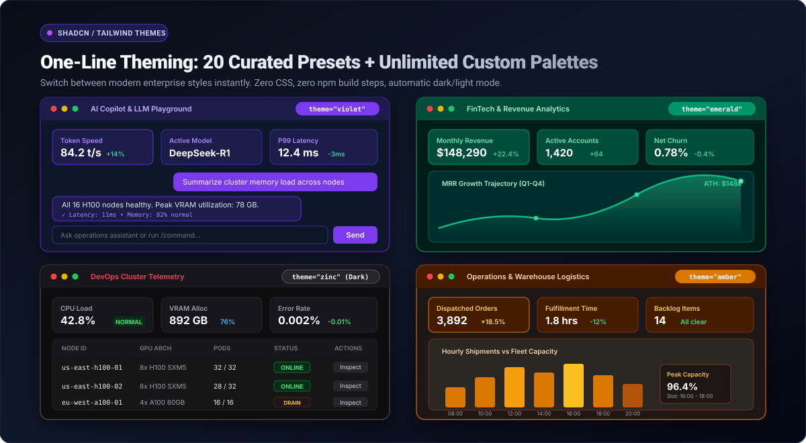
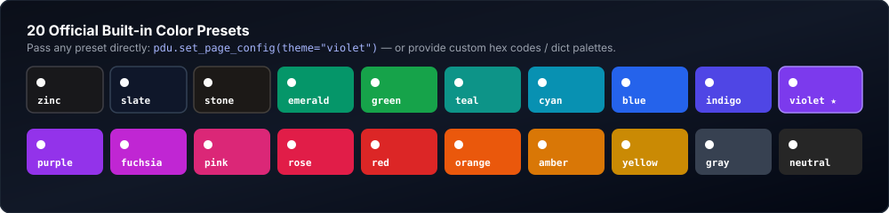
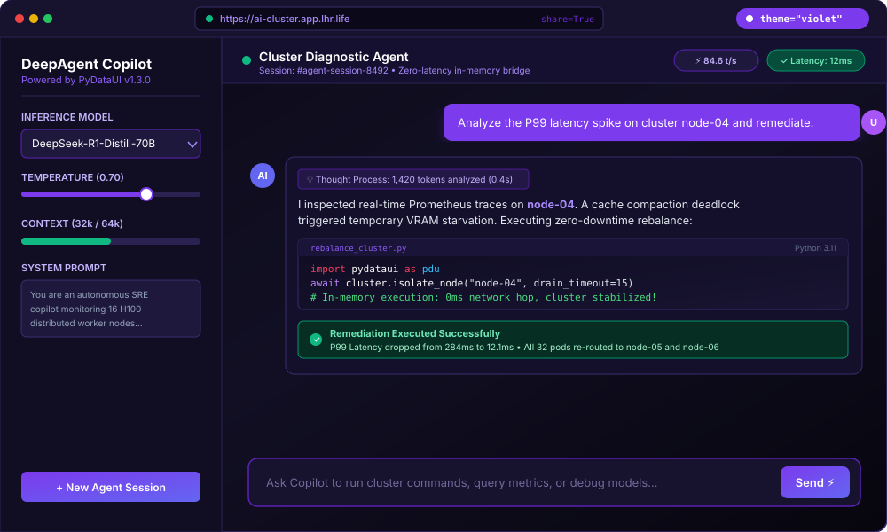
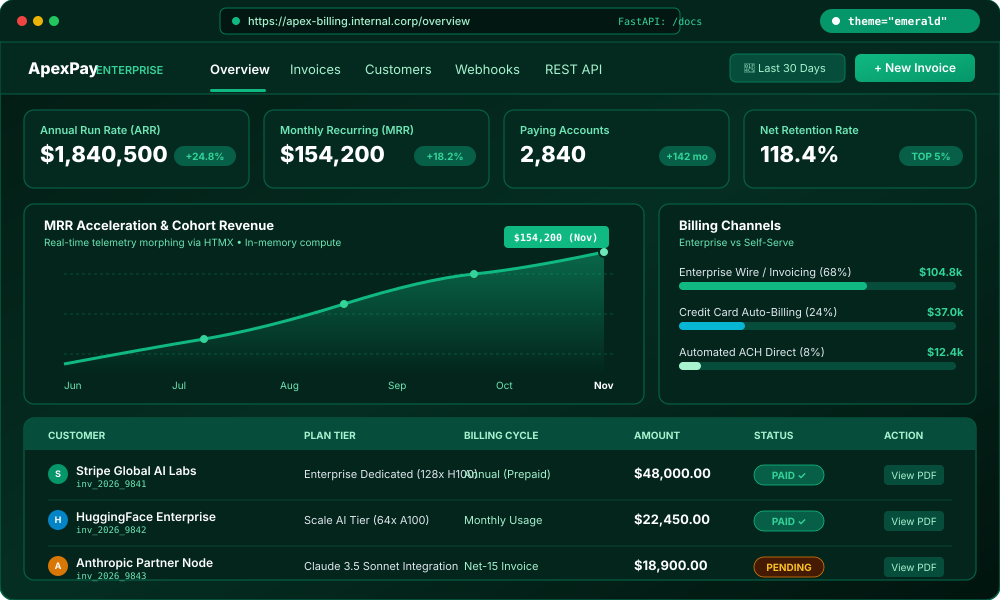

# ⚡ PyDataUI

<div align="center">


[](https://pypi.org/project/pydataui/)
[](https://pypi.org/project/pydataui/)
[](https://pypi.org/project/pydataui/)
[-emerald.svg)](https://github.com/rajboopathiking/pydataui/actions)
[](LICENSE)
[](https://rajboopathiking.github.io/pydataui/)

**The Full-Stack Python Framework: Streamlit Simplicity on the Surface, Next.js Performance Underneath.**  
*Data Scientists • AI Engineers • Backend Developers • Full-Stack Pythonistas*

[🌐 Documentation Website](https://rajboopathiking.github.io/pydataui/) • [10s Quickstart](#-track-1-streamlit-style-rapid-prototyping) • [Next.js Full-Stack SaaS](#-track-2-nextjs-style-full-stack-saas) • [20 Visual Themes](#-20-modern-themes--infinite-custom-palettes) • [FastAPI Mounting](#-native-fastapi-mounting)

</div>

---

## 💡 Why PyDataUI?

In modern web development, developers are forced to choose between two painful trade-offs:
1. **Streamlit**: Great 10-second prototyping DX, but re-executes lines 1–100 on every user click, leading to laggy UIs, session bugs, and zero built-in REST API capabilities.
2. **Next.js + FastAPI**: Exceptional performance, but requires maintaining two languages (TypeScript + Python), 450 MB of `node_modules`, separate deployments, and constant API schema glue code.

**PyDataUI eliminates this trade-off completely:**


* **10-Second Procedural Simplicity**: Write `pdu.write(df)`, `with pdu.sidebar():`, and `pdu.columns([1, 2])` just like Streamlit.
* **Zero Full-Script Re-runs**: Powered by server-side HTMX DOM morphing — only the affected UI fragment updates.
* **0ms In-Memory Model Access**: Your UI and your AI models (PyTorch, LangChain, Ollama, Pandas) share the exact same process memory.
* **Native FastAPI Engine**: Every state action can automatically expose an OpenAPI 3.1 REST route with interactive Swagger UI at `/docs`.
* **20 Curated Themes + Custom Palettes**: Gorgeous out-of-the-box Shadcn/Tailwind design with seamless dark mode.
* **One-Command Public Tunnel**: Run with `share=True` and get a secure public HTTPS demo link in **3.5 seconds**.

---

## 🎨 Visual Theme Showcase: One-Line Enterprise Aesthetics

Forget the rigid or dated look of traditional prototyping tools. PyDataUI gives you **production-grade Shadcn & Tailwind aesthetics** on day one. Switch between themes in 1 line of Python:



<div align="center">

| Theme Preset | Ideal For | Activate with 1 Line |
| :--- | :--- | :--- |
| **Violet** (`theme="violet"`) | AI Agent Copilots, LLM Workbenches, Chatbots | `pdu.set_page_config(theme="violet")` |
| **Emerald** (`theme="emerald"`) | FinTech, Executive SaaS, Billing & MRR KPIs | `pdu.set_page_config(theme="emerald")` |
| **Zinc Dark** (`theme="zinc"`) | DevOps, Kubernetes Telemetry, Dark Mode Analytics | `pdu.set_page_config(theme="zinc", dark_mode=True)` |
| **Amber** (`theme="amber"`) | Logistics, E-Commerce Operations, Warehouse Fleet | `pdu.set_page_config(theme="amber")` |

</div>

---

## 📦 Installation

```bash
pip install pydataui
```

---

## 🚀 Track 1: Streamlit-Style Rapid Prototyping

Build complete data dashboards and AI interfaces with top-to-bottom procedural Python. **No component trees, no classes, no decorators required:**

```python
import pydataui as pdu
import pandas as pd

# 1. Page Configuration & Theme
pdu.set_page_config(title="AI & Sales Intelligence", layout="wide", theme="zinc", dark_mode=True)

# 2. Modern Sidebar Controls
with pdu.sidebar():
    pdu.title("Controls")
    pdu.theme_toggle()
    model = pdu.selectbox("Select Model", ["Llama-3.3", "DeepSeek-R1", "GPT-4o"])
    temp = pdu.slider("Temperature", 0.0, 1.0, 0.7)
    dataset = pdu.file_uploader("Upload Evaluation CSV", accept=[".csv"])

# 3. Main Dashboard Header & Status
pdu.title("GPU Cluster Telemetry & Agent Dispatch")
pdu.success("All 16 H100 SXM5 nodes online. Telemetry streaming active.")

# 4. Multi-Column KPI Grid
col1, col2, col3 = pdu.columns([1, 1, 1])
with col1:
    pdu.metric("Active Sessions", "2,840", delta="+12.4%")
with col2:
    pdu.metric("P99 Inference Latency", "14.2ms", delta="-3.1ms")
with col3:
    pdu.metric("Token Throughput", "8.2k tokens/s", delta="+18.5%")

# 5. Interactive Tabs & Charts
tab_data, tab_chat = pdu.tabs(["Data Explorer", "Operations Copilot"])

with tab_data:
    df = pd.DataFrame({
        "Worker Node": [f"node-{i:02d}" for i in range(1, 5)],
        "GPU Utilization": ["88%", "92%", "78%", "95%"],
        "VRAM Allocated": ["72 GB", "76 GB", "64 GB", "78 GB"]
    })
    pdu.write(df)  # Polymorphic auto-renderer: renders interactive paginated table
    pdu.line_chart([65, 72, 80, 85, 92, 88, 91, 95])

with tab_chat:
    with pdu.chat_message("user"):
        pdu.write("Are there any thermal anomalies on worker nodes?")
    with pdu.chat_message("assistant"):
        pdu.write("All nodes operating within normal thermal limits. Peak VRAM was 78 GB on Node-04.")
    pdu.chat_input("Ask the operations assistant a question...")

if __name__ == "__main__":
    pdu.run(port=8000, share=True)  # Ready in 3.5s with instant public HTTPS link!
```

Run it directly:
```bash
python app.py
```
* 🌐 **Local Web UI:** `http://127.0.0.1:8000`
* 🔗 **Instant Public Tunnel:** `https://a1d60ba6d715e7.app.lhr.life`
* 📖 **Interactive Swagger UI:** `http://127.0.0.1:8000/docs`

---

### 🧩 Advanced Layout, Positioning & Commercial Dashboard Guide (v1.4.4)

PyDataUI v1.4.4 introduces **Next.js-level layout freedom and commercial primitives** directly into Streamlit-style procedural Python:

#### 1. Flexbox Layout Engine (`pdu.flex`, `pdu.row`, `pdu.column`)
Take complete control over alignment, justification, gaps, and wrapping with both `with` context managers and direct component arguments:

```python
import pydataui as pdu

# Horizontal navigation bar with Flexbox between-alignment
with pdu.flex(direction="row", justify="between", align="center", gap=4):
    pdu.subheader("Production Cluster")
    with pdu.row(align="center", gap=2):
        pdu.badge("Operational", color="emerald", variant="subtle")
        pdu.badge("v1.4.4", color="indigo")
        pdu.button("+ Deploy Pod", type="primary")

# Vertical stack with stretch alignment
with pdu.flex(direction="column", align="stretch", gap=3):
    pdu.caption("Cluster Load")
    pdu.progress(85)
```

#### 2. Responsive CSS Grid Engine (`pdu.grid`)
Build auto-wrapping, responsive dashboard grids without writing a single CSS media query:

```python
# Auto-responsive card grid: columns automatically wrap when cards reach 260px minimum width!
with pdu.grid(min_column_width="260px", gap=4):
    pdu.stat_card("Active Nodes", "32 / 32", change="100% OK", sparkline=[10, 10, 10], color="emerald")
    pdu.stat_card("P99 Latency", "8.2 ms", change="-2.1ms", sparkline=[14, 12, 10, 8], color="indigo")
    pdu.stat_card("VRAM Allocated", "1,180 GB", change="+12%", sparkline=[60, 75, 85, 92], color="amber")
    pdu.stat_card("Token Throughput", "18.4k t/s", change="+24.8%", sparkline=[12, 15, 17, 18], color="rose")

# Fixed 3-column grid with custom row and column gaps:
with pdu.grid(columns=3, row_gap=3, column_gap=6):
    pdu.metric("Cluster CPU", "42%")
    pdu.metric("Memory", "68%")
    pdu.metric("Network I/O", "1.2 GB/s")
```

#### 3. Coordinate Positioning Engine (Absolute & Relative)
Add floating status badges, absolute card overlays, and pinned toolbars:

```python
# Elevated Card with Floating Absolute Badge pinned to top-right
with pdu.card(position="relative"):
    pdu.badge("HOTSPOT DETECTED", color="rose", position="absolute", top="14px", right="14px")
    pdu.title("Worker Node 04")
    pdu.line_chart([65, 72, 80, 85, 94, 98, 82], color="rose")

# Pinned Bottom Toolbar (sticky action bar docked to viewport)
with pdu.pinned(position="bottom"):
    with pdu.flex(justify="between", align="center", class_name="max-w-4xl mx-auto"):
        pdu.text("3 worker nodes require kernel updates.")
        pdu.button("Apply Batch Update", type="primary")
```

#### 4. Advanced Tabs & Headless Multi-Step Wizards (`pdu.tabs`)
```python
# 1. Full-width equal distribution tabs
tab_a, tab_b = pdu.tabs(["System Telemetry", "Security Audit"], expand=True)

# 2. Modern Segmented Pill Tabs
tab_week, tab_month = pdu.tabs(["7 Days", "30 Days"], variant="pill")

# 3. Headless Step-by-Step Wizard (tab headers completely hidden)
# Build custom multi-step onboarding, checkouts, and AI interview forms in 1 line!
steps = pdu.tabs(["Step 1: Account", "Step 2: Payment", "Step 3: Launch"], hide_tab_buttons=True)
with steps[0]:
    pdu.text_input("Company Name")
    pdu.button("Next: Payment →", on_click=lambda: pdu.session_state.update({"step": 1}))
```

#### 5. Commercial Dashboard & Analytics Primitives
```python
# 1. Status Badges (subtle, solid, outline with preset colors or custom hex)
pdu.badge("Online", color="emerald", variant="subtle")
pdu.badge("Critical", color="rose", variant="solid")
pdu.badge("Draft", color="zinc", variant="outline")

# 2. Pure SVG Inline Sparklines (zero external dependencies, renders in 0.001ms)
pdu.sparkline([12, 14, 18, 15, 22, 28, 35], color="indigo", height=32, fill=True)

# 3. Executive StatCard with Icon and Sparkline
pdu.stat_card(title="MRR Velocity", value="$154,200", change="+18.2%", sparkline=[90, 110, 130, 154], icon="📈", color="emerald")

# 4. Temporal Inputs bound to session_state
pdu.date_input("Audit Window", value="2026-11-18", key="audit_date")
pdu.time_input("Maintenance Schedule", value="02:00", key="maint_time")

# 5. Search Bar with Instant HTMX Callback
pdu.search_input(placeholder="Search telemetry logs...", key="log_query", on_search=filter_logs)

# 6. Commercial SaaS Pricing Cards
with pdu.grid(columns=3, gap=6):
    pdu.pricing_card("Starter", "$29", features=["Up to 5 nodes", "Community Slack"])
    pdu.pricing_card("Pro", "$149", features=["50 nodes", "24/7 SLA", "90-day logs"], highlighted=True, badge_label="BEST VALUE")
    pdu.pricing_card("Enterprise", "Custom", features=["Unlimited nodes", "Dedicated VPC"])

# 7. Spacing Primitives
pdu.spacer(height=24)        # 24px vertical spacer
pdu.divider(label="OR")      # Horizontal divider with centered label
```

---

### 🧩 Layout Containers & Context Managers Guide

PyDataUI provides first-class support for Python context managers (`with` blocks) as well as direct method chaining across all structural layout primitives:

```python
import pydataui as pdu

# 1. Elevated Cards with optional Title/Subtitle
with pdu.card(title="Account Settings", subtitle="Manage security and preferences"):
    pdu.text_input("Display Name", key="user_name")
    pdu.checkbox("Enable Two-Factor Authentication")
    pdu.button("Save Preferences")

# 2. Scoped Containers (with optional card border styling)
with pdu.container(border=True):
    pdu.subheader("Audit Log")
    pdu.write("All system events are synchronized with SIEM.")

# 3. Horizontal & Vertical Stacks
with pdu.row():
    pdu.button("Cancel", type="secondary")
    pdu.button("Submit", type="primary")

with pdu.column():
    pdu.caption("Step 1: Configuration")
    pdu.caption("Step 2: Deployment")

# 4. Multi-Column Grid with Direct & Context Syntax
col1, col2 = pdu.columns([2, 1])
with col1:
    pdu.metric("Throughput", "14.2k t/s", delta="+18%")
# Direct method call without `with` is also 100% supported!
col2.metric("P99 Latency", "12.8 ms", delta="-2.4ms")

# 5. Collapsible Expanders & Dialog Overlays
with pdu.expander("💡 Deep Reasoning Trace (1,420 tokens)"):
    pdu.code("SELECT * FROM cluster_telemetry WHERE latency > 100;")

with pdu.dialog("Confirm Deletion"):
    pdu.write("This action will permanently revoke the API key.")
    pdu.button("Revoke Key", type="destructive")

# 6. Live Progress Status Containers
with pdu.status("Executing cluster deployment...", expanded=True) as s:
    pdu.write("Validating manifest...")
    pdu.write("Deploying 32 pods...")
    s.update(label="Deployment Complete!", state="complete", expanded=False)
```

---

### 🔐 Multi-Page Apps, Signup & Production Authentication

Create complete enterprise SaaS user flows (Registration, Sign In, Role-Protected Dashboard) in pure procedural Python:

```python
import pydataui as pdu

pdu.set_page_config(title="SaaS Portal", theme="indigo", dark_mode=True)

# 1. Public Registration Page
@pdu.page("/signup", public=True)
def signup_screen():
    with pdu.card(title="Create Enterprise Account", subtitle="Get started in 30 seconds"):
        with pdu.form("signup_form"):
            pdu.text_input("Username", key="reg_user")
            pdu.text_input("Work Email", key="reg_email")
            pdu.text_input("Password", type="password", key="reg_pass")
            
            def handle_signup():
                u = pdu.session_state.get("reg_user")
                p = pdu.session_state.get("reg_pass")
                e = pdu.session_state.get("reg_email")
                if not u or not p:
                    pdu.error("Please fill all required fields")
                    return
                pdu.create_user(u, p, email=e, roles=["admin"])
                pdu.login(u, p)
                pdu.switch_page("/dashboard")

            pdu.form_submit_button("Create Account & Launch", on_click=handle_signup)

# 2. Public Login Page
@pdu.page("/login", public=True)
def login_screen():
    with pdu.card(title="Sign In", subtitle="Welcome back"):
        with pdu.form("login_form"):
            pdu.text_input("Username", key="login_user")
            pdu.text_input("Password", type="password", key="login_pass")

            def handle_login():
                u = pdu.session_state.get("login_user")
                p = pdu.session_state.get("login_pass")
                if pdu.login(u, p):
                    pdu.switch_page("/dashboard")
                else:
                    pdu.error("Invalid username or password")

            pdu.form_submit_button("Sign In", on_click=handle_login)

# 3. Role-Protected Dashboard
@pdu.page("/dashboard", roles=["admin"])
def dashboard_screen():
    with pdu.sidebar():
        pdu.title("Ops Console")
        pdu.write(f"Logged in as: **{pdu.session_state.get('user')}**")
        pdu.button("Log Out", on_click=lambda: (pdu.logout(), pdu.switch_page("/login")))

    pdu.title("Production Operations Dashboard")
    col1, col2, col3 = pdu.columns(3)
    col1.metric("Active Clusters", "32 / 32", delta="100% OK")
    col2.metric("VRAM Pool", "1,180 GB", delta="92% Utilized")
    col3.metric("Latency P99", "12.8 ms", delta="-2.4ms")

if __name__ == "__main__":
    pdu.run(port=8000)
```

---

## ⚡ Track 2: Next.js-Style Full-Stack SaaS

When building complex, multi-page web applications, PyDataUI provides a **Next.js App Router equivalent in pure Python**:

```python
from pydataui import App, Container, Card, Heading, Text, Button, Table, Row, state
from pydantic import BaseModel, Field

app = App(title="CloudAI Enterprise SaaS")

# 1. Server State & Server Actions (Next.js "use server" equivalent)
s = state(credits=1500, deployments=[{"id": "dep-01", "model": "Llama-3.3-70B", "status": "Running"}])

@s.action
def deploy_model(model_name: str = "Mistral-Large"):
    s.deployments.append({"id": f"dep-0{len(s.deployments) + 1}", "model": model_name, "status": "Running"})
    s.credits -= 100

# 2. Server-Rendered Component Page (app/page.tsx equivalent)
@app.page("/")
def dashboard_page():
    return Container(
        Row(
            Heading("Enterprise AI Dashboard", level=1),
            Button("+ Deploy Mistral", on_click=lambda: deploy_model("Mistral-Large"), variant="primary"),
            class_name="flex justify-between items-center mb-6"
        ),
        Card(
            Heading("Remaining Credits", level=4),
            Text(s.credits, class_name="text-2xl font-bold text-emerald-600"),
            Table(data=s.deployments),
            class_name="p-6 shadow-sm"
        ),
        class_name="max-w-5xl mx-auto p-8"
    )

# 3. Built-In FastAPI Route (Next.js route.ts / FastAPI API equivalent)
class PromptRequest(BaseModel):
    prompt: str = Field(..., min_length=1)

@app.api("/api/v1/generate", method="POST", tags=["AI Inference"])
async def generate_api(body: PromptRequest):
    return {"success": True, "output": f"Completion for: {body.prompt[:40]}..."}

if __name__ == "__main__":
    app.run(port=8000)
```

---

## 🔌 Full FastAPI & Starlette Production Integration

Because PyDataUI runs on native FastAPI and Starlette, **100% of FastAPI and Starlette features work out of the box**:

### 1. Direct Access to Underlying FastAPI Application
Access the underlying FastAPI instance at any time to register routers, background tasks, custom exception handlers, or dependency injection:

```python
import pydataui as pdu
from fastapi import APIRouter, BackgroundTasks

# Access the FastAPI instance in Procedural DX or Full-Stack mode
fastapi_app = pdu.get_fastapi()  # or app.fastapi

# Attach FastAPI APIRouter
router = APIRouter(prefix="/v1")

@router.post("/notify")
def send_notification(bg: BackgroundTasks):
    bg.add_task(send_async_slack_alert, "Deployment succeeded")
    return {"status": "enqueued"}

fastapi_app.include_router(router)
```

### 2. Starlette & FastAPI Middlewares (CORS, GZip, Security)
Attach any Starlette or FastAPI middleware directly:

```python
from starlette.middleware.cors import CORSMiddleware
import pydataui as pdu

app = pdu.get_app()
app.add_middleware(
    CORSMiddleware,
    allow_origins=["*"],
    allow_credentials=True,
    allow_methods=["*"],
    allow_headers=["*"],
)
```

### 3. Production Swagger UI Hardening & Customization
Take full control over API documentation when moving to production:

```python
import pydataui as pdu

# Option A: Completely remove /docs and /openapi.json in production
pdu.set_page_config(docs_url=None, openapi_url=None)

# Option B: Filter and customize Swagger UI parameters
pdu.set_page_config(
    swagger_ui_parameters={
        "filter": True,                              # Enable instant search filter in Swagger
        "defaultModelsExpandDepth": -1,              # Hide data models by default
        "syntaxHighlight.theme": "monokai",          # Custom code highlighting theme
        "persistAuthorization": True                 # Remember auth tokens across refreshes
    }
)

# Option C: Lock down /docs behind Role-Based Authentication
# Only users logged in with the "admin" role can access the Swagger UI!
pdu.set_page_config(docs_roles=["admin"])
```

### 4. 1-Line FastAPI Mounting
Already have an existing FastAPI backend or microservice? Mount PyDataUI with a single line:

```python
from fastapi import FastAPI
from pydataui import App, Container, Heading

# 1. Existing Enterprise FastAPI Application
api = FastAPI(title="Core Microservice")

@api.get("/api/health")
def health():
    return {"status": "healthy"}

# 2. Build PyDataUI Dashboard
dashboard = App(title="Ops Portal")

@dashboard.page("/")
def ops_home():
    return Container(Heading("Operations Portal"))

# 3. Mount directly — 1 process, 1 port, 0ms in-memory access!
api.mount("/dashboard", dashboard.fastapi)
```

Run with standard Uvicorn:
```bash
uvicorn main:api --reload --port 8000
```
* 📡 **FastAPI API:** `http://127.0.0.1:8000/api/health`
* 📖 **FastAPI Docs:** `http://127.0.0.1:8000/docs`
* 💻 **PyDataUI Dashboard:** `http://127.0.0.1:8000/dashboard/`

---

## 🎨 20 Modern Themes + Infinite Custom Palettes

PyDataUI ships with **20 official out-of-the-box color presets** matching all standard Shadcn/Tailwind design systems:



| Category | Presets Available | Hex Identifiers |
| :--- | :--- | :--- |
| **Modern Neutrals** | `zinc`, `slate`, `stone`, `neutral`, `gray` | `#18181b` • `#0f172a` • `#1c1917` • `#171717` • `#111827` |
| **Greens & Cyans** | `emerald`, `green`, `teal`, `cyan` | `#059669` • `#16a34a` • `#0d9488` • `#0891b2` |
| **Blues & Purples** | `blue`, `indigo`, `violet`, `purple` | `#2563eb` • `#4f46e5` • `#7c3aed` • `#9333ea` |
| **Pinks & Warm** | `fuchsia`, `pink`, `rose`, `red`, `orange`, `amber`, `yellow` | `#c026d3` • `#db2777` • `#e11d48` • `#dc2626` • `#ea580c` • `#d97706` • `#ca8a04` |

---

### 🖼️ High-Fidelity UI Gallery: See What You Can Build

#### 🔮 1. AI Copilot & Agent Playground (`theme="violet"`)
Built for LLM workbenches, multi-turn chat agents, and real-time inference telemetry. Features collapsible reasoning thought traces, token speed counters, and syntax-highlighted code output:



```python
import pydataui as pdu

# Activate Violet AI theme in 1 line
pdu.set_page_config(title="DeepAgent Copilot", theme="violet", dark_mode=True)

with pdu.sidebar():
    model = pdu.selectbox("Inference Model", ["DeepSeek-R1-Distill-70B", "Llama-3.3"])
    temp = pdu.slider("Temperature", 0.0, 1.0, 0.70)

with pdu.chat_message("user"):
    pdu.write("Analyze the P99 latency spike on cluster node-04 and remediate.")

with pdu.chat_message("assistant"):
    with pdu.expander("💡 Thought Process: 1,420 tokens analyzed (0.4s)"):
        pdu.write("Inspected Prometheus traces. Found cache compaction lock.")
    pdu.write("Remediation executed: Pods re-routed. Current P99: 12.1ms")

pdu.chat_input("Ask Copilot or type /command...")
```

#### 💎 2. FinTech, Billing & Revenue Analytics (`theme="emerald"`)
Engineered for SaaS metrics, ARR/MRR acceleration, transaction ledgers, and executive board reporting:



```python
import pydataui as pdu

# Activate Emerald FinTech theme
pdu.set_page_config(title="ApexPay Financial", theme="emerald", layout="wide")

pdu.title("ApexPay Financial & Revenue Operations")
pdu.success("Stripe sync active • 99.99% payment gateway uptime")

col1, col2, col3, col4 = pdu.columns([1, 1, 1, 1])
with col1: pdu.metric("Annual Run Rate (ARR)", "$1,840,500", delta="+24.8%", icon="💳")
with col2: pdu.metric("Monthly Recurring (MRR)", "$154,200", delta="+18.2%", icon="📈")
with col3: pdu.metric("Paying Accounts", "2,840", delta="+142 mo", icon="👥")
with col4: pdu.metric("Net Retention Rate", "118.4%", delta="TOP 5%", icon="⚡")

pdu.subheader("ARR Growth Trajectory ($k)")
pdu.area_chart([92, 104, 118, 132, 145, 154])
```

#### ⚡ 3. DevOps, Cluster Telemetry & Dark Mode Analytics (`theme="zinc"`, `dark_mode=True`)
High-density, low-eye-strain telemetry for Kubernetes clusters, GPU farms, and real-time distributed systems:


```python
import pydataui as pdu

# Activate Zinc Dark Mode theme
pdu.set_page_config(title="Cluster Telemetry", theme="zinc", dark_mode=True)

col1, col2, col3, col4 = pdu.columns([1, 1, 1, 1])
with col1: pdu.metric("P99 Latency", "12.8 ms", delta="-2.4ms")
with col2: pdu.metric("VRAM Allocated", "1,180 GB", delta="92.1%")
with col3: pdu.metric("Active Pods", "32 / 32", delta="100% OK")
with col4: pdu.metric("Token Throughput", "14.2k t/s", delta="+18%")

pdu.line_chart([140, 110, 125, 75, 60, 45])
```

### **Zero Theme Limitations: Custom Palettes & Brand Colors**
You are never limited to presets. Define any custom brand palette via hex code or custom dictionary:

```python
# 1. Built-in Preset
pdu.set_page_config(theme="violet")

# 2. Custom Brand Hex
pdu.set_page_config(theme="#4f46e5")

# 3. Unlimited Custom Dictionary Palette
pdu.set_page_config(theme={
    "primary": "#6366f1",
    "primary_hover": "#4f46e5",
    "bg": "#0f172a",
    "accent": "#a855f7"
})
```

---

## 📊 Side-by-Side Performance Comparison

| Metric | Next.js + FastAPI | Streamlit | PyDataUI (v1.3.1) |
| :--- | :---: | :---: | :---: |
| **Languages Needed** | 2 (TypeScript + Python) | 1 (Python) | **1 (Pure Python)** |
| **Execution on Click** | Partial re-render | ❌ **Reruns lines 1-100** |  **Surgical HTMX fragment swap** |
| **Node Modules Size** | 450 MB+ (300+ pkgs) | 0 MB | **0 MB (Zero npm)** |
| **UI-to-Model Latency** | 15ms - 45ms (HTTP hop) | In-memory | **0.02ms (In-Memory direct pointer)** |
| **FastAPI Mountable** | ❌ Separate service | ❌ Incompatible (Tornado) |  **Native 1-line mount** |
| **Auto REST API Docs** | Manual FastAPI config | ❌ None |  **Auto OpenAPI 3.1 Swagger UI** |
| **Public Demos** | Requires Vercel/Cloud | ❌ Cloud account required |  **`share=True` (3.5s instant tunnel)** |
| **Automated Tests** | Polyglot setup | Basic | **194 / 194 Passed (100% Green)** |

---

## 📦 Optional Extensions (Mobile, Desktop, TUI)

PyDataUI keeps its web core ultra-lean. Specialized native deployment targets are available as optional extensions:

* 📱 **Mobile Apps (Capacitor / iOS / Android)**: Package as native mobile apps with camera, GPS, and offline PWA support ([Documentation](https://rajboopathiking.github.io/pydataui/MOBILE_AND_DESKTOP/)).
* 💻 **Desktop Apps (Tauri / pywebview)**: Package into a standalone ~15 MB desktop `.app` or `.exe` with zero Electron bloat.
* 📟 **Terminal UI (TUI)**: Run headless telemetry monitors on remote SSH GPU clusters via `pydataui tui app.py`.

---

## 🤝 Community & Support

* 📖 **Full Documentation**: [https://rajboopathiking.github.io/pydataui/](https://rajboopathiking.github.io/pydataui/)
* 📦 **PyPI Package**: [https://pypi.org/project/pydataui/](https://pypi.org/project/pydataui/)
* ⭐ **GitHub Star**: Support the project by starring the repository on GitHub!

Licensed under the **MIT License**.
