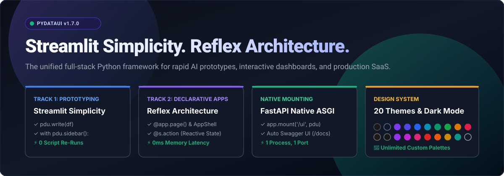
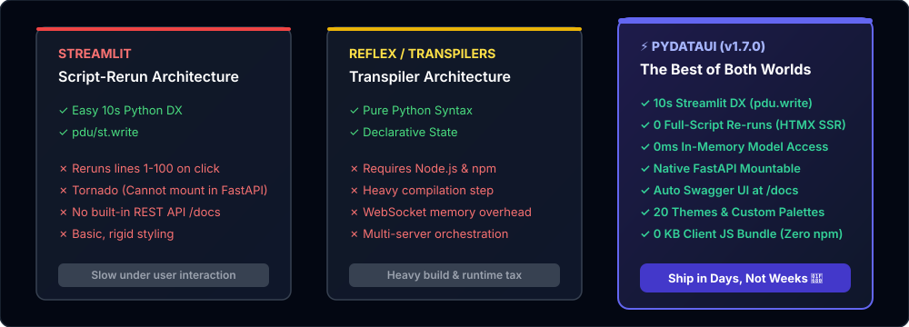

# ⚡ PyDataUI

<div align="center">



[](https://pypi.org/project/pydataui/)
[](https://pypi.org/project/pydataui/)
[](https://pypi.org/project/pydataui/)
[-emerald.svg)](https://github.com/rajboopathiking/pydataui/actions)
[](LICENSE)
[](https://rajboopathiking.github.io/pydataui/)

**The Full-Stack Python Framework: Streamlit Simplicity on the Surface, Next.js Performance Underneath.**  
*Data Scientists • AI Engineers • Backend Developers • Full-Stack Pythonistas*

[🌐 Documentation Website](https://rajboopathiking.github.io/pydataui/) • [10s Quickstart](#-track-1-streamlit-style-rapid-prototyping) • [Next.js Full-Stack SaaS](#-track-2-nextjs-style-full-stack-saas) • [20 Visual Themes](#-20-modern-themes--infinite-custom-palettes) • [FastAPI Mounting](#-native-fastapi-mounting)

</div>

---

## 💡 Why PyDataUI?

In modern web development, developers are forced to choose between two painful trade-offs:
1. **Streamlit**: Great 10-second prototyping DX, but re-executes lines 1–100 on every user click, leading to laggy UIs, session bugs, and zero built-in REST API capabilities.
2. **Next.js + FastAPI**: Exceptional performance, but requires maintaining two languages (TypeScript + Python), 450 MB of `node_modules`, separate deployments, and constant API schema glue code.

**PyDataUI eliminates this trade-off completely:**



* **10-Second Procedural Simplicity**: Write `pdu.write(df)`, `with pdu.sidebar():`, and `pdu.columns([1, 2])` just like Streamlit.
* **Zero Full-Script Re-runs**: Powered by server-side HTMX DOM morphing — only the affected UI fragment updates.
* **0ms In-Memory Model Access**: Your UI and your AI models (PyTorch, LangChain, Ollama, Pandas) share the exact same process memory.
* **Native FastAPI Engine**: Every state action can automatically expose an OpenAPI 3.1 REST route with interactive Swagger UI at `/docs`.
* **20 Curated Themes + Custom Palettes**: Gorgeous out-of-the-box Shadcn/Tailwind design with seamless dark mode.
* **One-Command Public Tunnel**: Run with `share=True` and get a secure public HTTPS demo link in **3.5 seconds**.

---

## 📦 Installation

```bash
pip install pydataui
```

---

## 🚀 Track 1: Streamlit-Style Rapid Prototyping

Build complete data dashboards and AI interfaces with top-to-bottom procedural Python. **No component trees, no classes, no decorators required:**

```python
import pydataui as pdu
import pandas as pd

# 1. Page Configuration & Theme
pdu.set_page_config(title="AI & Sales Intelligence", layout="wide", theme="zinc", dark_mode=True)

# 2. Modern Sidebar Controls
with pdu.sidebar():
    pdu.title("Controls")
    pdu.theme_toggle()
    model = pdu.selectbox("Select Model", ["Llama-3.3", "DeepSeek-R1", "GPT-4o"])
    temp = pdu.slider("Temperature", 0.0, 1.0, 0.7)
    dataset = pdu.file_uploader("Upload Evaluation CSV", accept=[".csv"])

# 3. Main Dashboard Header & Status
pdu.title("GPU Cluster Telemetry & Agent Dispatch")
pdu.success("All 16 H100 SXM5 nodes online. Telemetry streaming active.")

# 4. Multi-Column KPI Grid
col1, col2, col3 = pdu.columns([1, 1, 1])
with col1:
    pdu.metric("Active Sessions", "2,840", delta="+12.4%")
with col2:
    pdu.metric("P99 Inference Latency", "14.2ms", delta="-3.1ms")
with col3:
    pdu.metric("Token Throughput", "8.2k tokens/s", delta="+18.5%")

# 5. Interactive Tabs & Charts
tab_data, tab_chat = pdu.tabs(["Data Explorer", "Operations Copilot"])

with tab_data:
    df = pd.DataFrame({
        "Worker Node": [f"node-{i:02d}" for i in range(1, 5)],
        "GPU Utilization": ["88%", "92%", "78%", "95%"],
        "VRAM Allocated": ["72 GB", "76 GB", "64 GB", "78 GB"]
    })
    pdu.write(df)  # Polymorphic auto-renderer: renders interactive paginated table
    pdu.line_chart([65, 72, 80, 85, 92, 88, 91, 95])

with tab_chat:
    with pdu.chat_message("user"):
        pdu.write("Are there any thermal anomalies on worker nodes?")
    with pdu.chat_message("assistant"):
        pdu.write("All nodes operating within normal thermal limits. Peak VRAM was 78 GB on Node-04.")
    pdu.chat_input("Ask the operations assistant a question...")

if __name__ == "__main__":
    pdu.run(port=8000, share=True)  # Ready in 3.5s with instant public HTTPS link!
```

Run it directly:
```bash
python app.py
```
* 🌐 **Local Web UI:** `http://127.0.0.1:8000`
* 🔗 **Instant Public Tunnel:** `https://a1d60ba6d715e7.app.lhr.life`
* 📖 **Interactive Swagger UI:** `http://127.0.0.1:8000/docs`

---

## ⚡ Track 2: Next.js-Style Full-Stack SaaS

When building complex, multi-page web applications, PyDataUI provides a **Next.js App Router equivalent in pure Python**:

```python
from pydataui import App, Container, Card, Heading, Text, Button, Table, Row, state
from pydantic import BaseModel, Field

app = App(title="CloudAI Enterprise SaaS")

# 1. Server State & Server Actions (Next.js "use server" equivalent)
s = state(credits=1500, deployments=[{"id": "dep-01", "model": "Llama-3.3-70B", "status": "Running"}])

@s.action
def deploy_model(model_name: str = "Mistral-Large"):
    s.deployments.append({"id": f"dep-0{len(s.deployments) + 1}", "model": model_name, "status": "Running"})
    s.credits -= 100

# 2. Server-Rendered Component Page (app/page.tsx equivalent)
@app.page("/")
def dashboard_page():
    return Container(
        Row(
            Heading("Enterprise AI Dashboard", level=1),
            Button("+ Deploy Mistral", on_click=lambda: deploy_model("Mistral-Large"), variant="primary"),
            class_name="flex justify-between items-center mb-6"
        ),
        Card(
            Heading("Remaining Credits", level=4),
            Text(s.credits, class_name="text-2xl font-bold text-emerald-600"),
            Table(data=s.deployments),
            class_name="p-6 shadow-sm"
        ),
        class_name="max-w-5xl mx-auto p-8"
    )

# 3. Built-In FastAPI Route (Next.js route.ts / FastAPI API equivalent)
class PromptRequest(BaseModel):
    prompt: str = Field(..., min_length=1)

@app.api("/api/v1/generate", method="POST", tags=["AI Inference"])
async def generate_api(body: PromptRequest):
    return {"success": True, "output": f"Completion for: {body.prompt[:40]}..."}

if __name__ == "__main__":
    app.run(port=8000)
```

---

## 🔌 Native FastAPI Mounting

Already have an existing FastAPI backend or microservice? Unlike Streamlit (which runs on Tornado and cannot be mounted inside FastAPI), **PyDataUI mounts with a single line**:

```python
from fastapi import FastAPI
from pydataui import App, Container, Heading

# 1. Existing Enterprise FastAPI Application
api = FastAPI(title="Core Microservice")

@api.get("/api/health")
def health():
    return {"status": "healthy"}

# 2. Build PyDataUI Dashboard
dashboard = App(title="Ops Portal")

@dashboard.page("/")
def ops_home():
    return Container(Heading("Operations Portal"))

# 3. Mount directly — 1 process, 1 port, 0ms in-memory access!
api.mount("/dashboard", dashboard._engine.app)
```

Run with standard Uvicorn:
```bash
uvicorn main:api --reload --port 8000
```
* 📡 **FastAPI API:** `http://127.0.0.1:8000/api/health`
* 📖 **FastAPI Docs:** `http://127.0.0.1:8000/docs`
* 💻 **PyDataUI Dashboard:** `http://127.0.0.1:8000/dashboard/`

---

## 🎨 20 Modern Themes + Infinite Custom Palettes

PyDataUI ships with **20 official out-of-the-box color presets** matching all standard Shadcn/Tailwind design systems:

| Category | Presets Available | Hex Identifiers |
| :--- | :--- | :--- |
| **Modern Neutrals** | `zinc`, `slate`, `stone`, `neutral`, `gray` | `#18181b` • `#0f172a` • `#1c1917` • `#171717` • `#111827` |
| **Greens & Cyans** | `emerald`, `green`, `teal`, `cyan` | `#059669` • `#16a34a` • `#0d9488` • `#0891b2` |
| **Blues & Purples** | `blue`, `indigo`, `violet`, `purple` | `#2563eb` • `#4f46e5` • `#7c3aed` • `#9333ea` |
| **Pinks & Warm** | `fuchsia`, `pink`, `rose`, `red`, `orange`, `amber`, `yellow` | `#c026d3` • `#db2777` • `#e11d48` • `#dc2626` • `#ea580c` • `#d97706` • `#ca8a04` |

### **Zero Theme Limitations**
You are never limited to presets. Define any custom brand palette via hex code or custom dictionary:

```python
# 1. Built-in Preset
pdu.set_page_config(theme="violet")

# 2. Custom Brand Hex
pdu.set_page_config(theme="#4f46e5")

# 3. Unlimited Custom Dictionary Palette
pdu.set_page_config(theme={
    "primary": "#6366f1",
    "primary_hover": "#4f46e5",
    "bg": "#0f172a",
    "accent": "#a855f7"
})
```

---

## 📊 Side-by-Side Performance Comparison

| Metric | Next.js + FastAPI | Streamlit | PyDataUI (v1.3.0) |
| :--- | :---: | :---: | :---: |
| **Languages Needed** | 2 (TypeScript + Python) | 1 (Python) | **1 (Pure Python)** |
| **Execution on Click** | Partial re-render | ❌ **Reruns lines 1-100** |  **Surgical HTMX fragment swap** |
| **Node Modules Size** | 450 MB+ (300+ pkgs) | 0 MB | **0 MB (Zero npm)** |
| **UI-to-Model Latency** | 15ms - 45ms (HTTP hop) | In-memory | **0.02ms (In-Memory direct pointer)** |
| **FastAPI Mountable** | ❌ Separate service | ❌ Incompatible (Tornado) |  **Native 1-line mount** |
| **Auto REST API Docs** | Manual FastAPI config | ❌ None |  **Auto OpenAPI 3.1 Swagger UI** |
| **Public Demos** | Requires Vercel/Cloud | ❌ Cloud account required |  **`share=True` (3.5s instant tunnel)** |
| **Automated Tests** | Polyglot setup | Basic | **192 / 192 Passed (100% Green)** |

---

## 📦 Optional Extensions (Mobile, Desktop, TUI)

PyDataUI keeps its web core ultra-lean. Specialized native deployment targets are available as optional extensions:

* 📱 **Mobile Apps (Capacitor / iOS / Android)**: Package as native mobile apps with camera, GPS, and offline PWA support ([Documentation](https://rajboopathiking.github.io/pydataui/MOBILE_AND_DESKTOP/)).
* 💻 **Desktop Apps (Tauri / pywebview)**: Package into a standalone ~15 MB desktop `.app` or `.exe` with zero Electron bloat.
* 📟 **Terminal UI (TUI)**: Run headless telemetry monitors on remote SSH GPU clusters via `pydataui tui app.py`.

---

## 🤝 Community & Support

* 📖 **Full Documentation**: [https://rajboopathiking.github.io/pydataui/](https://rajboopathiking.github.io/pydataui/)
* 📦 **PyPI Package**: [https://pypi.org/project/pydataui/](https://pypi.org/project/pydataui/)
* ⭐ **GitHub Star**: Support the project by starring the repository on GitHub!

Licensed under the **MIT License**.
