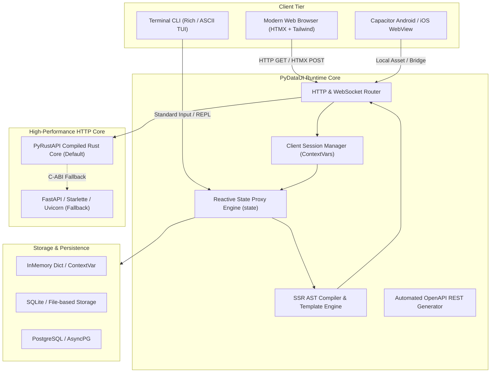
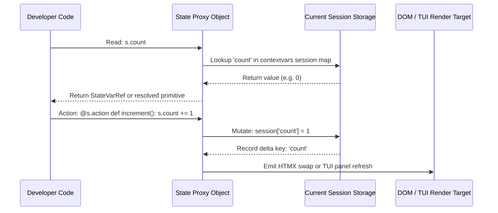
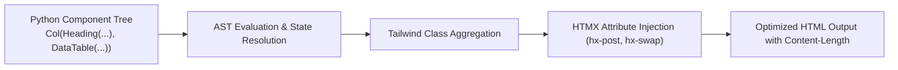
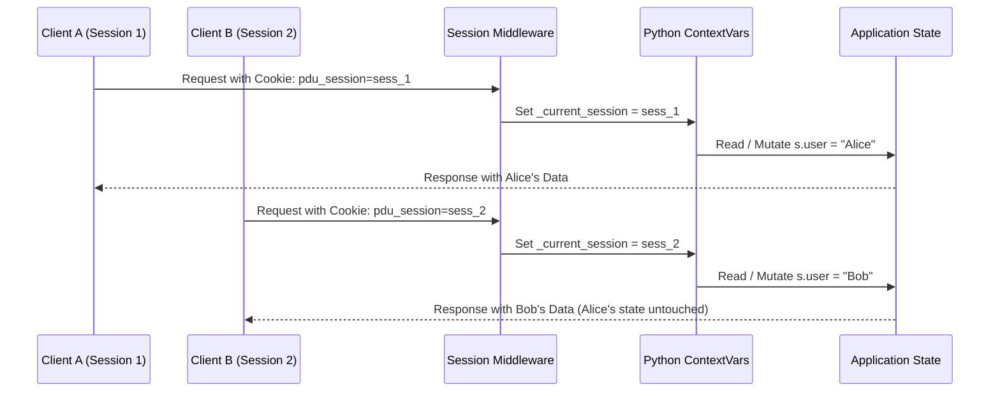

# PyDataUI Architecture & Internal Design

This document details the internal design and architectural mechanisms powering **PyDataUI**. It is written for core contributors, library authors, and systems architects who want to understand the framework's execution model from request lifecycle to reactive state diffing.

---

## 🏛️ High-Level System Architecture



---

## ⚡ 1. The Reactive State Engine

PyDataUI provides a declarative, synchronous Python syntax for state manipulation that feels like native procedural Python while maintaining fine-grained client-server reactivity.

### How State Proxies Work

When you invoke `s = state(count=0, query="")`:



1. **State Proxy Interception**: The `state()` factory returns an instance of `_StateProxy` that intercepts `__getattr__` and `__setattr__`.
2. **StateVarRef Construction**: When passed into component constructors (e.g. `Heading(s.count)`), `s.count` returns a lightweight `StateVarRef` pointer rather than an immutable string.
3. **Lazy Resolution**: During server-side rendering (`comp.render(state_snapshot)`), the component evaluates the `StateVarRef` against the active client's session snapshot.
4. **Action Handlers**: Methods decorated with `@s.action` are automatically exposed as secure RPC endpoints (`/_pdu/action/<action_name>`). When triggered by an HTMX client event, the action runs server-side, mutates the session state, and renders only the affected DOM slice.

---

## 🎨 2. The Compilation & SSR Pipeline

PyDataUI does not require Node.js, Webpack, Vite, or npm build steps. Everything compiles server-side in Python with high-throughput string interpolation.



### Component Structure
Every component subclasses `Component`:
- `children`: List of child components or primitives.
- `props`: Dictionary of HTML attributes, classes, and event bindings.
- `render(state_snapshot)`: Compiles the component into sanitized HTML.

### Zero-Build Tailwind CSS Injection
Rather than requiring a Node build process to extract Tailwind utilities:
- PyDataUI bundles the official Tailwind Play CDN runtime and CSS custom properties.
- Themes (`slate`, `indigo`, `dark`, `light`) are defined via CSS variables in the page header.
- Dynamic UI changes instantaneously adopt the CSS design tokens without full page reloads.

---

## 🦀 3. The Compiled Rust Core (`PyRustAPI`)

For enterprise deployments requiring microsecond latencies, PyDataUI integrates seamlessly with **PyRustAPI**:

| Feature | PyRustAPI Rust Core | Standard Python Uvicorn |
| :--- | :--- | :--- |
| **HTTP Parser** | Compiled Rust (`httparse` / `hyper`) | Python `uvicorn-h11` |
| **Throughput** | Up to 110,000 req/sec | ~18,000 req/sec |
| **Memory Footprint** | Extremely low (~25MB base) | ~70MB base |
| **Worker Threads** | Native OS threads (Tokio runtime) | Python GIL / Multi-process |
| **Fallback** | Automatic graceful fallback if missing | Native standard library |

When `pydataui run app.py` starts:
1. It inspects whether `pyrustapi` is available in the Python environment.
2. If available, it spins up the compiled Rust asynchronous server bridge.
3. If not installed, it falls back to Starlette/Uvicorn with zero configuration changes required from the user.

---

## 🔒 4. Multi-Tenant Session & Concurrency Isolation

To prevent state leakage between simultaneous users:



- Each HTTP request passes through `SessionMiddleware`.
- The session ID is extracted from a signed HTTP-only cookie (`pdu_session`).
- An asynchronous `contextvars.ContextVar` binds the request to its isolated session store.
- Cross-talk between concurrent requests is mathematically impossible because state proxies resolve strictly through the active context var.

---

## 🖥️ 5. Dual Execution Targets: Web Browser & Terminal UI

A key design innovation in PyDataUI is target-agnostic rendering:

```python
import pydataui as pdu

app = pdu.App(title="Ops Monitor")
s = pdu.state(active_jobs=12)

@app.page("/")
def home():
    return pdu.Col(
        pdu.Heading("Ops Monitor", level=1),
        pdu.Badge(f"Active Jobs: {s.active_jobs}"),
        pdu.Button("Refresh", on_click=s.refresh)
    )

if __name__ == "__main__":
    # Target 1: Web Browser
    # app.run(port=8000)

    # Target 2: Terminal UI (Zero Code Changes!)
    pdu.run_tui(app, interactive=True)
```

The component tree implements two rendering engines:
1. `render(state_snapshot)` -> HTML + Tailwind CSS for browsers.
2. `render_to_rich(comp, state_snapshot)` / `render_to_ascii(comp, state_snapshot)` -> Terminal panels, colored badges, and interactive REPL docks for command lines and SSH jump boxes.
