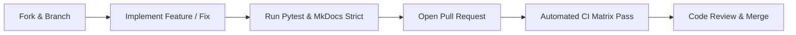

# Contributing to PyDataUI

Thank you for your interest in contributing to **PyDataUI**! As an open-source framework, PyDataUI thrives because of contributors like you—whether you are writing code, fixing typos in docs, adding real-world examples, or suggesting architectural improvements.

---

## 🚀 Quickstart for Contributors

### 1. Fork & Clone
```bash
git clone https://github.com/rajboopathiking/pydataui.git
cd pydataui
```

### 2. Set Up Virtual Environment
```bash
python3 -m venv .venv
source .venv/bin/activate  # On Windows: .venv\Scripts\activate

# Install package in editable mode with development & documentation extras
pip install --upgrade pip
pip install -e ".[dev,docs]"
```

### 3. Verify Existing Tests
```bash
pytest tests/ -q --ignore=tests/test_browser_security.py
```
All unit tests should pass with 0 failures before you start making changes.

---

## 🏛️ Repository Architecture

PyDataUI is organized into modular packages under `pydataui/`:

```
pydataui/
├── __init__.py           # Public exports (App, state, Shad*, Card, DataTable, etc.)
├── app.py                # App lifecycle, routing, FastAPI integration, middleware
├── state.py              # Reactive Proxy state system & action dispatchers
├── tui.py                # Terminal UI renderer (Rich & ASCII REPL fallback)
├── config.py             # Global AppConfig and environment variable overrides
├── api.py                # Automatic OpenAPI/REST endpoint generator
├── session.py            # Isolated per-client state session manager
├── event.py              # Event triggers & client-server RPC signals
├── auth/                 # JWT tokens, RBAC, password hashing, and user models
│   ├── manager.py        # AuthManager
│   ├── models.py         # User, Role, APIKey dataclasses
│   └── decorators.py     # @require_auth, @require_role, @require_api_key
├── compiler/             # SSR AST compiler & HTML templates
│   ├── renderer.py       # Compiles component trees to optimized HTML
│   └── templates.py      # Base HTML shell with Tailwind CSS & HTMX
├── components/           # 80+ UI components
│   ├── base.py           # Component base class & life cycle
│   ├── shadcn.py         # Modern shadcn/ui inspired primitives
│   ├── data_science.py   # Universal DataTable, Plotly charts, Metrics
│   ├── layout.py         # Container, Row, Col, Grid, Card
│   └── forms.py          # Input, Button, Slider, Select, Switch
└── styling/              # Embedded static assets
    ├── css/pydataui.css  # Framework stylesheet
    └── js/htmx.min.js    # Embedded HTMX runtime
```

---

## 🛠️ Step-by-Step: Adding a New Component

Every component in PyDataUI inherits from `Component` in `pydataui.components.base`.

### Step 1: Define the Component Class
```python
from typing import Optional, List, Dict, Any
from pydataui.components.base import Component
from pydataui.utils import escape_html

class ShadKpiCard(Component):
    """A high-contrast KPI metric card with trend badge."""

    def __init__(
        self,
        title: str,
        value: Any,
        trend: Optional[str] = None,
        is_positive: bool = True,
        **kwargs
    ):
        super().__init__(**kwargs)
        self.title = title
        self.value = value
        self.trend = trend
        self.is_positive = is_positive

    def render(self, state_snapshot: Optional[Dict[str, Any]] = None) -> str:
        # Resolve reactive state variables if passed
        resolved_val = self.value.resolve(state_snapshot) if hasattr(self.value, 'resolve') else self.value
        
        trend_badge = ""
        if self.trend:
            color_cls = "text-emerald-500 bg-emerald-50 dark:bg-emerald-950/40" if self.is_positive else "text-rose-500 bg-rose-50 dark:bg-rose-950/40"
            trend_badge = f'<span class="text-xs font-semibold px-2 py-0.5 rounded-full {color_cls}">{escape_html(self.trend)}</span>'

        return f'''
        <div class="p-6 rounded-xl border border-border bg-card text-card-foreground shadow-sm">
            <div class="flex items-center justify-between space-y-0 pb-2">
                <span class="text-sm font-medium text-muted-foreground">{escape_html(self.title)}</span>
                {trend_badge}
            </div>
            <div class="text-2xl font-bold tracking-tight">{escape_html(str(resolved_val))}</div>
        </div>
        '''
```

### Step 2: Register & Export
Add the component to `pydataui/components/__init__.py` and `pydataui/__init__.py`.

### Step 3: Add Unit Tests
Create a test in `tests/test_components.py`:
```python
def test_shad_kpi_card():
    from pydataui import ShadKpiCard, state
    s = state(revenue=50000)
    card = ShadKpiCard("Quarterly Revenue", s.revenue, trend="+12.4%", is_positive=True)
    html = card.render()
    assert "Quarterly Revenue" in html
    assert "50000" in html
    assert "+12.4%" in html
```

---

## 🧪 Testing Guidelines

1. **Fast Unit Tests**:
   ```bash
   pytest tests/ -q --ignore=tests/test_browser_security.py
   ```
2. **Headless Browser Tests**:
   Browser tests run Playwright against a live Chromium instance:
   ```bash
   pip install -e ".[browser]"
   python -m playwright install --with-deps chromium
   pytest tests/test_browser_security.py -v
   ```
3. **No Flaky Tests**: Tests must be deterministic and never depend on external live networks or unbounded sleeps.

---

## 📖 Documentation Standards

All PyDataUI documentation is written in **Material for MkDocs**.

### Rules for Documentation:
1. **Pure Markdown Only**: Do NOT check in raw HTML pages (`.html`) as primary documentation files. All docs must be `.md`.
2. **Brand Hygiene**: Never use legacy or personal project names in code, examples, or docs. Always use `pydataui` or `PyDataUI Platform`.
3. **Local Docs Preview**:
   ```bash
   mkdocs serve
   ```
4. **Strict Build Validation**:
   Before committing, verify that there are zero warnings and zero broken links:
   ```bash
   mkdocs build --strict
   ```

---

## 🔀 Pull Request Lifecycle



1. **Branch Naming**:
   - `feat/add-stepper-component`
   - `fix/tui-session-leak`
   - `docs/add-duckdb-guide`
2. **Commit Messages**: Follow [Conventional Commits](https://www.conventionalcommits.org/):
   - `feat: add ShadKpiCard metric component`
   - `fix: resolve TUI ASCII header output`
   - `docs: add comprehensive contribution guide`
3. **Checklist Before Submitting**:
   - [x] Code passes `pytest`.
   - [x] `mkdocs build --strict` exits 0.
   - [x] Type hints included for all public API functions.
   - [x] PR description references the related issue.
