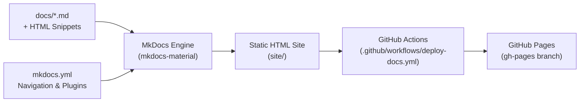
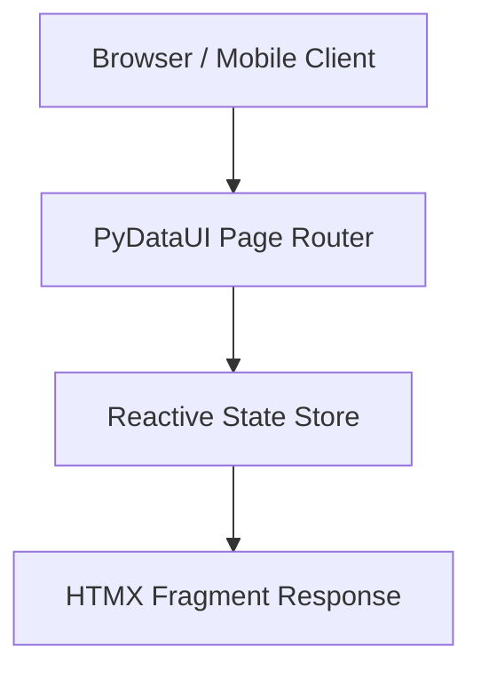

# 📚 Documentation Developer Guide (Markdown, HTML & GitHub Pages)

This guide is for developers and contributors writing, previewing, and publishing documentation for **PyDataUI**. It covers how to use **Markdown (`.md`)**, embed **HTML (`.html`)**, test changes locally, and deploy to **GitHub Pages**.

---

## 🏗️ Architecture & Tooling

PyDataUI's documentation site is generated statically from Markdown and HTML source files using **Material for MkDocs** and deployed automatically via **GitHub Pages**.



- **Live URL**: [https://rajboopathiking.github.io/pydataui/](https://rajboopathiking.github.io/pydataui/)
- **Configuration File**: [`mkdocs.yml`](file:///Users/boopathiraj/Downloads/AI_Browsers/Full-Web-Framework/mkdocs.yml)
- **Source Directory**: `docs/`
- **Output Directory**: `site/` (generated during build, gitignored)
- **CI/CD Workflow**: [`.github/workflows/deploy-docs.yml`](file:///Users/boopathiraj/Downloads/AI_Browsers/Full-Web-Framework/.github/workflows/deploy-docs.yml)

---

## ⚡ Quick Start: Local Preview

### 1. Install Documentation Dependencies
Install the required packages in your Python virtual environment:

```bash
pip install mkdocs mkdocs-material pymdown-extensions
```

### 2. Start Live Development Server
Run `mkdocs serve` from the repository root:

```bash
mkdocs serve
```

- Access the live preview at **`http://127.0.0.1:8000/`**.
- Any edits saved in `docs/` or `mkdocs.yml` trigger **instant hot-reload** in your browser.

### 3. Verify Production Build
Ensure there are no broken links, unclosed tags, or missing navigation references:

```bash
mkdocs build --strict
```

---

## ✍️ Writing Documentation in Markdown (`.md`)

PyDataUI documentation is powered by **Python-Markdown** and **PyMdown Extensions**.

### 1. Admonitions (Callout Boxes)
Use admonitions to highlight notes, tips, warnings, and dangers:

```markdown
!!! note "Helpful Note"
    This provides useful background context or secondary details.

!!! tip "Best Practice"
    Use `pwa=True` in `App()` for instant mobile home-screen capabilities.

!!! warning "Heads Up"
    Never commit live secret keys to version control.

!!! danger "Breaking Change"
    Always migrate your routes using the v0.3.0 guidelines.
```

### 2. Tabbed Code Blocks
Display alternative commands or multi-language examples using tabs:

````markdown
=== "Python (FastAPI)"

    ```python
    from pydataui import App
    app = App(backend="fastapi")
    ```

=== "Python (PyRustAPI)"

    ```python
    from pydataui import App
    app = App(backend="rust")
    ```

=== "Bash CLI"

    ```bash
    pydataui run app.py --desktop
    ```
````

### 3. Syntax Highlighting, Line Numbers & Highlighting
Specify language identifiers for proper syntax coloring. Use line numbers and highlighted lines for walkthroughs:

````markdown
```python linenums="1" hl_lines="4 7"
from pydataui import App, State

class CounterState(State):
    count: int = 0  # Highlighted line

    def increment(self):
        self.count += 1  # Highlighted line
```
````

### 4. Mermaid Flowcharts & Diagrams
Use standard Mermaid code blocks to visualize workflows and architectures:

````markdown

````

### 5. Collapsible Details Blocks
Keep long code snippets or technical deep dives tidy:

```markdown
???+ note "Click to expand technical details"
    Here is an in-depth breakdown of how the ASGI lifecycles interact
    with HTMX swap headers.
```

---

## 🌐 Embedding HTML (`.html`) in Documentation

PyDataUI has the `md_in_html` extension enabled, allowing you to embed raw HTML components, cards, tables, and styling directly inside Markdown files.

### 1. Inline HTML Badges & Labels
```html
<span style="background-color: #3b82f6; color: white; padding: 2px 8px; border-radius: 9999px; font-size: 0.75rem; font-weight: 600;">
  NEW FEATURE
</span>
```

### 2. Custom Responsive Showcase Cards
When creating custom visual callouts or product cards, use standard `<div>` tags with `markdown="1"` so internal Markdown links and bold text are rendered:

```html
<div style="border: 1px solid #3f3f46; border-radius: 8px; padding: 1.25rem; margin: 1rem 0; background: rgba(39, 39, 42, 0.4);" markdown="1">

#### 🚀 Native Mobile Shell Available
You can wrap any PyDataUI app into a native **iOS** or **Android** project using Capacitor:

- **Full-Screen standalone**: No browser chrome.
- **Hardware access**: Camera, push notifications, and geolocation.

[Read Mobile Guide](MOBILE_AND_DESKTOP.md){ .md-button .md-button--primary }
</div>
```

> [!IMPORTANT]
> Always add `markdown="1"` to block-level HTML tags (`<div>`, `<section>`, `<aside>`) if you want Markdown inside them (headers, links, code blocks) to be compiled.

### 3. Interactive Component Mockups & Tables
You can embed custom HTML tables with custom column alignments and inline badge styling:

```html
<table>
  <thead>
    <tr>
      <th>Platform</th>
      <th>Engine</th>
      <th>Status</th>
    </tr>
  </thead>
  <tbody>
    <tr>
      <td><strong>iOS & Android</strong></td>
      <td>Capacitor 8.x</td>
      <td><span style="color: #22c55e;">● Production Ready</span></td>
    </tr>
    <tr>
      <td><strong>macOS, Windows, Linux</strong></td>
      <td>Tauri 2.0</td>
      <td><span style="color: #22c55e;">● Production Ready</span></td>
    </tr>
  </tbody>
</table>
```

---

## 🚀 GitHub Pages Deployment Workflow

### Automated CI/CD Pipeline
Every time a commit is pushed to the `main` branch affecting documentation, the GitHub Actions workflow at [`.github/workflows/deploy-docs.yml`](file:///Users/boopathiraj/Downloads/AI_Browsers/Full-Web-Framework/.github/workflows/deploy-docs.yml) triggers automatically:

1. **Trigger Condition**:
   - Push to branch `main`
   - Modified paths: `docs/**`, `mkdocs.yml`, `.github/workflows/deploy-docs.yml`
   - Or manual trigger via **Actions ➡️ Deploy Documentation to GitHub Pages ➡️ Run workflow**.
2. **Build Step**:
   - Installs `python 3.11`, `mkdocs`, `mkdocs-material`, and `pymdown-extensions`.
   - Runs `mkdocs build` to output HTML into `site/`.
3. **Deploy Step**:
   - Commits and pushes the static assets to the `gh-pages` branch via `mkdocs gh-deploy --force`.
   - Deploys live to GitHub Pages.

---

## 📑 Updating Site Navigation (`mkdocs.yml`)

When you create a new documentation page in `docs/`:

1. Save the file: `docs/YOUR_NEW_PAGE.md`
2. Open [`mkdocs.yml`](file:///Users/boopathiraj/Downloads/AI_Browsers/Full-Web-Framework/mkdocs.yml) and add it to the `nav:` tree:

```yaml
nav:
  - Home: index.md
  - Benchmarks: BENCHMARKS.md
  - Guides:
      - Mobile & Desktop Apps: MOBILE_AND_DESKTOP.md
      - Documentation & HTML Guide: DOCS_DEVELOPER_GUIDE.md  # <--- Add your page
      - Authentication & Security: AUTHENTICATION.md
      # ...
```

3. Run `mkdocs build --strict` to verify there are no syntax warnings or missing pages.

---

## ✅ Pre-Commit Documentation Checklist

Before submitting a Pull Request with documentation changes:

- [ ] `mkdocs serve` runs without errors or warnings.
- [ ] `mkdocs build --strict` exits with code 0.
- [ ] All internal links (`[Text](TARGET.md)`) resolve to valid files.
- [ ] Any embedded HTML tags are properly closed.
- [ ] Markdown inside HTML blocks includes the `markdown="1"` attribute.
- [ ] New pages are registered in `mkdocs.yml` under `nav:`.
