# 🎓 The Python Developer's Masterclass: Building Production AI APIs, Dashboards & Internal Tooling with FastAPI & PyDataUI

> **A Comprehensive Guide for Python Developers, Data Scientists & AI Engineers.**  
> Learn how to turn any FastAPI AI service into a complete, enterprise-grade application with an embedded modern dashboard—**in pure Python, with zero JavaScript, zero Node.js, and running on a single unified server.**

---

## 1. Executive Vision: Why This Architecture Wins

### The Core Industry Dilemma
In modern AI, ML, and data engineering, **FastAPI is the undisputed standard**. Whether you are deploying an LLM gateway, fine-tuning Mistral or LLaMA with vLLM, building RAG pipelines with LangChain or LlamaIndex, or running high-performance DuckDB and Polars queries, your backend code is almost certainly written in Python on FastAPI.

However, every production AI backend immediately needs an **Internal UI**:
1. **Interactive Prompt & Model Playground**: For engineers and domain experts to test generation parameters ($temperature$, $top\_p$, stop sequences) and benchmark latency live.
2. **Observability & Evaluation Dashboard**: To monitor drift, hallucination rates, token throughput, and confusion matrices.
3. **Internal Operations & Admin Portal**: To manage API keys, inspect cluster health, approve human-in-the-loop agent steps, and review audit logs.

### Why Existing Solutions Fail in Production

```mermaid
flowchart TD
    subgraph TraditionalFails["Common Pitfalls in Enterprise Tooling"]
        direction TB
        F1["❌ Separate React/Next.js App\nRequires Node.js, npm, separate repo, separate frontend team with 6-month backlog, and CORS nightmares."]
        F2["❌ Streamlit / Gradio\nRuns on a separate server (port 8501). Reruns the entire script on every button click, causing catastrophic 10GB model reloads and data query lag."]
        F3["❌ Reflex (Pynecone)\nTranspiles to Next.js under the hood. Requires Node.js/npm runtime, heavy WebSocket connections that lag over high latency, and confusing dual-stack stacktraces."]
    end

    subgraph PyDataUIWinner["✨ The PyDataUI + FastAPI Unified Pattern"]
        direction TB
        W1["✅ Single Process, Single Server\nMount directly inside FastAPI via mount(api, app, path='/dashboard'). No separate ports, no CORS, shared in-process memory."]
        W2["✅ Pure Python (Zero Node.js / Zero npm)\npip install pydataui gives you modern shadcn/ui and Tailwind with zero JavaScript build steps."]
        W3["✅ Partial Hypermedia SSR (HTMX)\nMoving a slider only re-renders that specific metric bubble or card. Models and database connections stay permanently resident in memory."]
        W4["✅ Universal Component Ingestion\nCopy-paste raw JSX snippets from ui.shadcn.com or 21st.dev directly into Python with from_jsx()."]
    end
```



---

## 2. The Power of High-Level Pythonic Abstractions

Python developers prioritize **velocity, readability, and clean mental models**. They do not want to spend hours debugging flexbox margins, CSS cascading conflicts, or React state hooks.

PyDataUI provides **high-level, composable Python abstractions**:

| Abstraction | What it Replaces | Code Simplicity |
| :--- | :--- | :--- |
| **[`DashboardLayout`](#)** | 800+ lines of responsive HTML/CSS shell code | Single call: `DashboardLayout(sidebar=..., header=..., content=[...])` |
| **[`Sidebar`](#)** | Complex multi-tier collapsible drawer logic | Pure Python dictionaries: `Sidebar(brand={...}, groups=[...], footer={...})` |
| **[`Header`](#)** | Sticky navigation bar, breadcrumbs, `⌘K` search trigger | Single call: `Header(breadcrumbs=[...], search=True, actions=[...])` |
| **[`ShadSlider`](#)** | HTML range input + value bubble + JS listener | `ShadSlider(label="Temperature", min_val=0, max_val=2, step=0.05, bind=State.temp)` |
| **[`ShadRadioGroup`](#)** | Styled radio selection cards with descriptions | Pass clean Python option dicts: `[{"value": "vllm", "label": "vLLM", "badge": "Fast"}]` |
| **[`MetricCard`](#)** | Custom card, status pill, badge, and delta indicator | `MetricCard(title="Throughput", value="1,840 tok/s", delta="+12%")` |
| **[`ConfusionMatrix`](#)** | Canvas/D3 heatmaps | `ConfusionMatrix(matrix=[[850, 42], [38, 910]], labels=["Hallucinated", "Grounded"])` |
| **[`from_jsx`](#)** | Entire frontend component build pipeline | Copy-paste JSX snippet directly into a Python string |

---

## 3. End-to-End Master Tutorial: Building a Unified AI Service

Here is a complete, runnable reference showing how to build an **LLM Gateway with a production API and an embedded Model Evaluation Dashboard** on the same server.

### Step 1: Install Dependencies
```bash
pip install fastapi uvicorn pydataui
```
*(No Node.js, no npm, and no frontend bundler required!)*

### Step 2: Create the Unified Application (`main.py`)

```python
"""
Unified AI Inference Gateway & Operations Dashboard
FastAPI REST API + PyDataUI Dashboard running on a single Uvicorn process.
"""
from fastapi import FastAPI, HTTPException
from pydantic import BaseModel
from typing import List, Optional

from pydataui import App, State, mount
from pydataui.shadcn import (
    DashboardLayout, Sidebar, NavGroup, NavItem, Header,
    ShadButton, ShadCard, ShadCardHeader, ShadCardTitle, ShadCardDescription,
    ShadCardContent, ShadBadge, ShadSlider, ShadRadioGroup, ShadDatePicker,
    ShadDropdownMenu, ShadDropdownItem, ShadDropdownSeparator, ShadTooltip,
    from_jsx
)
from pydataui.components.data_science import MetricCard, ConfusionMatrix, PipelineStatus


# ---------------------------------------------------------------------------
# 1. Core FastAPI REST API (For programmatic clients, LangChain, SDKs)
# ---------------------------------------------------------------------------

api = FastAPI(
    title="NeuroNest AI Inference Gateway",
    description="Production LLM endpoints with embedded internal ops portal.",
    version="1.0.0"
)

class GenerateRequest(BaseModel):
    prompt: str
    model: str = "mistral-7b"
    temperature: float = 0.7
    max_tokens: int = 512

class GenerateResponse(BaseModel):
    completion: str
    tokens_generated: int
    latency_ms: float

# Shared in-memory model telemetry state
TELEMETRY = {
    "total_requests": 14250,
    "avg_latency_ms": 14.2,
    "gpu_vram_pct": 84.6,
    "active_model": "mistral-7b-instruct-v0.3"
}

@api.post("/api/v1/generate", response_model=GenerateResponse)
async def generate(req: GenerateRequest):
    """Production endpoint used by external apps, curl, and microservices."""
    return GenerateResponse(
        completion=f"Simulated LLM completion for prompt: '{req.prompt}' using {req.model}",
        tokens_generated=len(req.prompt.split()) * 4,
        latency_ms=14.2
    )

@api.get("/api/v1/health")
async def health():
    return {"status": "healthy", "model_loaded": TELEMETRY["active_model"]}


# ---------------------------------------------------------------------------
# 2. PyDataUI Dashboard Application (For data scientists & internal team)
# ---------------------------------------------------------------------------

dashboard = App(title="NeuroNest Model Registry & Ops", theme="dark", palette="zinc")

class PlaygroundState(State):
    temperature: float = 0.7
    top_p: float = 0.95
    selected_engine: str = "vllm"
    benchmark_date: str = "2026-11-11"

# Extensibility Engine: Ingest an upcoming modern card without JavaScript:
BentoMetricsCard = from_jsx("""
<div className="rounded-xl border border-border bg-card text-card-foreground p-5 shadow-sm">
  <div className="flex items-center justify-between pb-2">
    <span className="text-xs font-semibold uppercase text-muted-foreground">{category}</span>
    <span className="text-xs font-semibold px-2 py-0.5 rounded-full bg-emerald-500/10 text-emerald-400">{status}</span>
  </div>
  <h4 className="text-lg font-bold tracking-tight">{title}</h4>
  <p className="text-xs text-muted-foreground mt-1">{description}</p>
  <div className="mt-4 pt-3 border-t border-border flex justify-between items-center text-xs">
    <span className="font-mono text-muted-foreground">{latency}</span>
    {action}
  </div>
</div>
""")

@dashboard.page("/")
def ops_home():
    # 1. Collapsible Sidebar Shell
    sidebar = Sidebar(
        brand={"name": "NeuroNest AI", "logo": "cpu", "plan": "Enterprise"},
        groups=[
            NavGroup("Serving & Testing", [
                NavItem("Model Registry", icon="box", href="/dashboard", active=True, badge="14"),
                NavItem("Prompt Studio", icon="sparkles", href="/dashboard/prompts"),
                NavItem("Evaluation Benchmarks", icon="activity", href="/dashboard/benchmarks"),
            ]),
            NavGroup("Operations & Telemetry", [
                NavItem("Cluster Health", icon="activity", href="/dashboard/health"),
                NavItem("Vector Stores", icon="database", href="/dashboard/vectors"),
                NavItem("Security & Audit", icon="shield-check", href="/dashboard/audit"),
            ]),
        ],
        footer={"name": "Lead ML Engineer", "email": "engineer@neuronest.ai", "avatar": "ML"},
        collapsible="icon"
    )

    # 2. Top Header with Breadcrumbs, Search, Actions, Theme Toggle
    header = Header(
        breadcrumbs=[("Gateway", "/dashboard"), ("Models", "/dashboard"), TELEMETRY["active_model"]],
        search=True,
        actions=[
            ShadTooltip("Inspect Raw Safetensors", ShadButton("Export Weights", variant="outline", size="sm")),
            ShadDropdownMenu(
                trigger=ShadButton("Deploy to Node", variant="default", size="sm"),
                content=[
                    ShadDropdownItem("Deploy to 8x H100 Cluster", icon="cpu", shortcut="⌘D"),
                    ShadDropdownItem("Deploy to AWS Inferentia2", icon="box"),
                    ShadDropdownSeparator(),
                    ShadDropdownItem("Drain Active Replicas", icon="x", danger=True)
                ]
            )
        ],
        theme_toggle=True,
        user={"avatar": "ML"}
    )

    # 3. Main Operational Content Canvas
    content = [
        # KPI Telemetry Cards Row
        MetricCard(title="Throughput", value="1,840 tok/s", delta="+12.4%", delta_type="increase", icon="📈"),
        MetricCard(title="P99 Inference Latency", value=f"{TELEMETRY['avg_latency_ms']} ms", delta="-3.1 ms", delta_type="decrease", icon="⚡"),
        MetricCard(title="GPU VRAM Allocated", value=f"{TELEMETRY['gpu_vram_pct']}%", delta="Optimal", delta_type="neutral", icon="🧠"),

        # Pipeline Execution Visualizer
        PipelineStatus(
            steps=[
                {"name": "Tokenization", "status": "completed", "duration": "1.2ms"},
                {"name": "KV Cache Lookup", "status": "completed", "duration": "0.8ms"},
                {"name": "FlashAttention-3", "status": "running", "duration": "10.4ms"},
                {"name": "Sampling & Detokenize", "status": "pending", "duration": "-"},
            ]
        ),

        # Hyperparameter Tuning Studio
        ShadCard(
            ShadCardHeader(
                ShadCardTitle("Model Generation Hyperparameters"),
                ShadCardDescription("Tune generation parameters in real-time with automatic reactive state binding.")
            ),
            ShadCardContent(
                ShadSlider(
                    label="Sampling Temperature",
                    min_val=0.0,
                    max_val=2.0,
                    step=0.05,
                    value=0.7,
                    bind=PlaygroundState.temperature
                ),
                ShadSlider(
                    label="Nucleus Sampling (top_p)",
                    min_val=0.1,
                    max_val=1.0,
                    step=0.01,
                    value=0.95,
                    bind=PlaygroundState.top_p
                ),
                ShadRadioGroup(
                    name="engine",
                    value="vllm",
                    options=[
                        {"value": "vllm", "label": "vLLM PagedAttention", "description": "High-throughput production engine", "badge": "Optimal"},
                        {"value": "tgi", "label": "HuggingFace TGI", "description": "Tensor-parallel optimized"},
                        {"value": "trt", "label": "NVIDIA TensorRT-LLM", "description": "Maximum kernel fusion speed"}
                    ],
                    bind=PlaygroundState.selected_engine
                ),
                ShadDatePicker(label="Evaluation Date Filter", value="2026-11-11", bind=PlaygroundState.benchmark_date)
            )
        ),

        # Bento Card using from_jsx extensibility
        BentoMetricsCard(
            category="Vector Database",
            status="Healthy",
            title="Qdrant Hybrid Dense-Sparse Shards",
            description="Indexing 2.4M chunks with BGE-M3 embeddings across 4 nodes.",
            latency="p99: 18.2ms",
            action=ShadButton("Inspect Shards", variant="outline", size="sm")
        ),

        # Evaluation Confusion Matrix
        ConfusionMatrix(
            matrix=[[850, 42], [38, 910]],
            labels=["Hallucinated", "Grounded"],
            title="Hallucination & Factuality Evaluation"
        )
    ]

    return DashboardLayout(
        sidebar=sidebar,
        header=header,
        content=content,
        collapsible="icon"
    )


# ---------------------------------------------------------------------------
# 3. The Magic Connection: Mount Dashboard into FastAPI
# ---------------------------------------------------------------------------

# One single line connects the entire UI to FastAPI with full sub-path isolation!
mount(api, dashboard, path="/dashboard")


# ---------------------------------------------------------------------------
# 4. Entry Point Execution
# ---------------------------------------------------------------------------

if __name__ == "__main__":
    import uvicorn
    # Single server command runs both the API and the full Dashboard!
    uvicorn.run("main:api", host="0.0.0.0", port=8000, reload=True)
```

---

## 4. Running and Inspecting the Application

Start the application with a standard Uvicorn command:

```bash
python main.py
```

Now open your browser:
- **Interactive Ops Dashboard**: [http://127.0.0.1:8000/dashboard](http://127.0.0.1:8000/dashboard)  
  *Gives you the full collapsible sidebar, responsive header, hyperparameter sliders, confusion matrix, and `⌘K` spotlight command palette.*
- **FastAPI Interactive Swagger Docs**: [http://127.0.0.1:8000/docs](http://127.0.0.1:8000/docs)  
  *Allows external developers to test the REST endpoints.*
- **Automated REST Endpoint**: `curl -X POST http://127.0.0.1:8000/api/v1/generate -H "Content-Type: application/json" -d '{"prompt": "Explain Quantum Computing"}'`

### What Just Happened?
1. **Zero Node.js was executed.**
2. **Zero NPM packages were installed.**
3. **No separate server process or port was created.**
4. **Shared In-Memory State**: The dashboard and the API endpoints directly read and mutate the exact same in-memory variables (`TELEMETRY`), database pools, and loaded model weights.
5. **Ultra-Low Memory Footprint**: Instead of running a 400MB Node/Next.js server alongside a Python process, the entire application runs inside Python's single, highly efficient process.

---

## 5. Honest Framework Comparison: Why PyDataUI is the Go-To for Internal Products

### Where Does JavaScript Dominate?
Let's be completely transparent: **JavaScript and React/Next.js dominate commercial consumer-facing public websites.**
- If you are building Amazon, Airbnb, a public marketing homepage with heavy SEO requirements, or a consumer mobile app with 10 million users, React/Next.js is the proven choice.

### Where Does PyDataUI Outperform Everything Else?
For **enterprise internal tools, AI/ML engineering portals, operations cockpits, and data applications**, PyDataUI outperforms every alternative:

```
               ┌────────────────────────────────────────────────────────┐
               │             Which Python UI Framework?                 │
               └────────────────────────────────────────────────────────┘
                                           │
                    Is it a quick 10-line temporary script?
                                ├── YES ──► Streamlit / Gradio
                                │
                    Do you want to manage Node.js, NPM & Next.js?
                                ├── YES ──► Reflex (Pynecone)
                                │
                    Do you want raw HTML without design systems?
                                ├── YES ──► FastHTML
                                │
                    Do you want production shadcn/ui aesthetics,
                    zero Node.js, sub-millisecond reactivity, and
                    native FastAPI mounting in a single server?
                                └── YES ──► 🚀 PyDataUI
```

### Direct Head-to-Head Comparison

| Feature | **PyDataUI** | **Streamlit** | **Reflex** | **Dash** |
| :--- | :--- | :--- | :--- | :--- |
| **Server Architecture** | **Unified**: Mounts inside FastAPI (`mount()`) | **Separate**: Runs on port 8501 | **Dual**: Python backend + Node/Next frontend | **Separate**: Flask/Werkzeug app |
| **Execution Model** | **HTMX Partial SSR**: Only swapped elements re-render | **Full Script Rerun**: Entire file re-runs on click | **WebSocket Diffs**: Relies on state diffs | **Callback Graphs**: Complex `@app.callback` |
| **Heavy Model Handling** | **Zero Overhead**: Models stay in memory permanently | **Catastrophic**: Re-runs cause leaks or reload latency | **Overhead**: Must serialize state across WebSockets | **Complex**: Requires manual `dcc.Store` caching |
| **Aesthetics** | **Production shadcn/ui**: Modern dark mode, clean typography | **Notebook**: Recognizable "toy" appearance | **Tailwind**: Good styling, but high build setup | **Dated**: Requires manual custom CSS sheets |
| **Component Extensibility** | **`from_jsx()` & `pydataui add`**: Paste React/shadcn code directly | **Impossible**: Must write iframe React plugins | **DSL Wrappers**: Must write Python React bindings | **React Components**: High boilerplate packaging |
| **Deployment Simplicity** | **1 Docker Container**: Single `uvicorn main:api` | **2 Containers**: API server + Streamlit container | **2 Build Stages**: Node build + Python build | **1 Container**: Flask-centric |

---

## 6. Addressing Perceived Disadvantages (The Reality)

### "Does PyDataUI compile into a React SPA?"
- **Perceived Disadvantage**: "It doesn't generate a client-side React Single Page Application."
- **The Engineering Reality**: This is an **intentional design breakthrough, not a bug**.
  - Compiling to React requires Node.js, Webpack/Vite, npm dependencies, and hydration mismatches.
  - By using **Hypermedia-driven Server-Side Rendering (HTMX)** styled with standard Tailwind and shadcn/ui CSS, PyDataUI achieves **faster initial page loads**, **zero hydration delay**, and **instant interaction**, while eliminating the entire JavaScript build toolchain.

### "What if I need a cutting-edge community widget?"
- In older Python frameworks, you were trapped: if Streamlit or Dash didn't have a component, you had to wait months or write an npm wrapper.
- In PyDataUI, you use the **Universal Extensibility Engine**:
  ```python
  from pydataui.shadcn import from_jsx

  # Copy any JSX snippet from 21st.dev or ui.shadcn.com:
  FancyCard = from_jsx("""
  <div className="rounded-xl border p-4 bg-card shadow-sm">
    <h3>{title}</h3>
    <div>{children}</div>
  </div>
  """)

  FancyCard(title="My Custom Card", children=[...])
  ```
- **You get the full aesthetic power of the React ecosystem without ever writing JavaScript.**

---

## 7. Production Deployment Checklist for Engineering Teams

When deploying your unified FastAPI + PyDataUI service to Kubernetes, AWS ECS, Google Cloud Run, or Docker:

1. **Single Dockerfile**:
   ```dockerfile
   FROM python:3.11-slim
   WORKDIR /app
   COPY requirements.txt .
   RUN pip install --no-cache-dir -r requirements.txt
   COPY . .
   EXPOSE 8000
   CMD ["uvicorn", "main:api", "--host", "0.0.0.0", "--port", "8000", "--workers", "4"]
   ```
2. **Access Control**:
   - Protect sensitive dashboard sub-paths using PyDataUI's built-in role decorator:
     ```python
     from pydataui.auth import require_role

     @dashboard.page("/admin")
     @require_role("admin")
     def admin_console():
         return DashboardLayout(...)
     ```
3. **Database & Resource Sharing**:
   - Instantiate your database connection pool (e.g. SQLAlchemy, asyncpg, DuckDB) once in FastAPI's `lifespan` handler.
   - Both your REST endpoints and your PyDataUI dashboard functions can access the exact same pool directly.

---

## 8. Summary: The Golden Standard for Python Developers

PyDataUI provides Python developers with the ultimate balance:
- **Zero Frontend Friction**: No Node.js, no TypeScript, no npm, no Webpack.
- **Modern Aesthetics**: Built-in shadcn/ui design tokens, collapsible sidebars, and dark palettes.
- **Native FastAPI Integration**: Unified single-server deployment via `mount()`.
- **Instant Extensibility**: Copy-paste JSX snippets directly with `from_jsx()`.

## 7. The 5 Targeted DX Enhancements & Terminal TUI Runner (v1.2.0)

To eliminate any reason for a Python developer to pick Streamlit, Reflex, or Gradio, PyDataUI v1.2.0 introduces five high-impact Developer Experience (DX) enhancements along with a native Terminal User Interface (TUI) runner.

---

### 1. Zero-Class Procedural State Hook (`state(**defaults)`)

No need to subclass `State` for simple tools or interactive prototypes. Declare reactive variables directly and attach functions with `@s.action`:

```python
from pydataui import App, state, Button, Text, Row

app = App()
s = state(count=0, query="GPT-4")

@s.action
def increment():
    s.count += 1

@s.action
def decrement():
    s.count -= 1

@app.page("/")
def home():
    return Row(
        Button("-", on_click=s.decrement),
        Text(s.count),
        Button("+", on_click=s.increment)
    )
```

---

### 2. Universal Data Sniffing for `DataTable` and `Table`

Pass any Python data structure directly to `DataTable` or `Table` without manual conversion:

* **Polars DataFrame / LazyFrame**: `DataTable(pl_df)`
* **Pandas DataFrame / Series**: `DataTable(pd_df)`
* **DuckDB PyRelation**: `DataTable(conn.sql("SELECT * FROM models"))`
* **PyArrow Table**: `DataTable(arrow_table)`
* **Pydantic Models**: `DataTable([User(id=1, name="Alice"), User(id=2, name="Bob")])`
* **Dataclasses**: `DataTable([Metric(name="Latency", value=14.2)])`
* **Columnar Dicts**: `DataTable({"epochs": [1, 2, 3], "loss": [0.45, 0.32, 0.21]})`

Includes instant in-browser column sorting, real-time search filtering, and client-side pagination with zero JavaScript.

---

### 3. Pythonic Spatial Layout Shorthands (`Row`, `Col`, `Grid`, `Spacer`)

Avoid raw Tailwind utility classes for layout. Structure pages using clean spatial primitives:

```python
from pydataui import Row, Col, Grid, Spacer, Card, Text

Row(
    Col(Card(Text("Model Overview")), span=4),        # 4/12 grid span
    Spacer(),                                         # Auto-flex expanding spacer
    Col(Card(Text("Live Cluster VRAM")), width="1/2") # Half width
)
```

---

### 4. Pydantic Auto-Form Generator (`ShadForm.from_pydantic(Model)`)

Generate typed, validated shadcn/ui forms directly from existing FastAPI schemas:

```python
from pydantic import BaseModel, Field
from typing import Literal
from pydataui.shadcn import ShadForm

class JobRequest(BaseModel):
    experiment_name: str = Field(..., description="Unique run name")
    learning_rate: float = Field(0.001, description="AdamW learning rate")
    use_fp16: bool = Field(True, description="Enable mixed precision")
    sampling: Literal["greedy", "beam", "top_k"] = "beam"

# Instant validated form with submit button and card shell:
form = ShadForm.from_pydantic(
    JobRequest,
    on_submit=s.launch_experiment,
    submit_text="Deploy Training Run",
    field_configs={
        "learning_rate": {"component": "slider", "min": 0.0001, "max": 0.01, "step": 0.0001}
    }
)
```

---

### 5. Multi-Page Directory Auto-Discovery (`pages/`)

Organize multi-page applications into a `pages/` directory:

```
my_app/
├── app.py
└── pages/
    ├── 01_dashboard.py
    ├── 02_model_registry.py
    └── 03_system_logs.py
```

PyDataUI automatically discovers the pages, registers their routes (`/dashboard`, `/model-registry`, `/system-logs`), parses module-level metadata (`TITLE`, `ICON`, `ROLES`, `PUBLIC`), and populates the sidebar:

```python
from pydataui import App
from pydataui.shadcn import DashboardLayout

app = App() # auto-discovers pages/

@app.page("/")
def home():
    # Sidebar automatically populated with all discovered pages:
    return DashboardLayout.from_app(app, title="Operations Center")
```

---

### 6. Terminal User Interface (TUI) Runner

For remote GPU clusters, headless servers, and SSH sessions without X11 or web ports:

```bash
# Launch interactive Rich terminal dashboard:
pydataui run --tui app.py
# Or using shorthand:
pydataui tui app.py

# Render once to terminal output (e.g. for batch cron logs):
pydataui tui --once app.py
```

---

For any Python engineer building commercial internal tools, AI playgrounds, or operations dashboards, **FastAPI + PyDataUI is the definitive, production-ready stack.**
