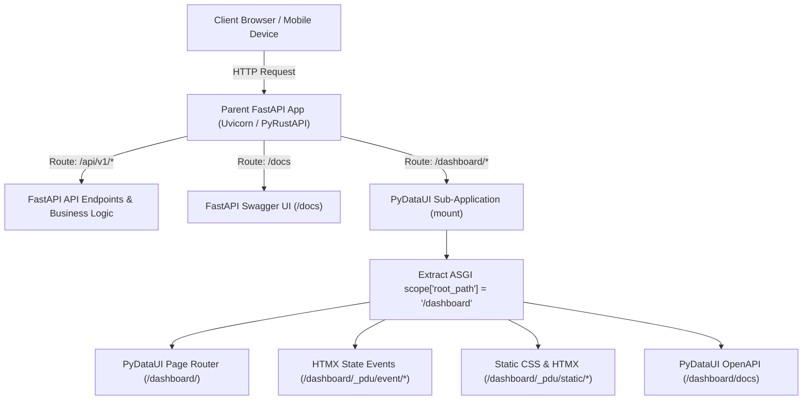
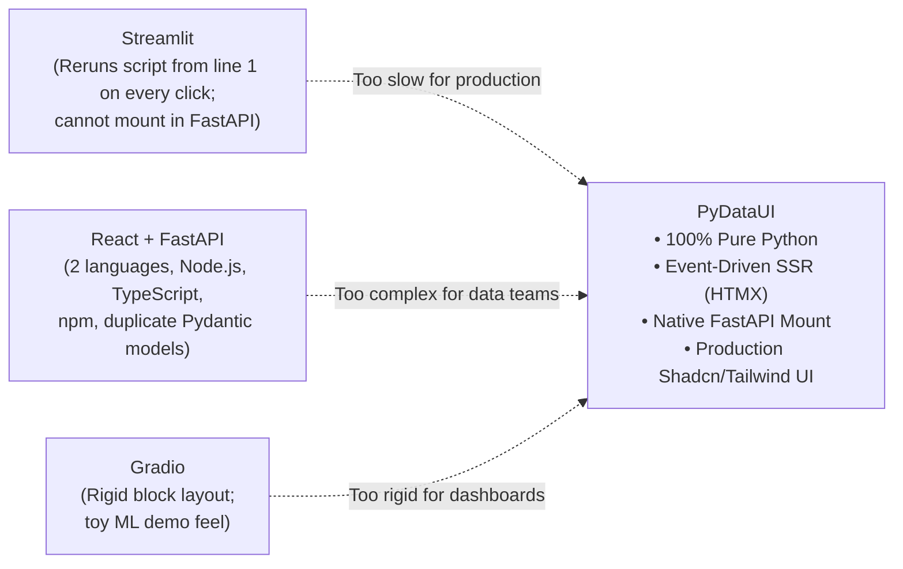

# FastAPI Mounting, Architecture & Conflict Handling

PyDataUI is designed from the ground up to be a **first-class citizen in the FastAPI ecosystem**. Rather than requiring a separate Node.js frontend server or fragile iframe embeds, PyDataUI applications are standard ASGI applications that can be mounted directly into existing FastAPI backends with a single line of code.

```python
from fastapi import FastAPI
from pydataui import App, mount

api = FastAPI(title="Core Enterprise API")
dashboard = App(title="Executive Analytics")

mount(api, dashboard, path="/dashboard")
# or: dashboard.mount_to(api, path="/dashboard")
```

---

## 1. How FastAPI Mounting Works Under the Hood

When you attach a PyDataUI application to an existing FastAPI application, the following ASGI delegation flow occurs:



### The ASGI Delegation Lifecycle

1. **Routing Delegation**: FastAPI uses Starlette's `Mount` router to match any URL starting with the mounted path (e.g., `/dashboard`).
2. **Root Path Scoping**: When the request reaches PyDataUI, FastAPI sets `scope["root_path"] = "/dashboard"`.
3. **Context Variable Propagation**: PyDataUI extracts `root_path` from the ASGI scope and stores it in the thread-safe `_current_root_path` context variable.
4. **Dynamic Path Rewriting**:
   - All internal assets (`/_pdu/static/pydataui.css`, `/_pdu/static/htmx.min.js`) automatically prefix `/dashboard`.
   - All HTMX event endpoints (`/_pdu/event/{state}/{method}`) automatically prefix `/dashboard`.
   - PWA manifest (`/_pdu/manifest.json`) and service worker (`/_pdu/sw.js`) automatically scope to `/dashboard/`.
   - Authentication redirects (`/login` -> `/dashboard/login`) preserve the mount prefix.

---

## 2. Complete Conflict Handling Architecture

Attaching a full-stack UI framework into an existing backend often risks route collisions, documentation overwrites, static file clashes, and cookie overrides. PyDataUI eliminates these conflicts through **complete architectural sandboxing**:

### Conflict Matrix & Resolution

| Potential Conflict Area | Problem in Other Frameworks | How PyDataUI Resolves It Gracefully |
| :--- | :--- | :--- |
| **Route Name Collisions** | Parent has `/users`, UI also defines `/users`. | **Strict Sub-Tree Scoping**: PyDataUI routes are namespaced under `/dashboard/users`. Parent FastAPI's `/users` route remains completely unaffected. |
| **Swagger / OpenAPI Collisions** | Parent `/docs` gets overwritten or polluted with UI endpoints. | **Independent OpenAPI Schemas**: Parent FastAPI keeps `/docs`. PyDataUI maintains its own isolated OpenAPI documentation at `/dashboard/docs` and `/dashboard/api/docs`. |
| **Static File Overlaps** | Both parent and UI use `/static/*`. | **Internal Prefix Sandboxing**: PyDataUI static assets (Tailwind CSS, HTMX, Lucide) are served strictly under `/_pdu/static/*` (e.g. `/dashboard/_pdu/static/*`). Parent `/static/*` is untouched. |
| **Session & Cookie Overwriting** | UI overwrites parent auth tokens or JWT cookies. | **Cryptographic Cookie Scoping**: PyDataUI uses a distinct signed cookie name (`pdu-session`) with `HttpOnly` and `SameSite=Lax`. Parent JWT, Bearer tokens, or session cookies are never modified. |
| **Middleware Interference** | Parent CORS, Sentry, or Rate-Limiters break UI. | **Layered ASGI Middleware Execution**: Parent FastAPI middlewares execute *before* delegating to PyDataUI. PyDataUI inherits parent security policies seamlessly. |
| **Multiple UI Applications** | Running multiple dashboards in one API causes state cross-contamination. | **Instance-Level Isolation**: You can mount multiple PyDataUI apps (`/admin`, `/portal`, `/analytics`) in the same FastAPI backend with zero state leakage. |

---

## 3. Working Example: Existing FastAPI + PyDataUI Dashboard

Here is a complete, production-ready example demonstrating an existing FastAPI API attached to a PyDataUI dashboard:

```python
from fastapi import FastAPI, Depends
from pydataui import App, State, mount
from pydataui.components import Container, Card, Heading, MetricCard, DataTable, Row, Button

# ==========================================
# 1. Existing FastAPI Backend Application
# ==========================================
api = FastAPI(
    title="Company Core API",
    description="Existing production REST API microservice",
    version="2.0.0"
)

@api.get("/api/v1/health")
def api_health():
    return {"status": "healthy", "service": "Core API"}

@api.get("/api/v1/orders")
def get_orders():
    return [
        {"order_id": "ORD-101", "customer": "Acme Corp", "amount": 1420.50, "status": "Shipped"},
        {"order_id": "ORD-102", "customer": "Stark Ind", "amount": 8900.00, "status": "Processing"},
    ]


# ==========================================
# 2. PyDataUI Analytics Application
# ==========================================
dashboard = App(
    title="Executive Analytics",
    theme="dark",
    palette="zinc",
    pwa=True
)

class AnalyticsState(State):
    refresh_count: int = 0
    total_sales: float = 10320.50
    active_orders: int = 42

    def refresh_metrics(self):
        self.refresh_count += 1
        self.total_sales += 1250.00
        self.active_orders += 1

@dashboard.page("/")
def home(state: AnalyticsState):
    orders_data = get_orders()
    return Container(
        Card(
            Row(
                Heading("Executive Operations Dashboard", level=1, class_name="text-2xl font-bold"),
                Button("⚡ Refresh Live Data", on_click=state.refresh_metrics, variant="primary"),
                class_name="justify-between items-center mb-6"
            ),
            Row(
                MetricCard(title="Total Revenue", value=f"${state.total_sales:,.2f}", delta="+12.4%"),
                MetricCard(title="Active Orders", value=state.active_orders, delta="+3"),
                MetricCard(title="Sync Count", value=state.refresh_count),
                spacing="md",
                class_name="mb-8"
            ),
            Heading("Recent Order Stream", level=3, class_name="text-lg font-semibold mb-3"),
            DataTable(data=orders_data),
            class_name="p-8 max-w-6xl mx-auto mt-6"
        )
    )

# ==========================================
# 3. Mount PyDataUI into FastAPI
# ==========================================
mount(api, dashboard, path="/dashboard")

# When running via Uvicorn:
# uvicorn main:api --host 0.0.0.0 --port 8000 --reload
#
# Endpoints available:
# - Existing API:        http://localhost:8000/api/v1/orders
# - Existing API Docs:   http://localhost:8000/docs
# - PyDataUI Dashboard:  http://localhost:8000/dashboard/
# - PyDataUI Docs:       http://localhost:8000/dashboard/docs
```

---

## 4. Mounting Multiple Independent PyDataUI Dashboards

You can mount multiple completely independent PyDataUI apps on the same parent FastAPI application:

```python
from fastapi import FastAPI
from pydataui import App, mount

api = FastAPI(title="Enterprise API Gateway")

# Application 1: Public Customer Portal (Light Theme)
portal = App(title="Customer Portal", theme="light", palette="blue")

# Application 2: Internal Admin Console (Dark Theme, Auth Required)
admin = App(title="Admin Console", theme="dark", palette="zinc")

# Application 3: ML Model Playground
ml_lab = App(title="AI Model Lab", theme="dark", palette="emerald")

# Mount all three with zero route or cookie collisions:
mount(api, portal, path="/portal")
mount(api, admin, path="/admin")
mount(api, ml_lab, path="/ml-lab")
```

---

## 5. Why PyDataUI Offers a Superior Developer Experience (DX) for Python Developers

Python developers building data tools, ML interfaces, and enterprise backends often face frustrating tradeoffs:



### Comprehensive Comparison Matrix

| Feature | PyDataUI | Streamlit | Gradio | Dash (Plotly) | React + FastAPI |
| :--- | :--- | :--- | :--- | :--- | :--- |
| **Language Requirements** | **100% Python** | 100% Python | 100% Python | 100% Python | Python + TypeScript + JavaScript |
| **Execution Model** | **Event-Driven SSR (HTMX)** | Re-executes whole file on click | Blocks & Event queues | Reactive Callbacks | Client-Side SPA + JSON REST |
| **Mount in Existing FastAPI** | ✅ **Native (`mount()`)** | ❌ Impossible (separate server) | ⚠️ ASGI Mount (heavy) | ⚠️ WSGI/ASGI dispatcher | ✅ Native (API only) |
| **UI Design System** | **Tailwind CSS + shadcn/ui** | Custom rigid widgets | Standard gradio themes | Custom CSS / Bootstrap | Full Tailwind / React ecosystem |
| **State Management** | **Clean Python Classes (`State`)** | `st.session_state` dict | Block inputs/outputs | Complex `@app.callback` | Redux / Zustand / React State |
| **Mobile & Desktop Shell** | ✅ **Built-in APK, IPA & Tauri** | ❌ Browser only | ❌ Browser only | ❌ Browser only | ⚠️ Capacitor / Electron setup |
| **API Auto-Generation** | ✅ **Automatic OpenAPI docs** | ❌ None | ⚠️ Gradio Client API | ❌ None | Manual Pydantic routing |
| **Multi-Worker Production** | ✅ **SQLite WAL / Postgres** | ⚠️ Complex Redis setup | ⚠️ Memory only | ⚠️ Gunicorn WSGI | ✅ Standard Uvicorn / Gunicorn |

---

## 6. Production Containerization (`pydataui build`)

When you are ready to ship your application to Kubernetes, Docker Swarm, AWS ECS, or Fly.io, PyDataUI provides a built-in headless compiler:

```bash
pydataui build app.py --output dist
```

### Generated Production Artifacts:
1. `dist/app.py`: Standalone application entrypoint.
2. `dist/static/`: Pre-bundled and minified static assets (`htmx.min.js`, `pydataui.css`) — no external CDN dependencies required at runtime.
3. `dist/Dockerfile`: Optimized multi-stage `python:3.11-slim` container definition.
4. `dist/docker-compose.yml`: Production compose file with healthchecks and port bindings.
5. `dist/requirements.txt`: Locked dependency manifest.

### Deploying with Docker:
```bash
cd dist
docker compose up --build -d
```
Your containerized PyDataUI service is live on port `8000` with production Uvicorn or PyRustAPI engine!
