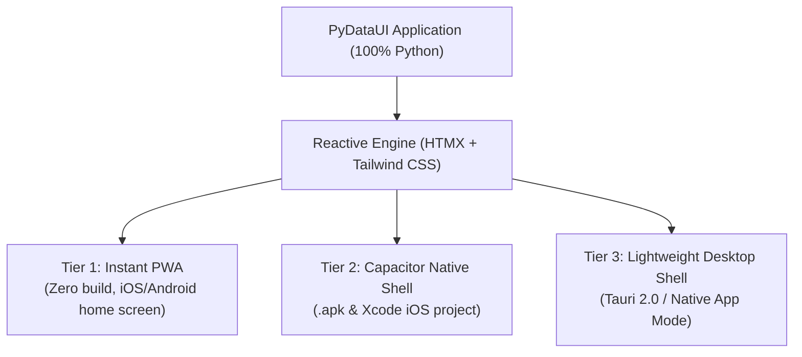

# 📱 Mobile & Desktop Capabilities in PyDataUI

PyDataUI gives you pure-Python cross-platform application development across **Web**, **Mobile (iOS & Android)**, and **Desktop (macOS, Windows, Linux)** with **zero Swift or Kotlin code required**.

---

## 🏗️ Architecture Overview

Rather than rewriting your UI in platform-specific native UI primitives (like React Native / Flutter bridge overhead), PyDataUI uses an optimized **Server-Driven Webview Architecture** across three tiers:



| Strategy | Target | Setup Effort | Build Required? | App Store Ready? |
| :--- | :--- | :--- | :--- | :--- |
| **Mobile Simulator & Preview** | Browser (iPhone/Android bezel) | ⚡ Instant (0 sec) | ❌ No Xcode/Android Studio | 📱 Live Web Preview |
| **Instant PWA** | iOS Safari & Android Chrome | ⚡ Instant (0 sec) | ❌ No | 🟡 Add to Home Screen |
| **Capacitor Headless CLI** | Android `.apk` & iOS Native | 2 minutes | ❌ Headless CLI (No IDE) | ✅ Yes (Google Play / App Store) |
| **Lightweight Desktop Window** | macOS, Windows, Linux | ⚡ Instant (0 sec) | ❌ No | 🖥️ Desktop window mode |
| **Tauri 2.0 Native Shell** | macOS `.dmg`, Win `.msi`, Linux `.deb` | 2 minutes | 🦀 Rust / Cargo | ✅ Yes |

---

## ⚡ Zero-IDE Mobile Development (No Xcode & No Android Studio)

PyDataUI eliminates the need to install or open heavy IDEs like Xcode or Android Studio just to develop, preview, or test mobile apps.

<div style="background: rgba(59, 130, 246, 0.1); border: 1px solid rgba(59, 130, 246, 0.3); border-radius: 8px; padding: 1.25rem; margin: 1.5rem 0;" markdown="1">

### 💡 The PyDataUI Fast-Mobile Loop
1. **Develop in Python**: Edit your UI components and reactive state in Python with instant auto-reload.
2. **Preview in Browser**: Test inside realistic device bezels (iPhone 15 Pro, Pixel 8, iPad Mini) directly in your browser.
3. **Scan QR Code**: Scan with your physical phone camera to test on real hardware over Wi-Fi.
4. **Finalize & Install**: Install immediately as a PWA or compile an Android `.apk` directly from the terminal without opening Android Studio.
</div>

### 1. Launch the In-Browser Mobile Device Simulator

Run your app with the mobile simulator enabled:

```bash
pydataui mobile preview app.py
```
or via the run command:
```bash
pydataui run app.py --mobile-preview
```

- Navigate to `http://localhost:8000/_pdu/preview`.
- **Realistic Phone Chassis**: Switch between **iPhone 15 Pro**, **Google Pixel 8**, **iPhone SE**, and **iPad Mini**.
- **Rotate Device**: One-click toggle between Portrait and Landscape orientation.
- **Fast Reload**: Instantly refresh the embedded app frame when updating Python code.
- **Real Phone QR Code**: Click **Test on Real Phone** to display a QR code containing your local LAN IP or tunnel URL (`share=True`). Scan with your phone's camera to run the app directly on your physical device.

---

### 2. Headless Android APK Build & Direct Device Install

When you have finalized your app and want an installable Android APK, build it directly from your terminal:

```bash
# Compile standalone Android APK without opening Android Studio GUI:
pydataui mobile build --platform android

# Directly install to connected Android device over USB/Wi-Fi via ADB:
pydataui mobile install --platform android
```
The compiled APK is output to `android/app/build/outputs/apk/debug/app-debug.apk`.

---

## 📱 Tier 1: Instant Mobile PWA (Zero Setup)

Every PyDataUI application includes automatic Progressive Web App (PWA) support enabled by default.

### Features
- **Mobile Viewport Optimization**: Rendered with `viewport-fit=cover`, disabling unintended zoom glitches while respecting iOS notch & home indicator safe-areas.
- **Standalone Mode**: Runs without Safari/Chrome browser address bars or navigation toolbars.
- **Auto-generated Web Manifest**: Served at `/_pdu/manifest.json`.
- **Service Worker**: Cache and offline lifecycle handled at `/_pdu/sw.js`.

### How to use:
```python
from pydataui import App
from pydataui.components import Container, Heading, Button

app = App(
    title="Inventory Tracker",
    pwa=True,                     # Enabled by default
    pwa_name="Inventory Pro",     # Name on mobile home screen
    pwa_short_name="Inventory"
)

@app.page("/")
def home():
    return Container(
        Heading("Mobile Ready App", level=1),
        Button("Tap Action", variant="primary", full_width=True),
        padding="md"
    )

if __name__ == "__main__":
    app.run()
```

1. Run your app: `python app.py`
2. Open the URL in Safari (iOS) or Chrome (Android).
3. Tap **Share** ➡️ **Add to Home Screen**.
4. The app launches full-screen directly from the phone's home screen.

---

## 📦 Tier 2: Capacitor Mobile Shell (iOS & Android Native)

To package your PyDataUI application as a native `.apk` or submit it to the Apple App Store, PyDataUI provides 1-command scaffolding via Capacitor.

### 1. Initialize Mobile Project
Run the following CLI command in your project directory:
```bash
pydataui mobile init --app-name "My Data App" --app-id "com.company.dataapp" --server-url "http://localhost:8000"
```

This automatically generates:
- `capacitor.config.json` configured with your live server URL and mobile preferences.
- `package.json` with `@capacitor/core` and `@capacitor/cli`.
- `public/index.html` fallback bridge.

### 2. Add Mobile Platforms
```bash
pydataui mobile add ios
pydataui mobile add android
```

### 3. Build & Run on Device / Simulator
```bash
# Sync web configuration to native projects
pydataui mobile sync

# Open in Xcode or Android Studio
pydataui mobile run ios
pydataui mobile run android
```

From Xcode or Android Studio, click **Run** to launch in the simulator, or archive for TestFlight / Google Play production release.

---

## 🖥️ Tier 3: Desktop Shell & Standalone Window

### Instant Desktop Window (Zero Dependency)
You can launch any PyDataUI app in a standalone native desktop window without installing Node.js or Rust:

```bash
pydataui run app.py --desktop
```
or programmatically in Python:
```python
from pydataui import App

app = App(title="Desktop Analytics")

# ... routes ...

if __name__ == "__main__":
    app.run(desktop=True)
```
This automatically leverages the system's native application webview window (Chromium App Mode / Edge / WebKit), launching a clean window without browser tabs or address bars.

---

### Tauri 2.0 High-Performance Native Desktop Shell
For distribution as a compiled macOS `.dmg` / Windows `.msi` / Linux `.deb` executable:

### 1. Initialize Tauri Shell
```bash
pydataui desktop init --app-name "PyDataUI Desktop" --server-url "http://localhost:8000"
```
This generates an optimized `src-tauri` directory with:
- `Cargo.toml` and Tauri 2.0 dependencies.
- `tauri.conf.json` configured to embed PyDataUI.
- Polling mechanism to await Python server readiness before showing the window.

### 2. Run in Dev Mode
```bash
pydataui desktop dev
```

### 3. Build Production Native Bundles
```bash
pydataui desktop build
```
The compiled platform binary is generated in `src-tauri/target/release/bundle/`.

---

## 💡 Best Practices for Mobile UI in PyDataUI

1. **Use Responsive Containers**:
   ```python
   from pydataui.components import Container, Grid
   
   Container(
       Grid(..., cols=1, md_cols=2, lg_cols=4),
       max_width="full",
       padding="md"
   )
   ```
2. **Touch-friendly tap targets**:
   Use `size="lg"` or `full_width=True` on buttons for easy mobile tapping.
3. **Bottom navigation bar**:
   Combine `Flex` with Tailwind classes `fixed bottom-0 left-0 right-0 z-50 bg-background border-t` for mobile tab navigation.
