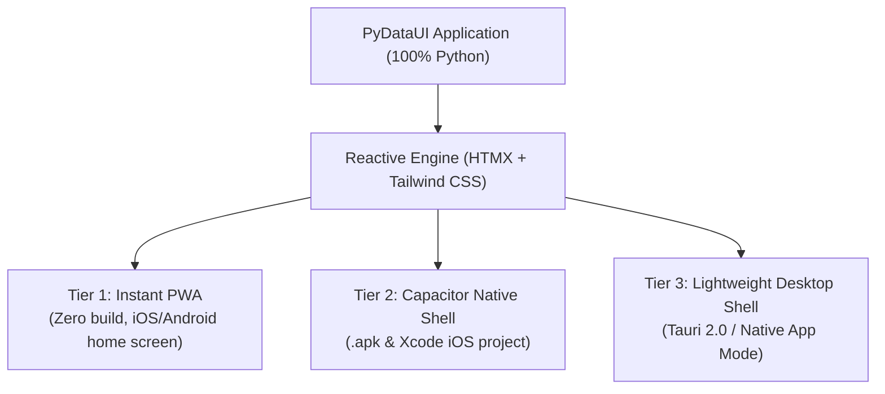

# 📱 Mobile & Desktop Capabilities in PyDataUI

PyDataUI gives you pure-Python cross-platform application development across **Web**, **Mobile (iOS & Android)**, and **Desktop (macOS, Windows, Linux)** with **zero Swift or Kotlin code required**.

<div style="background: rgba(59, 130, 246, 0.1); border: 1px solid rgba(59, 130, 246, 0.3); border-radius: 8px; padding: 1rem 1.25rem; margin: 1.25rem 0;" markdown="1">

👉 **Prefer an interactive, standalone HTML guide?**  
View the <a href="../mobile-desktop-guide.html" target="_blank" rel="noopener"><strong>Interactive Mobile &amp; Desktop Build Guide (HTML)</strong></a> with interactive OS tabs, ADB checklist, and Sideloadly IPA walkthrough.
</div>

---

## 🏗️ Architecture Overview

Rather than rewriting your UI in platform-specific native UI primitives (like React Native / Flutter bridge overhead), PyDataUI uses an optimized **Server-Driven Webview Architecture** across three tiers:



| Strategy | Target | Setup Effort | Build Required? | App Store Ready? |
| :--- | :--- | :--- | :--- | :--- |
| **Mobile Simulator & Preview** | Browser (iPhone/Android bezel) | ⚡ Instant (0 sec) | ❌ No Xcode/Android Studio | 📱 Live Web Preview |
| **Instant PWA** | iOS Safari & Android Chrome | ⚡ Instant (0 sec) | ❌ No | 🟡 Add to Home Screen |
| **Capacitor Headless CLI** | Android `.apk` & iOS Native | 2 minutes | ❌ Headless CLI (No IDE) | ✅ Yes (Google Play / App Store) |
| **Lightweight Desktop Window** | macOS, Windows, Linux | ⚡ Instant (0 sec) | ❌ No | 🖥️ Desktop window mode |
| **Tauri 2.0 Native Shell** | macOS `.dmg`, Win `.msi`, Linux `.deb` | 2 minutes | 🦀 Rust / Cargo | ✅ Yes |

---

## ⚡ Zero-IDE Mobile Development (No Xcode & No Android Studio)

PyDataUI eliminates the need to install or open heavy IDEs like Xcode or Android Studio just to develop, preview, or test mobile apps.

<div style="background: rgba(59, 130, 246, 0.1); border: 1px solid rgba(59, 130, 246, 0.3); border-radius: 8px; padding: 1.25rem; margin: 1.5rem 0;" markdown="1">

### 💡 The PyDataUI Fast-Mobile Loop
1. **Develop in Python**: Edit your UI components and reactive state in Python with instant auto-reload.
2. **Preview in Browser**: Test inside realistic device bezels (iPhone 15 Pro, Pixel 8, iPad Mini) directly in your browser.
3. **Scan QR Code**: Scan with your physical phone camera to test on real hardware over Wi-Fi.
4. **Finalize & Install**: Install immediately as a PWA or compile an Android `.apk` directly from the terminal without opening Android Studio.
</div>

### 1. Launch the In-Browser Mobile Device Simulator

Run your app with the mobile simulator enabled:

```bash
pydataui mobile preview app.py
```
or via the run command:
```bash
pydataui run app.py --mobile-preview
```

- Navigate to `http://localhost:8000/_pdu/preview`.
- **Realistic Phone Chassis**: Switch between **iPhone 15 Pro**, **Google Pixel 8**, **iPhone SE**, and **iPad Mini**.
- **Rotate Device**: One-click toggle between Portrait and Landscape orientation.
- **Fast Reload**: Instantly refresh the embedded app frame when updating Python code.
- **Real Phone QR Code**: Click **Test on Real Phone** to display a QR code containing your local LAN IP or tunnel URL (`share=True`). Scan with your phone's camera to run the app directly on your physical device.

---

### 2. Headless Android APK Build & Direct Device Install

When you have finalized your app and want an installable Android APK, build it directly from your terminal:

```bash
# Compile 100% offline standalone Android APK (React Native Parity, default):
pydataui mobile build --platform android

# Compile for live Wi-Fi development / hot reload:
pydataui mobile build --platform android --live-sync

# Connect to a remote production API:
pydataui mobile build --platform android --server-url https://api.mycompany.com

# Directly install to connected Android device over USB/Wi-Fi via ADB:
pydataui mobile install --platform android
```

The compiled APK is output to `android/app/build/outputs/apk/debug/app-debug.apk` and `./app-debug.apk`.

> 📘 **Deep Dive Guide**: See [Native Offline & Standalone Mobile Architecture](NATIVE_OFFLINE_AND_STANDALONE.md) for full details on asset bundling, in-process JNI dispatch, and eliminating `net::ERR_CONNECTION_REFUSED`.

---

## 📱 Tier 1: Instant Mobile PWA (Zero Setup)

Every PyDataUI application includes automatic Progressive Web App (PWA) support enabled by default.

### Features
- **Mobile Viewport Optimization**: Rendered with `viewport-fit=cover`, disabling unintended zoom glitches while respecting iOS notch & home indicator safe-areas.
- **Standalone Mode**: Runs without Safari/Chrome browser address bars or navigation toolbars.
- **Auto-generated Web Manifest**: Served at `/_pdu/manifest.json`.
- **Service Worker**: Cache and offline lifecycle handled at `/_pdu/sw.js`.

### How to use:
```python
from pydataui import App
from pydataui.components import Container, Heading, Button

app = App(
    title="Inventory Tracker",
    pwa=True,                     # Enabled by default
    pwa_name="Inventory Pro",     # Name on mobile home screen
    pwa_short_name="Inventory"
)

@app.page("/")
def home():
    return Container(
        Heading("Mobile Ready App", level=1),
        Button("Tap Action", variant="primary", full_width=True),
        padding="md"
    )

if __name__ == "__main__":
    app.run()
```

1. Run your app: `python app.py`
2. Open the URL in Safari (iOS) or Chrome (Android).
3. Tap **Share** ➡️ **Add to Home Screen**.
4. The app launches full-screen directly from the phone's home screen.

---

## 📦 Tier 2: Capacitor Mobile Shell (iOS & Android Native)

To package your PyDataUI application as a native `.apk` or submit it to the Apple App Store, PyDataUI provides 1-command scaffolding via Capacitor.

### 1. Initialize Mobile Project
Run the following CLI command in your project directory:
```bash
pydataui mobile init --app-name "My Data App" --app-id "com.company.dataapp" --server-url "http://localhost:8000"
```

This automatically generates:
- `capacitor.config.json` configured with your live server URL and mobile preferences.
- `package.json` with `@capacitor/core` and `@capacitor/cli`.
- `public/index.html` fallback bridge.

### 2. Add Mobile Platforms
```bash
pydataui mobile add ios
pydataui mobile add android
```

### 3. Build & Run on Device / Simulator
```bash
# Sync web configuration to native projects
pydataui mobile sync

# Open in Xcode or Android Studio
pydataui mobile run ios
pydataui mobile run android
```

From Xcode or Android Studio, click **Run** to launch in the simulator, or archive for TestFlight / Google Play production release.

---

## 📋 Native Build Requirements & Prerequisites (Android & iOS)

To compile native mobile packages (`.apk` / `.aab` for Android or `.ipa` / `.xcarchive` for iOS), your development machine must satisfy specific platform toolchain prerequisites.

<div style="background: rgba(39, 39, 42, 0.4); border: 1px solid #3f3f46; border-radius: 8px; padding: 1.25rem; margin: 1.5rem 0;" markdown="1">

### 📊 Platform Requirements Comparison

| Requirement | 🤖 Android Native (`.apk` / `.aab`) | 🍎 iOS Native (`.ipa` / Xcode) | ⚡ Instant PWA (Recommended) |
| :--- | :--- | :--- | :--- |
| **Host OS** | macOS, Linux, or Windows | **macOS required** | Any OS |
| **JDK (Java)** | **Java 17 LTS** (or 21 LTS)<br><span style="color: #ef4444; font-weight: 600;">⚠️ Do NOT use Java 25+</span> | ❌ None | ❌ None |
| **Node.js & npm** | Node 18+ or 20+ LTS | Node 18+ or 20+ LTS | ❌ None |
| **Build Core** | Gradle 8.x + Android SDK | Xcode 15+ & `xcodebuild` | ❌ None |
| **Package Manager** | npm (`@capacitor/android`) | CocoaPods or SPM (`@capacitor/ios`) | ❌ None |
| **Developer Account** | Google Play Console ($25 once, for store) | Apple ID (Free for device, $99/yr for store) | ❌ None |
| **Build Time** | ~1 to 2 minutes | ~1 to 3 minutes | **Instant (0 sec)** |
</div>

---

### 🤖 Android Native Build Requirements

Android compilation is powered by Gradle and the Android SDK.

#### 1. Java Development Kit (JDK 17 LTS Required)
Gradle and the Android Gradle Plugin (AGP) require an LTS Java runtime.

> [!CAUTION]
> **Do NOT install Java 25 or higher.** Gradle 8.x will fail with:  
> `Unsupported class file major version 69`.  
> Always use **Java 17 (Recommended by Google)** or **Java 21**.

=== "macOS (Homebrew)"

    ```bash
    # Install Eclipse Temurin Java 17 LTS
    brew install --cask temurin@17

    # Set JAVA_HOME in current session & ~/.zshrc
    export JAVA_HOME=$(/usr/libexec/java_home -v 17)
    echo 'export JAVA_HOME=$(/usr/libexec/java_home -v 17)' >> ~/.zshrc

    # Verify installation
    java -version
    # Expected: openjdk version "17.0.x"
    ```

=== "Ubuntu / Debian"

    ```bash
    sudo apt update
    sudo apt install openjdk-17-jdk -y
    export JAVA_HOME=/usr/lib/jvm/java-17-openjdk-amd64
    java -version
    ```

=== "Windows"

    ```powershell
    # Via winget
    winget install EclipseAdoptium.Temurin.17.JDK
    
    # Or set system environment variable:
    # JAVA_HOME = C:\Program Files\Eclipse Adoptium\jdk-17.x.x-hotspot
    ```

---

#### 2. Android SDK & Environment Variables
If you build locally via Gradle, you must provide the Android SDK:

1. **Option A: Android Studio (Easiest)**
   - Download & install [Android Studio](https://developer.android.com/studio).
   - In Settings ➡️ **SDK Manager**, ensure the following are checked:
     - Android SDK Platform 34 (or latest)
     - Android SDK Build-Tools (34.0.0+)
     - Android SDK Command-line Tools
2. **Option B: Headless Command-line Tools**
   - Download `commandlinetools-mac/linux` from Google's Android developer site.
   - Accept licenses: `yes | sdkmanager --licenses`

#### Required Environment Variables:
Add the following to your `~/.zshrc` or `~/.bashrc`:

```bash
export ANDROID_HOME=$HOME/Library/Android/sdk
export PATH=$PATH:$ANDROID_HOME/emulator
export PATH=$PATH:$ANDROID_HOME/platform-tools
export PATH=$PATH:$ANDROID_HOME/cmdline-tools/latest/bin
```

---

#### 3. Capacitor Android Plugin
In your PyDataUI project directory:

```bash
npm install @capacitor/core @capacitor/cli @capacitor/android
pydataui mobile build --platform android
```

The resulting debug APK is generated at:
```
android/app/build/outputs/apk/debug/app-debug.apk
```

---

### 🍎 iOS Native Build Requirements

iOS apps must be compiled on **macOS** using Apple's official Xcode toolchain.

#### 1. System & Hardware
- **macOS Sonoma (14+)** or macOS Ventura (13+).
- Mac hardware: Apple Silicon (M1/M2/M3/M4) or Intel Mac.

#### 2. Xcode & Command Line Tools
1. Install **Xcode 15+** or **16+** from the Mac App Store.
2. Install command line developer tools:
   ```bash
   xcode-select --install
   ```
3. Accept the Xcode license:
   ```bash
   sudo xcodebuild -license accept
   ```

#### 3. CocoaPods (Dependency Manager)
Capacitor iOS projects require CocoaPods to link native iOS frameworks:

```bash
sudo gem install cocoapods
# or via Homebrew:
brew install cocoapods
```

#### 4. Capacitor iOS Plugin
In your PyDataUI project directory:

```bash
npm install @capacitor/core @capacitor/cli @capacitor/ios
pydataui mobile add ios
```

#### 5. Code Signing & Apple Developer Account
Apple requires code signing for every executable on physical iOS devices:

<div style="background: rgba(34, 197, 94, 0.08); border: 1px solid rgba(34, 197, 94, 0.25); border-radius: 8px; padding: 1.25rem; margin: 1rem 0;" markdown="1">

- **Free Personal Apple ID**: Allows deploying directly to your personal connected iPhone for 7 days via USB without paying the $99/year developer fee.
- **Apple Developer Program ($99/year)**: Mandatory if distributing via **TestFlight** or the public **Apple App Store**.
</div>

To sign your app:
1. Open the generated iOS project:
   ```bash
   npx cap open ios
   ```
2. In Xcode, click **App** in the sidebar ➡️ **Signing & Capabilities**.
3. Under **Team**, select your Apple ID account.
4. Connect your iPhone via USB, select it as the target device, and press **Cmd + R** to run.

---

### 🛠️ Common Native Build Issues & Solutions

<div style="margin: 1.5rem 0;" markdown="1">

| Error Message | Root Cause | Solution |
| :--- | :--- | :--- |
| `Unsupported class file major version 69` | Installed Java 25+, which Gradle 8.x does not support. | Install Java 17 LTS: `brew install --cask temurin@17` and set `export JAVA_HOME=$(/usr/libexec/java_home -v 17)`. |
| `The operation couldn’t be completed. Unable to locate a Java Runtime.` | Java is missing or unlinked on macOS. | Run `brew install --cask temurin@17` or use the zero-Java PWA alternative. |
| `SDK location not found. Define a location with an ANDROID_HOME environment variable` | Android SDK directory is not set. | Add `export ANDROID_HOME=$HOME/Library/Android/sdk` to your shell profile, or create `android/local.properties` with `sdk.dir=/Users/YOUR_USER/Library/Android/sdk`. |
| `Signing for "App" requires a development team` | Xcode cannot sign without an Apple Developer Team. | Open Xcode (`npx cap open ios`), go to **Signing & Capabilities**, and select your personal Apple ID under "Team". |
| `CocoaPods could not find compatible versions` | Pods lockfile or repo out of date. | Run `cd ios/App && pod repo update && pod install`. |

</div>

---

### 💡 Recommendation: Skip Heavy SDKs with Instant PWA

If you do not want to manage 10GB+ of Xcode, Android Studio, and Java toolchains:

```python
# 100% native feel, zero installation on your Mac:
app = App(pwa=True, pwa_name="My Field App")
```
1. Run `pydataui run app.py` (or `pydataui mobile preview app.py`).
2. Scan the QR code on your iPhone or Android.
3. Tap **Add to Home Screen**.
4. You get an app icon, standalone full-screen view, and offline caching with **zero build tools**!

---

## 🖥️ Tier 3: Desktop Shell & Standalone Window

### Instant Desktop Window (Zero Dependency)
You can launch any PyDataUI app in a standalone native desktop window without installing Node.js or Rust:

```bash
pydataui run app.py --desktop
```
or programmatically in Python:
```python
from pydataui import App

app = App(title="Desktop Analytics")

# ... routes ...

if __name__ == "__main__":
    app.run(desktop=True)
```
This automatically leverages the system's native application webview window (Chromium App Mode / Edge / WebKit), launching a clean window without browser tabs or address bars.

---

### Tauri 2.0 High-Performance Native Desktop Shell
For distribution as a compiled macOS `.dmg` / Windows `.msi` / Linux `.deb` executable:

### 1. Initialize Tauri Shell
```bash
pydataui desktop init --app-name "PyDataUI Desktop" --server-url "http://localhost:8000"
```
This generates an optimized `src-tauri` directory with:
- `Cargo.toml` and Tauri 2.0 dependencies.
- `tauri.conf.json` configured to embed PyDataUI.
- Polling mechanism to await Python server readiness before showing the window.

### 2. Run in Dev Mode
```bash
pydataui desktop dev
```

### 3. Build Production Native Bundles
```bash
pydataui desktop build
```
The compiled platform binary is generated in `src-tauri/target/release/bundle/`.

---

## 💡 Best Practices for Mobile UI in PyDataUI

1. **Enable Mobile Mode Preset**:
   ```python
   app = App(title="Mobile App", mobile_mode=True)
   # Or via environment variable:
   # PYDATAUI_MOBILE_MODE=1
   ```
   Automatically activates Starlette `GZipMiddleware`, strips web PWA service-worker boilerplate, and activates dirty-tracked component subtree updates.

2. **In-Process JNI Bridge (Chaquopy)**:
   In Capacitor mobile apps, PyDataUI supports zero-socket native execution via `PyDataUIWebViewInterceptor` and `pydataui.shell.bridge.dispatch_in_process`. The native Android webview catches all `/_pdu/*` calls before hitting the network stack and executes the ASGI app in-process in memory, cutting latency by 5–15 ms per request and eliminating Uvicorn daemon threads.

3. **Use Responsive Containers**:
   ```python
   from pydataui.components import Container, Grid
   
   Container(
       Grid(..., cols=1, md_cols=2, lg_cols=4),
       max_width="full",
       padding="md"
   )
   ```
4. **Touch-friendly tap targets**:
   Use `size="lg"` or `full_width=True` on buttons for easy mobile tapping.
5. **Bottom navigation bar**:
   Combine `Flex` with Tailwind classes `fixed bottom-0 left-0 right-0 z-50 bg-background border-t` for mobile tab navigation.
