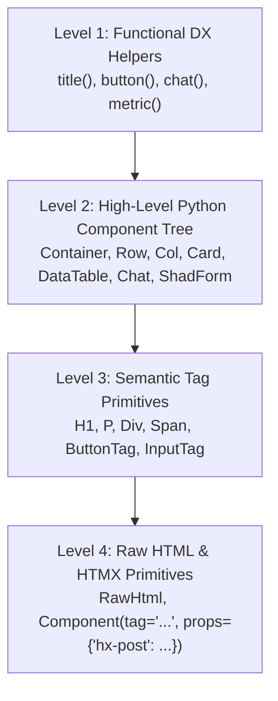

# PyDataUI vs. React & Streamlit: Architecture, Customization & Abstraction

Understanding how **PyDataUI** differs from **React** and **Streamlit** is key to appreciating its design. This guide provides a deep-dive architectural comparison and explains the exact mechanics of **abstraction** and **customization** in PyDataUI.

---

## 1. Architectural Tri-Way Comparison

| Dimension | React (JavaScript / Next.js) | Streamlit (Python) | PyDataUI (Python) |
| :--- | :--- | :--- | :--- |
| **Execution Model** | **Client-Side Virtual DOM**<br>Browser compiles JSX, runs JavaScript runtime, and updates a virtual DOM tree. | **Top-to-Bottom Script Re-execution**<br>On every single button click or input, Streamlit runs the entire `.py` script from line 1 to the end. | **Event-Driven Server-Side Rendering (SSR)**<br>Initial load is instant static HTML. Clicks send tiny HTMX events triggering *only* the targeted `@s.action`. |
| **State Management** | `useState`, `useReducer`, Redux, Zustand, Pinia.<br>Requires actions, reducers, and dispatch glue. | Session state dictionary (`st.session_state`).<br>Requires `@st.cache_data` workarounds to avoid re-querying databases. | `s = state(...)`, `@s.action`<br>Mutate native Python variables directly with zero boilerplate. |
| **Build & Setup Overhead** | **Very High**<br>Requires Node.js, npm/yarn/pnpm, Vite/Webpack, Babel/SWC, TypeScript, and 300MB+ `node_modules`. | **Low**<br>`pip install streamlit`. Easy to prototype, but hits performance walls in production. | **Zero**<br>`pip install pydataui`. Zero JavaScript, zero npm, zero build configs. |
| **Memory & Concurrency** | High client-side browser memory; backend is separate API server (FastAPI/Express). | **High Server Memory (1GB+ per session)**<br>Every connected user duplicates DataFrame objects across script re-runs. | **Ultra-Low Memory Footprint**<br>State snapshots share immutable process memory. Sub-10ms response times. |
| **UI Customization & Quality** | **Unlimited**<br>Full access to HTML, CSS, Tailwind, Radix UI, Framer Motion. | **Extremely Limited**<br>Confined to rigid Streamlit widgets. Custom CSS requires fragile `unsafe_allow_html=True` hacks. | **Commercial & Enterprise Grade**<br>Full Tailwind utility classes, CSS tokens, shadcn enterprise components, and JSX ingestion. |
| **Dual-Surface Execution** | Web browser only. | Web browser only. | **Dual Surface**<br>The exact same Python code runs in the Web Browser and in the Terminal (TUI). |
| **Best For** | Consumer-facing public web apps with massive frontend engineering teams. | Quick single-file data prototypes and temporary demos. | **Internal tools, AI agent copilots, MLops control planes, and enterprise dashboards.** |

---

## 2. Why PyDataUI Outperforms Streamlit in Production

### The Streamlit Bottleneck: Script Re-Runs
When a user clicks a button in Streamlit:
```text
User Clicks Button
       │
       ▼
Re-run script from Line 1 ──► Re-import modules ──► Check cache ──► Re-generate widgets
```
This paradigm breaks down for production internal tools:
1. **Slow Click Feedback**: Even with caching, re-evaluating the Python AST introduces latency.
2. **State Sync Bugs**: Multi-step workflows and modals require complex session state management to prevent premature resets.
3. **Widget Lock-In**: You cannot build custom enterprise headers, collapsible sidebars, or floating chat bubbles without breaking out of Streamlit's runtime.

### The PyDataUI Solution: Targeted Event Swapping
When a user clicks a button in PyDataUI:
```text
User Clicks Button
       │
       ▼
Lightweight HTMX POST (/_pdu/event/s/action)
       │
       ▼
Only the targeted @s.action executes (e.g., s.count += 1)
       │
       ▼
Server sends back the updated HTML fragment (e.g., <h2>Count: 1</h2>)
       │
       ▼
Browser morphs the DOM in milliseconds (Zero full-page refresh)
```

---

## 3. How Abstraction Works in PyDataUI: The 4 Progressive Levels

PyDataUI is designed with **progressive disclosure of complexity**. You can start at the highest level of abstraction and drop down to lower levels whenever you need custom control.



### Level 1: Declarative DX Helpers (Zero-Boilerplate)
Short function helpers for rapid scripting:
```python
from pydataui.dx import title, metric, button, chat

title("Fleet Overview")
metric("Throughput", "1,420 req/s")
button("Scale Cluster")
```

### Level 2: High-Level Component Tree (Production Default)
Structured Python classes with type safety, responsive props, and automated HTMX wiring:
```python
from pydataui import Container, Row, Col, Card, DataTable, Chat

Container(
    Row(
        Card(title="Worker Nodes", children=[...]),
        Card(title="Queue Latency", children=[...])
    ),
    DataTable(data=my_dataframe, searchable=True)
)
```

### Level 3: Semantic HTML Tag Components
Direct 1-to-1 mappings to standard HTML5 tags in `pydataui.components.html`:
```python
from pydataui.components.html import H1, P, Div, Section, FormTag, InputTag

Section(
    H1("Custom Section Header"),
    P("Direct control over HTML5 tags without writing strings."),
    class_name="bg-card border p-6 rounded-xl"
)
```

### Level 4: Raw HTML & Custom HTMX Primitives
Inject custom markup, SVG paths, or third-party web components:
```python
from pydataui import Component, RawHtml

# Raw HTML injection with security control
RawHtml('<div class="custom-badge"><span class="pulse"></span> Live</div>')

# Custom component with raw HTMX attributes
Component(
    tag="button",
    children=["Trigger Webhook"],
    props={
        "hx-post": "/api/webhook",
        "hx-target": "#notification-area",
        "hx-swap": "innerHTML"
    }
)
```

---

## 4. How UI Customization Works in PyDataUI

Unlike Streamlit (which restricts styling) or React (which requires complex CSS toolchains), PyDataUI provides four straightforward layers of customization:

### 1. Semantic Design Tokens & Theme Palettes
Customize the overall theme without touching CSS:
```python
from pydataui import App

# Choose theme mode and color palette
app = App(
    title="Ops Portal",
    theme="dark",       # 'dark', 'light', 'system'
    palette="zinc"      # 'zinc', 'slate', 'indigo', 'emerald', 'violet'
)
```
Behind the scenes, PyDataUI sets standard CSS variables:
```css
:root {
  --pdu-primary: 221.2 83.2% 53.3%;
  --pdu-background: 0 0% 100%;
  --pdu-card: 0 0% 100%;
  --pdu-border: 214.3 31.8% 91.4%;
  --pdu-radius: 0.5rem;
}
```

### 2. Full Tailwind Utility Classes via `class_name`
Every PyDataUI component accepts `class_name` and compiles Tailwind CSS utility classes:
```python
from pydataui import Box, Text

Box(
    Text("Gradient Telemetry Card", class_name="text-white font-extrabold text-xl"),
    class_name="bg-gradient-to-r from-blue-600 via-indigo-600 to-purple-600 p-6 rounded-2xl shadow-xl border border-white/10"
)
```

### 3. Inline Styles
Pass styles as a Python dictionary or raw CSS string:
```python
from pydataui import Card

Card(
    title="Custom Sized Node",
    style={"min-height": "480px", "background-color": "#0d1117"}
)
```

### 4. Community Extensibility: Ingesting JSX and HTML Without Node.js
PyDataUI includes an extensibility engine that converts modern JSX/HTML component snippets directly into Python components:

```python
from pydataui.shadcn import from_jsx

# Define a reusable Bento Grid Card using JSX syntax directly in Python:
BentoCard = from_jsx("""
<div className="rounded-xl border border-border bg-card p-5 shadow-sm">
  <div className="flex items-center justify-between pb-2">
    <span className="text-xs font-semibold uppercase text-muted-foreground">{category}</span>
    <span className="text-xs font-semibold px-2 py-0.5 rounded-full bg-emerald-500/10 text-emerald-400">{status}</span>
  </div>
  <h4 className="text-lg font-bold">{title}</h4>
  <p className="text-xs text-muted-foreground mt-1">{description}</p>
</div>
""")

# Instantiate in your layout:
card_instance = BentoCard(
    category="Compute",
    status="Healthy",
    title="Worker 01",
    description="Running inference at 14.2ms avg latency"
)
```

---

## 5. Summary: Which Tool Should You Choose?

```text
Do you need a public consumer B2C web app with 50+ frontend developers?
  └──► Choose React / Next.js

Do you need a quick 10-line throwaway chart for a 5-minute data exploration?
  └──► Choose Streamlit

Do you need production-grade internal tools, AI Copilots, MLops dashboards,
or operational tools with low latency, commercial UI, and dual Web + TUI execution?
  └──► Choose PyDataUI
```

---

## 6. The 5 Concrete Limitations of PyDataUI vs. Next.js

Being completely transparent about architectural boundaries:

1. **Zero Offline-First Apps (Network & Server Dependency)**:
   * *Next.js*: Bundles client-side React code running entirely in the user's browser without a backend connection (e.g. offline PWAs, local SQLite via WASM).
   * *PyDataUI*: Is server-driven. User clicks trigger HTMX requests to the Python ASGI backend. If connection drops, interactive callbacks pause until reconnect.
2. **Canvas-Heavy, 120 FPS Client-Side Tools (Figma, Canva, Video Editors)**:
   * *Next.js*: Excels at client-only apps executing thousands of vector calculations at 120 FPS directly on the GPU canvas.
   * *PyDataUI*: Built for analytical applications, AI copilots, executive dashboards, and B2B SaaS. It is not designed to be an in-browser vector editor or game engine.
3. **The Vast 3rd-Party NPM React Component Ecosystem (2M+ Packages)**:
   * *Next.js*: Instant access to 2M+ NPM packages (e.g. `react-flow`, `tiptap`).
   * *PyDataUI*: Ships with 40+ curated Shadcn/Tailwind enterprise components. Niche React widgets require custom web component or iframe encapsulation.
4. **Python GIL & CPU-Bound Blocking Concurrency**:
   * *Next.js / Node.js*: V8 handles high non-blocking concurrent I/O.
   * *PyDataUI*: Multi-minute CPU-bound ML computations must be explicitly offloaded to `BackgroundTasks`, `multiprocessing`, or Celery/Redis workers to prevent blocking the async event loop.
5. **0ms Optimistic Client UI Updates**:
   * *Next.js*: React can flip button states optimistically in 0ms before server response.
   * *PyDataUI*: Waits for the 10ms–25ms server roundtrip before surgical DOM morphing.

---

## 7. 4-Way Comprehensive Architecture Comparison

| Feature / Dimension | Next.js (Node.js) | FastAPI (Backend Only) | Streamlit (Python) | PyDataUI v1.5.0 (Full-Stack) |
| :--- | :---: | :---: | :---: | :---: |
| **Languages Required** | 2 (TypeScript + Python) | 1 (Python backend only) | 1 (Python) | **1 (Pure Python Full-Stack)** |
| **UI Presentation Layer** | React / Virtual DOM | ❌ None (API only) | Python procedural widgets | **Server-Side HTMX DOM Morphing** |
| **Execution on Click** | Client-side re-render | N/A (REST endpoint) | ❌ **Reruns script lines 1-100** | **Surgical fragment swap (0 rerun)** |
| **Model / Data Latency** | 15ms–60ms (JSON HTTP hop) | 0.02ms (In-Memory) | 0.02ms (In-Memory) | **0.02ms (Direct process memory)** |
| **Build & Dependencies** | 450 MB+ `node_modules` | Clean Python | Clean Python | **Clean Python (0 MB npm)** |
| **Built-in REST API & Docs** | Manual route handlers |  OpenAPI 3.1 Swagger | ❌ None | **Auto OpenAPI 3.1 Swagger UI** |
| **Responsive Flex & Grid** |  Tailwind CSS | ❌ None | ❌ Primitive columns only | **Native `pdu.flex` & `pdu.grid`** |
| **Coordinate Positioning** |  Tailwind CSS | ❌ None | ❌ None | **Native props (`top`, `right`, etc.)** |
| **Public Sharing Demos** | Manual Vercel / Cloud | Manual cloud hosting | Cloud login required | **`share=True` (3.5s instant tunnel)** |
| **Memory per User Session** | Low (Client-side) | Stateless | ❌ High (Duplicate DataFrames) | **Ultra-Low (Shared memory)** |

---

## 8. Streamlit: Prototyping Tool vs. Production-Grade Full-Stack MVP

A frequent debate in the Python community is whether **Streamlit** can serve as a production-grade commercial MVP. The short answer: **Streamlit is architecturally optimized for rapid exploratory prototyping and internal dashboards, not commercial full-stack SaaS MVPs.**

### The 5 Fatal Bottlenecks of Streamlit in Production

1. **Top-to-Bottom Script Re-Execution**:
   * *Problem*: Clicking any widget re-runs lines 1–100 of your Python file. 
   * *Commercial Impact*: Multi-step onboarding flows, checkout forms, and transactional dashboards require defensive `st.session_state` flags and caching workarounds. Flashing spinners and input resets degrade user trust.
   * *PyDataUI Fix*: Event-driven dispatch. A button click triggers only the targeted Python action and morphs only the updated DOM element.

2. **Absence of a Real Backend, API & Webhook Layer**:
   * *Problem*: Streamlit has no HTTP API routing engine.
   * *Commercial Impact*: You cannot listen for Stripe checkout webhooks (`/api/v1/stripe`), expose REST endpoints for mobile apps, or integrate third-party services.
   * *PyDataUI Fix*: Powered directly by **FastAPI and Starlette**. Your application is simultaneously an interactive UI and a production REST API with interactive Swagger docs at `/docs`.

3. **Memory Footprint & Concurrency Degradation**:
   * *Problem*: Stateful persistent WebSockets per browser tab and cloned in-memory DataFrames per user.
   * *Commercial Impact*: A single Streamlit node often runs out of memory (OOM) at just 20–50 concurrent users.
   * *PyDataUI Fix*: Stateless ASGI HTTP requests with shared process memory and Uvicorn horizontal worker clustering handling 1,000+ concurrent sessions per container.

4. **Rigid Layout & Academic "Toy" Look**:
   * *Problem*: Confined to primitive column splits and vertical stacks without CSS Grid, Flexbox alignment, or native navigation bars.
   * *Commercial Impact*: Customers immediately recognize the prototype appearance, impacting perceived product value.
   * *PyDataUI Fix*: Native `pdu.flex`, `pdu.grid`, `pdu.navbar`, `pdu.popover`, `pdu.tooltip`, and 20+ Shadcn enterprise design themes.

5. **Lack of Clean Dynamic URL Routing**:
   * *Problem*: Script-based multipage navigation cannot handle RESTful parameterized paths (`/projects/{id}/analytics`) or deep-linking.
   * *Commercial Impact*: Customers cannot bookmark, share, or deep-link to specific resource states.
   * *PyDataUI Fix*: Standard parameterized route decorators (`@app.page("/projects/{project_id}")`).

---

## 9. Achieving Next.js-Style Architecture in Pure Python

Developers love **Next.js** because it combines frontend components, file/URL routing, API routes, and Tailwind styling into a single coherent framework. **PyDataUI brings this exact Next.js architecture to Python**, eliminating Node.js, TypeScript, and `npm`:

### Next.js Architecture vs. PyDataUI Python Equivalent

| Next.js Feature | Next.js (TypeScript) | PyDataUI (Pure Python) |
| :--- | :--- | :--- |
| **App Routing** | `app/dashboard/page.tsx` | `@app.page("/dashboard")` |
| **Route Handlers / APIs**| `app/api/generate/route.ts` | `@app.api("/api/generate", method="POST")` |
| **Server Components** | React Server Components (RSC) | Native Python Component Tree (AST SSR) |
| **Token Streaming** | Vercel AI SDK (`useChat`, Streaming) | `pdu.write_stream(token_generator)` |
| **Styling & Tokens** | Tailwind CSS (`className="..."`) | Tailwind CSS (`class_name="..."`) + Shadcn tokens |
| **Design System** | Shadcn UI (`components/ui/...`) | Native 40+ Shadcn Python components |
| **State Mutation** | Server Actions (`"use server"`) | Procedural Actions (`@s.action`, `on_click=...`) |
| **Build & Toolchain** | Node.js, Webpack, Turbopack, 450MB `node_modules` | **0 MB npm, 0 build tools (`pip install pydataui`)** |

### Complete "Next.js-Style" App in Pure Python

```python
import pydataui as pdu
from pydantic import BaseModel

# 1. Next.js-style Page Configuration
pdu.set_page_config(title="SaaS Analytics", theme="zinc", dark_mode=True)

# 2. Top Navigation Bar (Next.js layout.tsx header)
pdu.navbar(
    title="Acme Cloud",
    logo="⚡",
    links=[{"label": "Overview", "href": "/"}, {"label": "Billing", "href": "/billing"}],
    search=True,
    user={"name": "Alex", "role": "Owner"}
)

# 3. Next.js App Router Page
@pdu.page("/")
def home():
    pdu.breadcrumb(["Home", "Analytics", "Real-Time"])
    
    # Next.js Flexbox & CSS Grid
    with pdu.flex(justify="between", align="center", class_name="mb-6"):
        pdu.header("Compute Fleet Telemetry")
        with pdu.row(gap=2):
            pdu.badge("Cluster Active", color="emerald")
            pdu.button("+ Deploy Node", type="primary")

    # Responsive Grid of KPI Cards
    with pdu.grid(columns={"sm": 1, "md": 3}, gap=4):
        pdu.metric("Active Pods", "48 / 48", delta="100% OK")
        pdu.metric("Inference P99", "11.4 ms", delta="-2.1ms")
        pdu.metric("Throughput", "18.4k req/s", delta="+12.4%")

# 4. Built-in Next.js Route Handler / FastAPI Endpoint
class QueryRequest(BaseModel):
    query: str

@pdu.api("/api/v1/query", method="POST")
async def api_query(body: QueryRequest):
    return {"status": "success", "results": [f"Processed: {body.query}"]}

if __name__ == "__main__":
    pdu.run(port=8000)
```

