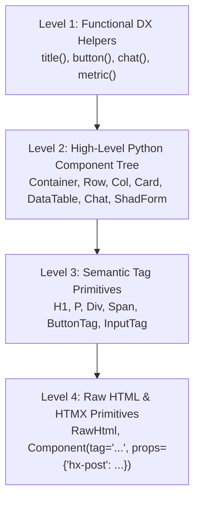

# PyDataUI vs. React & Streamlit: Architecture, Customization & Abstraction

Understanding how **PyDataUI** differs from **React** and **Streamlit** is key to appreciating its design. This guide provides a deep-dive architectural comparison and explains the exact mechanics of **abstraction** and **customization** in PyDataUI.

---

## 1. Architectural Tri-Way Comparison

| Dimension | React (JavaScript / Next.js) | Streamlit (Python) | PyDataUI (Python) |
| :--- | :--- | :--- | :--- |
| **Execution Model** | **Client-Side Virtual DOM**<br>Browser compiles JSX, runs JavaScript runtime, and updates a virtual DOM tree. | **Top-to-Bottom Script Re-execution**<br>On every single button click or input, Streamlit runs the entire `.py` script from line 1 to the end. | **Event-Driven Server-Side Rendering (SSR)**<br>Initial load is instant static HTML. Clicks send tiny HTMX events triggering *only* the targeted `@s.action`. |
| **State Management** | `useState`, `useReducer`, Redux, Zustand, Pinia.<br>Requires actions, reducers, and dispatch glue. | Session state dictionary (`st.session_state`).<br>Requires `@st.cache_data` workarounds to avoid re-querying databases. | `s = state(...)`, `@s.action`<br>Mutate native Python variables directly with zero boilerplate. |
| **Build & Setup Overhead** | **Very High**<br>Requires Node.js, npm/yarn/pnpm, Vite/Webpack, Babel/SWC, TypeScript, and 300MB+ `node_modules`. | **Low**<br>`pip install streamlit`. Easy to prototype, but hits performance walls in production. | **Zero**<br>`pip install pydataui`. Zero JavaScript, zero npm, zero build configs. |
| **Memory & Concurrency** | High client-side browser memory; backend is separate API server (FastAPI/Express). | **High Server Memory (1GB+ per session)**<br>Every connected user duplicates DataFrame objects across script re-runs. | **Ultra-Low Memory Footprint**<br>State snapshots share immutable process memory. Sub-10ms response times. |
| **UI Customization & Quality** | **Unlimited**<br>Full access to HTML, CSS, Tailwind, Radix UI, Framer Motion. | **Extremely Limited**<br>Confined to rigid Streamlit widgets. Custom CSS requires fragile `unsafe_allow_html=True` hacks. | **Commercial & Enterprise Grade**<br>Full Tailwind utility classes, CSS tokens, shadcn enterprise components, and JSX ingestion. |
| **Dual-Surface Execution** | Web browser only. | Web browser only. | **Dual Surface**<br>The exact same Python code runs in the Web Browser and in the Terminal (TUI). |
| **Best For** | Consumer-facing public web apps with massive frontend engineering teams. | Quick single-file data prototypes and temporary demos. | **Internal tools, AI agent copilots, MLops control planes, and enterprise dashboards.** |

---

## 2. Why PyDataUI Outperforms Streamlit in Production

### The Streamlit Bottleneck: Script Re-Runs
When a user clicks a button in Streamlit:
```text
User Clicks Button
       │
       ▼
Re-run script from Line 1 ──► Re-import modules ──► Check cache ──► Re-generate widgets
```
This paradigm breaks down for production internal tools:
1. **Slow Click Feedback**: Even with caching, re-evaluating the Python AST introduces latency.
2. **State Sync Bugs**: Multi-step workflows and modals require complex session state management to prevent premature resets.
3. **Widget Lock-In**: You cannot build custom enterprise headers, collapsible sidebars, or floating chat bubbles without breaking out of Streamlit's runtime.

### The PyDataUI Solution: Targeted Event Swapping
When a user clicks a button in PyDataUI:
```text
User Clicks Button
       │
       ▼
Lightweight HTMX POST (/_pdu/event/s/action)
       │
       ▼
Only the targeted @s.action executes (e.g., s.count += 1)
       │
       ▼
Server sends back the updated HTML fragment (e.g., <h2>Count: 1</h2>)
       │
       ▼
Browser morphs the DOM in milliseconds (Zero full-page refresh)
```

---

## 3. How Abstraction Works in PyDataUI: The 4 Progressive Levels

PyDataUI is designed with **progressive disclosure of complexity**. You can start at the highest level of abstraction and drop down to lower levels whenever you need custom control.



### Level 1: Declarative DX Helpers (Zero-Boilerplate)
Short function helpers for rapid scripting:
```python
from pydataui.dx import title, metric, button, chat

title("Fleet Overview")
metric("Throughput", "1,420 req/s")
button("Scale Cluster")
```

### Level 2: High-Level Component Tree (Production Default)
Structured Python classes with type safety, responsive props, and automated HTMX wiring:
```python
from pydataui import Container, Row, Col, Card, DataTable, Chat

Container(
    Row(
        Card(title="Worker Nodes", children=[...]),
        Card(title="Queue Latency", children=[...])
    ),
    DataTable(data=my_dataframe, searchable=True)
)
```

### Level 3: Semantic HTML Tag Components
Direct 1-to-1 mappings to standard HTML5 tags in `pydataui.components.html`:
```python
from pydataui.components.html import H1, P, Div, Section, FormTag, InputTag

Section(
    H1("Custom Section Header"),
    P("Direct control over HTML5 tags without writing strings."),
    class_name="bg-card border p-6 rounded-xl"
)
```

### Level 4: Raw HTML & Custom HTMX Primitives
Inject custom markup, SVG paths, or third-party web components:
```python
from pydataui import Component, RawHtml

# Raw HTML injection with security control
RawHtml('<div class="custom-badge"><span class="pulse"></span> Live</div>')

# Custom component with raw HTMX attributes
Component(
    tag="button",
    children=["Trigger Webhook"],
    props={
        "hx-post": "/api/webhook",
        "hx-target": "#notification-area",
        "hx-swap": "innerHTML"
    }
)
```

---

## 4. How UI Customization Works in PyDataUI

Unlike Streamlit (which restricts styling) or React (which requires complex CSS toolchains), PyDataUI provides four straightforward layers of customization:

### 1. Semantic Design Tokens & Theme Palettes
Customize the overall theme without touching CSS:
```python
from pydataui import App

# Choose theme mode and color palette
app = App(
    title="Ops Portal",
    theme="dark",       # 'dark', 'light', 'system'
    palette="zinc"      # 'zinc', 'slate', 'indigo', 'emerald', 'violet'
)
```
Behind the scenes, PyDataUI sets standard CSS variables:
```css
:root {
  --pdu-primary: 221.2 83.2% 53.3%;
  --pdu-background: 0 0% 100%;
  --pdu-card: 0 0% 100%;
  --pdu-border: 214.3 31.8% 91.4%;
  --pdu-radius: 0.5rem;
}
```

### 2. Full Tailwind Utility Classes via `class_name`
Every PyDataUI component accepts `class_name` and compiles Tailwind CSS utility classes:
```python
from pydataui import Box, Text

Box(
    Text("Gradient Telemetry Card", class_name="text-white font-extrabold text-xl"),
    class_name="bg-gradient-to-r from-blue-600 via-indigo-600 to-purple-600 p-6 rounded-2xl shadow-xl border border-white/10"
)
```

### 3. Inline Styles
Pass styles as a Python dictionary or raw CSS string:
```python
from pydataui import Card

Card(
    title="Custom Sized Node",
    style={"min-height": "480px", "background-color": "#0d1117"}
)
```

### 4. Community Extensibility: Ingesting JSX and HTML Without Node.js
PyDataUI includes an extensibility engine that converts modern JSX/HTML component snippets directly into Python components:

```python
from pydataui.shadcn import from_jsx

# Define a reusable Bento Grid Card using JSX syntax directly in Python:
BentoCard = from_jsx("""
<div className="rounded-xl border border-border bg-card p-5 shadow-sm">
  <div className="flex items-center justify-between pb-2">
    <span className="text-xs font-semibold uppercase text-muted-foreground">{category}</span>
    <span className="text-xs font-semibold px-2 py-0.5 rounded-full bg-emerald-500/10 text-emerald-400">{status}</span>
  </div>
  <h4 className="text-lg font-bold">{title}</h4>
  <p className="text-xs text-muted-foreground mt-1">{description}</p>
</div>
""")

# Instantiate in your layout:
card_instance = BentoCard(
    category="Compute",
    status="Healthy",
    title="Worker 01",
    description="Running inference at 14.2ms avg latency"
)
```

---

## 5. Summary: Which Tool Should You Choose?

```text
Do you need a public consumer B2C web app with 50+ frontend developers?
  └──► Choose React / Next.js

Do you need a quick 10-line throwaway chart for a 5-minute data exploration?
  └──► Choose Streamlit

Do you need production-grade internal tools, AI Copilots, MLops dashboards,
or operational tools with low latency, commercial UI, and dual Web + TUI execution?
  └──► Choose PyDataUI
```
