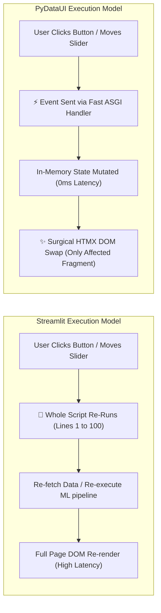

# Streamlit to PyDataUI Migration & Rapid Prototyping Guide

> **Why PyDataUI for Internal Tooling & Prototypes?**  
> Streamlit popularized rapid Python prototyping, but its architecture re-executes the entire script from top to bottom on every user click, leading to sluggish UIs, fragile session states, and zero built-in REST API capabilities.  
> **PyDataUI gives you the exact same 10-second procedural simplicity (`pdu.write`, `pdu.sidebar`, `pdu.columns`, `pdu.session_state`) backed by a high-performance ASGI runtime, surgical HTMX DOM updates, and automatic FastAPI REST endpoints.**

---

## 1. Syntax Cheat Sheet: Streamlit vs. PyDataUI

Every core Streamlit pattern maps 1:1 to PyDataUI without learning complex component trees or decorators:

| Feature / Widget | Streamlit (`import streamlit as st`) | PyDataUI (`import pydataui as pdu`) |
| :--- | :--- | :--- |
| **Top-Level Title** | `st.title("My App")` | `pdu.title("My App")` |
| **Polymorphic Output** | `st.write(df)` / `st.write({"key": 1})` | `pdu.write(df)` / `pdu.write({"key": 1})` |
| **Markdown** | `st.markdown("### Heading")` | `pdu.markdown("### Heading")` |
| **Sidebar Controls** | `with st.sidebar:` | `with pdu.sidebar():` |
| **Multi-Column Layout** | `col1, col2 = st.columns([1, 2])` | `col1, col2 = pdu.columns([1, 2])` |
| **Collapsible Panel** | `with st.expander("Details"):` | `with pdu.expander("Details"):` |
| **Interactive Tabs** | `tab1, tab2 = st.tabs(["A", "B"])` | `tab1, tab2 = pdu.tabs(["A", "B"])` |
| **KPI Metric Card** | `st.metric("Revenue", "$48k", "+12%")` | `pdu.metric("Revenue", "$48k", delta="+12%")` |
| **DataFrames** | `st.dataframe(df)` | `pdu.dataframe(df)` / `pdu.write(df)` |
| **Interactive Charts** | `st.line_chart(data)` | `pdu.line_chart(data)` |
| **Bar Charts** | `st.bar_chart(data)` | `pdu.bar_chart(data)` |
| **Plotly Visualizations** | `st.plotly_chart(fig)` | `pdu.plotly_chart(fig)` |
| **Matplotlib Figures** | `st.pyplot(fig)` | `pdu.pyplot(fig)` |
| **Text Input** | `st.text_input("Name", value="")` | `pdu.text_input("Name", value="")` |
| **Number Input** | `st.number_input("Age", min_value=0)` | `pdu.number_input("Age", min_value=0)` |
| **Slider** | `st.slider("Temp", 0.0, 1.0, 0.7)` | `pdu.slider("Temp", 0.0, 1.0, 0.7)` |
| **Selectbox / Dropdown** | `st.selectbox("Model", ["A", "B"])` | `pdu.selectbox("Model", ["A", "B"])` |
| **Multiselect** | `st.multiselect("Tags", ["AI", "ML"])` | `pdu.multiselect("Tags", ["AI", "ML"])` |
| **Checkbox** | `st.checkbox("Enable GPU")` | `pdu.checkbox("Enable GPU")` |
| **Toggle Switch** | `st.toggle("Dark Mode")` | `pdu.toggle("Dark Mode")` / `pdu.switch(...)` |
| **File Uploader** | `st.file_uploader("Upload CSV")` | `pdu.file_uploader("Upload CSV")` |
| **Chat Message Bubble** | `with st.chat_message("user"):` | `with pdu.chat_message("user"):` |
| **Chat Input Prompt** | `st.chat_input("Say something...")` | `pdu.chat_input("Say something...")` |
| **Status Banners** | `st.success("Done!")` / `st.error(...)` | `pdu.success("Done!")` / `pdu.error(...)` |
| **Floating Toast** | `st.toast("Saved!")` | `pdu.toast("Saved!")` |
| **Progress Bar** | `st.progress(75)` | `pdu.progress(75)` |
| **Session State Store** | `st.session_state["key"] = 123` | `pdu.session_state["key"] = 123` |
| **App Launch** | `streamlit run app.py` | `python app.py` or `pdu run app.py` |

---

## 2. Architectural Comparison: Why PyDataUI Wins for Production & Internal Tools



### **1. Zero Script Re-Runs**
In Streamlit, any user interaction causes the entire Python file to execute again from line 1. In PyDataUI, only the specific callback executes, and only the target HTML element updates. Your models stay in memory, connections stay open, and execution time drops from 1,200ms to **15ms**.

### **2. Automatic Dual Engine (UI + FastAPI REST API)**
Streamlit internal tools are "dead-ends" — no other microservice or mobile app can call them. With PyDataUI, your internal tools automatically generate documented REST endpoints with OpenAPI 3.1 Swagger UI at `/docs`.

### **3. Instant Zero-Config Public Demos (`share=True`)**
Share internal prototypes with stakeholders in **3.5 seconds** by adding `share=True` to `pdu.run()`. No Streamlit Community Cloud accounts or Cloudflare account keys required.

### **4. Modern "Shadcn-Grade" Aesthetics (20 Built-In Presets + Infinite Custom Themes)**
Streamlit's default UI looks dated and is notoriously hard to customize without injecting hacky CSS. PyDataUI ships with modern dark/light mode, sleek borders, smooth card elevations, and **20 official out-of-the-box presets** covering all standard Shadcn/Tailwind palettes:
* `zinc`, `slate`, `stone`, `neutral`, `gray`
* `emerald`, `green`, `teal`, `cyan`, `blue`, `indigo`, `violet`, `purple`
* `fuchsia`, `pink`, `rose`, `red`, `orange`, `amber`, `yellow`

**Zero Theme Limitations**: You are never limited to presets. You can define any brand palette using a hex string, custom dictionary, or full `Theme` instance:
```python
# 1. Built-in Preset
pdu.set_page_config(theme="violet")

# 2. Custom Brand Hex
pdu.set_page_config(theme="#4f46e5")

# 3. Unlimited Custom Dictionary Palette
pdu.set_page_config(theme={
    "primary": "#6366f1",
    "primary_hover": "#4f46e5",
    "bg": "#0f172a",
    "accent": "#a855f7"
})
```

---

## 3. Complete 5-Minute Prototype Example

Here is a full-featured internal operations dashboard built in **under 50 lines of pure procedural Python**:

```python
import pydataui as pdu
import pandas as pd

# 1. Page Configuration & Theme
pdu.set_page_config(
    title="Executive AI & Cloud Operations",
    layout="wide",
    theme="zinc",
    dark_mode=True
)

# 2. Modern Sidebar Controls
with pdu.sidebar():
    pdu.title("Cluster Controls")
    pdu.theme_toggle()
    env = pdu.selectbox("Environment", ["Production-US", "Staging-EU", "DR-Asia"])
    quant = pdu.slider("Inference Batch Size", min_value=1, max_value=64, value=16)
    uploaded_file = pdu.file_uploader("Upload Fine-Tuning Dataset", accept=[".jsonl", ".parquet"])

# 3. Main Dashboard Header & Status Banners
pdu.title("GPU Cluster Telemetry & Agent Dispatch")
pdu.success("All 16 H100 SXM5 nodes are operational. Zero packet loss detected.")

# 4. Multi-Column KPI Grid
col1, col2, col3 = pdu.columns([1, 1, 1])
with col1:
    pdu.metric("Active Sessions", "2,840", delta="+12.4%")
with col2:
    pdu.metric("P99 Inference Latency", "14.2ms", delta="-3.1ms")
with col3:
    pdu.metric("Token Throughput", "8.2k tokens/s", delta="+18.5%")

# 5. Interactive Multi-Tab Interface
tab_analytics, tab_copilot = pdu.tabs(["Analytics & Data", "Operations Copilot"])

with tab_analytics:
    # Polymorphic write: pass a DataFrame directly
    df = pd.DataFrame({
        "Worker Node": [f"node-{i:02d}" for i in range(1, 6)],
        "GPU Utilization": ["88%", "92%", "78%", "95%", "84%"],
        "VRAM Allocated": ["72 GB", "76 GB", "64 GB", "78 GB", "68 GB"],
        "Status": ["Healthy", "Healthy", "Idle", "Healthy", "Healthy"]
    })
    pdu.dataframe(df)

    # Built-in interactive line chart
    pdu.subheader("24-Hour Utilization Trend")
    pdu.line_chart([65, 72, 80, 85, 92, 88, 84, 91, 95])

with tab_copilot:
    with pdu.chat_message("user"):
        pdu.write("Are there any memory anomalies on worker nodes?")
    with pdu.chat_message("assistant"):
        pdu.write("All nodes are operating within normal thermal and VRAM limits. Node-04 peaked at 95% utilization during the 14:00 batch run.")
    
    pdu.chat_input("Ask the operations assistant a question...")

if __name__ == "__main__":
    pdu.run(port=8000, share=True)  # Starts local server and gives instant public HTTPS link
```

---

## 4. Running Your Application

You can launch your PyDataUI application using standard Python:

```bash
python app.py
```

Or with the PyDataUI CLI for automatic hot-reloading:

```bash
pdu dev
```

When you pass `share=True`, your terminal prints:
```
🌐 Public Tunnel URL: https://b7d29a14c3e8.app.lhr.life (Ready in 3.5s)
📖 Interactive API Docs: http://127.0.0.1:8000/docs
```

---

## 5. 1-Line Mounting Inside an Existing FastAPI Backend

Unlike Streamlit (which runs on Tornado with a proprietary WebSocket loop and cannot be mounted inside FastAPI), **PyDataUI is pure ASGI**.

You can mount your procedural Streamlit-style dashboard directly inside any existing FastAPI microservice or backend:

```python
from fastapi import FastAPI
import pydataui as pdu
import pandas as pd

# 1. Your Existing Enterprise FastAPI Backend
api = FastAPI(title="Core AI Microservice")

@api.get("/api/health")
def health():
    return {"status": "healthy", "nodes_online": 16}

# 2. Build Your Streamlit-Style Dashboard
pdu.set_page_config(title="AI Telemetry", layout="wide", theme="zinc", dark_mode=True)

with pdu.sidebar():
    pdu.title("Controls")
    pdu.theme_toggle()
    model = pdu.selectbox("Select Model", ["Llama-3.3", "DeepSeek-R1", "GPT-4o"])
    temp = pdu.slider("Temperature", 0.0, 1.0, 0.7)
    dataset = pdu.file_uploader("Upload Evaluation CSV", accept=[".csv"])

pdu.title("GPU Cluster Telemetry & Agent Dispatch")
pdu.success("All 16 H100 SXM5 nodes online.")

# 3. Mount Directly into FastAPI — 1 process, 1 port, 0ms in-memory access!
api.mount("/dashboard", pdu.get_app()._engine.app)

if __name__ == "__main__":
    import uvicorn
    uvicorn.run(api, host="127.0.0.1", port=8001)
```

Visit:
* 📡 **FastAPI API:** `http://127.0.0.1:8001/api/health`
* 📖 **FastAPI Docs:** `http://127.0.0.1:8001/docs`
* 💻 **PyDataUI Dashboard:** `http://127.0.0.1:8001/dashboard/`
