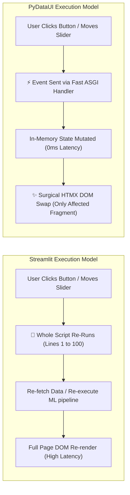

# Streamlit to PyDataUI Migration & Rapid Prototyping Guide

> **Why PyDataUI for Internal Tooling & Prototypes?**  
> Streamlit popularized rapid Python prototyping, but its architecture re-executes the entire script from top to bottom on every user click, leading to sluggish UIs, fragile session states, and zero built-in REST API capabilities.  
> **PyDataUI gives you the exact same 10-second procedural simplicity (`pdu.write`, `pdu.sidebar`, `pdu.columns`, `pdu.session_state`) backed by a high-performance ASGI runtime, surgical HTMX DOM updates, and automatic FastAPI REST endpoints.**

---

## 1. Syntax Cheat Sheet: Streamlit vs. PyDataUI

Every core Streamlit pattern maps 1:1 to PyDataUI without learning complex component trees or decorators:

| Feature / Widget | Streamlit (`import streamlit as st`) | PyDataUI (`import pydataui as pdu`) |
| :--- | :--- | :--- |
| **Top-Level Title** | `st.title("My App")` | `pdu.title("My App")` |
| **Polymorphic Output** | `st.write(df)` / `st.write({"key": 1})` | `pdu.write(df)` / `pdu.write({"key": 1})` |
| **Markdown** | `st.markdown("### Heading")` | `pdu.markdown("### Heading")` |
| **Sidebar Controls** | `with st.sidebar:` | `with pdu.sidebar():` |
| **Multi-Column Layout** | `col1, col2 = st.columns([1, 2])` | `col1, col2 = pdu.columns([1, 2])` |
| **Collapsible Panel** | `with st.expander("Details"):` | `with pdu.expander("Details"):` |
| **Interactive Tabs** | `tab1, tab2 = st.tabs(["A", "B"])` | `tab1, tab2 = pdu.tabs(["A", "B"])` |
| **KPI Metric Card** | `st.metric("Revenue", "$48k", "+12%")` | `pdu.metric("Revenue", "$48k", delta="+12%")` |
| **DataFrames** | `st.dataframe(df)` | `pdu.dataframe(df)` / `pdu.write(df)` |
| **Interactive Charts** | `st.line_chart(data)` | `pdu.line_chart(data)` |
| **Bar Charts** | `st.bar_chart(data)` | `pdu.bar_chart(data)` |
| **Plotly Visualizations** | `st.plotly_chart(fig)` | `pdu.plotly_chart(fig)` |
| **Matplotlib Figures** | `st.pyplot(fig)` | `pdu.pyplot(fig)` |
| **Text Input** | `st.text_input("Name", value="")` | `pdu.text_input("Name", value="")` |
| **Number Input** | `st.number_input("Age", min_value=0)` | `pdu.number_input("Age", min_value=0)` |
| **Slider** | `st.slider("Temp", 0.0, 1.0, 0.7)` | `pdu.slider("Temp", 0.0, 1.0, 0.7)` |
| **Selectbox / Dropdown** | `st.selectbox("Model", ["A", "B"])` | `pdu.selectbox("Model", ["A", "B"])` |
| **Multiselect** | `st.multiselect("Tags", ["AI", "ML"])` | `pdu.multiselect("Tags", ["AI", "ML"])` |
| **Checkbox** | `st.checkbox("Enable GPU")` | `pdu.checkbox("Enable GPU")` |
| **Toggle Switch** | `st.toggle("Dark Mode")` | `pdu.toggle("Dark Mode")` / `pdu.switch(...)` |
| **File Uploader** | `st.file_uploader("Upload CSV")` | `pdu.file_uploader("Upload CSV")` |
| **Chat Message Bubble** | `with st.chat_message("user"):` | `with pdu.chat_message("user"):` |
| **Chat Input Prompt** | `st.chat_input("Say something...")` | `pdu.chat_input("Say something...")` |
| **Status Banners** | `st.success("Done!")` / `st.error(...)` | `pdu.success("Done!")` / `pdu.error(...)` |
| **Floating Toast** | `st.toast("Saved!")` | `pdu.toast("Saved!")` |
| **Progress Bar** | `st.progress(75)` | `pdu.progress(75)` |
| **Session State Store** | `st.session_state["key"] = 123` | `pdu.session_state["key"] = 123` |
| **App Launch** | `streamlit run app.py` | `python app.py` or `pdu run app.py` |

---

## 2. Architectural Comparison: Why PyDataUI Wins for Production & Internal Tools



### **1. Zero Script Re-Runs**
In Streamlit, any user interaction causes the entire Python file to execute again from line 1. In PyDataUI, only the specific callback executes, and only the target HTML element updates. Your models stay in memory, connections stay open, and execution time drops from 1,200ms to **15ms**.

### **2. Automatic Dual Engine (UI + FastAPI REST API)**
Streamlit internal tools are "dead-ends" — no other microservice or mobile app can call them. With PyDataUI, your internal tools automatically generate documented REST endpoints with OpenAPI 3.1 Swagger UI at `/docs`.

### **3. Instant Zero-Config Public Demos (`share=True`)**
Share internal prototypes with stakeholders in **3.5 seconds** by adding `share=True` to `pdu.run()`. No Streamlit Community Cloud accounts or Cloudflare account keys required.

### **4. Modern "Shadcn-Grade" Aesthetics (20 Built-In Presets + Infinite Custom Themes)**
Streamlit's default UI looks dated and is notoriously hard to customize without injecting hacky CSS. PyDataUI ships with modern dark/light mode, sleek borders, smooth card elevations, and **20 official out-of-the-box presets** covering all standard Shadcn/Tailwind palettes:
* `zinc`, `slate`, `stone`, `neutral`, `gray`
* `emerald`, `green`, `teal`, `cyan`, `blue`, `indigo`, `violet`, `purple`
* `fuchsia`, `pink`, `rose`, `red`, `orange`, `amber`, `yellow`

**Zero Theme Limitations**: You are never limited to presets. You can define any brand palette using a hex string, custom dictionary, or full `Theme` instance:
```python
# 1. Built-in Preset
pdu.set_page_config(theme="violet")

# 2. Custom Brand Hex
pdu.set_page_config(theme="#4f46e5")

# 3. Unlimited Custom Dictionary Palette
pdu.set_page_config(theme={
    "primary": "#6366f1",
    "primary_hover": "#4f46e5",
    "bg": "#0f172a",
    "accent": "#a855f7"
})
```

---

## 3. Complete 5-Minute Prototype Example

Here is a full-featured internal operations dashboard built in **under 50 lines of pure procedural Python**:

```python
import pydataui as pdu
import pandas as pd

# 1. Page Configuration & Theme
pdu.set_page_config(
    title="Executive AI & Cloud Operations",
    layout="wide",
    theme="zinc",
    dark_mode=True
)

# 2. Modern Sidebar Controls
with pdu.sidebar():
    pdu.title("Cluster Controls")
    pdu.theme_toggle()
    env = pdu.selectbox("Environment", ["Production-US", "Staging-EU", "DR-Asia"])
    quant = pdu.slider("Inference Batch Size", min_value=1, max_value=64, value=16)
    uploaded_file = pdu.file_uploader("Upload Fine-Tuning Dataset", accept=[".jsonl", ".parquet"])

# 3. Main Dashboard Header & Status Banners
pdu.title("GPU Cluster Telemetry & Agent Dispatch")
pdu.success("All 16 H100 SXM5 nodes are operational. Zero packet loss detected.")

# 4. Multi-Column KPI Grid
col1, col2, col3 = pdu.columns([1, 1, 1])
with col1:
    pdu.metric("Active Sessions", "2,840", delta="+12.4%")
with col2:
    pdu.metric("P99 Inference Latency", "14.2ms", delta="-3.1ms")
with col3:
    pdu.metric("Token Throughput", "8.2k tokens/s", delta="+18.5%")

# 5. Interactive Multi-Tab Interface
tab_analytics, tab_copilot = pdu.tabs(["Analytics & Data", "Operations Copilot"])

with tab_analytics:
    # Polymorphic write: pass a DataFrame directly
    df = pd.DataFrame({
        "Worker Node": [f"node-{i:02d}" for i in range(1, 6)],
        "GPU Utilization": ["88%", "92%", "78%", "95%", "84%"],
        "VRAM Allocated": ["72 GB", "76 GB", "64 GB", "78 GB", "68 GB"],
        "Status": ["Healthy", "Healthy", "Idle", "Healthy", "Healthy"]
    })
    pdu.dataframe(df)

    # Built-in interactive line chart
    pdu.subheader("24-Hour Utilization Trend")
    pdu.line_chart([65, 72, 80, 85, 92, 88, 84, 91, 95])

with tab_copilot:
    with pdu.chat_message("user"):
        pdu.write("Are there any memory anomalies on worker nodes?")
    with pdu.chat_message("assistant"):
        pdu.write("All nodes are operating within normal thermal and VRAM limits. Node-04 peaked at 95% utilization during the 14:00 batch run.")
    
    pdu.chat_input("Ask the operations assistant a question...")

if __name__ == "__main__":
    pdu.run(port=8000, share=True)  # Starts local server and gives instant public HTTPS link
```

---

## 4. Running Your Application

You can launch your PyDataUI application using standard Python:

```bash
python app.py
```

Or with the PyDataUI CLI for automatic hot-reloading:

```bash
pdu dev
```

When you pass `share=True`, your terminal prints:
```
🌐 Public Tunnel URL: https://b7d29a14c3e8.app.lhr.life (Ready in 3.5s)
📖 Interactive API Docs: http://127.0.0.1:8000/docs
```

---

## 5. 1-Line Mounting Inside an Existing FastAPI Backend

Unlike Streamlit (which runs on Tornado with a proprietary WebSocket loop and cannot be mounted inside FastAPI), **PyDataUI is pure ASGI**.

You can mount your procedural Streamlit-style dashboard directly inside any existing FastAPI microservice or backend:

```python
from fastapi import FastAPI
import pydataui as pdu
import pandas as pd

# 1. Your Existing Enterprise FastAPI Backend
api = FastAPI(title="Core AI Microservice")

@api.get("/api/health")
def health():
    return {"status": "healthy", "nodes_online": 16}

# 2. Build Your Streamlit-Style Dashboard
pdu.set_page_config(title="AI Telemetry", layout="wide", theme="zinc", dark_mode=True)

with pdu.sidebar():
    pdu.title("Controls")
    pdu.theme_toggle()
    model = pdu.selectbox("Select Model", ["Llama-3.3", "DeepSeek-R1", "GPT-4o"])
    temp = pdu.slider("Temperature", 0.0, 1.0, 0.7)
    dataset = pdu.file_uploader("Upload Evaluation CSV", accept=[".csv"])

pdu.title("GPU Cluster Telemetry & Agent Dispatch")
pdu.success("All 16 H100 SXM5 nodes online.")

# 3. Mount Directly into FastAPI — 1 process, 1 port, 0ms in-memory access!
api.mount("/dashboard", pdu.get_app()._engine.app)

if __name__ == "__main__":
    import uvicorn
    uvicorn.run(api, host="127.0.0.1", port=8001)
```

Visit:
* 📡 **FastAPI API:** `http://127.0.0.1:8001/api/health`
* 📖 **FastAPI Docs:** `http://127.0.0.1:8001/docs`
* 💻 **PyDataUI Dashboard:** `http://127.0.0.1:8001/dashboard/`

---

## 6. Deep Dive: UI Component vs. File Data Payload

### Why Can't You Just Write `df = pd.read_csv(dataset)` at the Top Level?

In Streamlit, developers often ask:
```python
dataset = pdu.file_uploader("Upload Evaluation CSV", accept=[".csv"])
df = pd.read_csv(dataset)  # ❌ Why does this not work directly at top-level?
```

Understanding this distinction is the key difference between a **toy prototyping script** and an **enterprise ASGI web framework**:

```mermaid
flowchart TD
    subgraph Import_Time["1. Server Startup / Module Import Time (0 HTTP Requests)"]
        A["Python imports app.py"] --> B["pdu.file_uploader() runs"]
        B --> C["Returns FileUpload Component (Visual HTML Widget)"]
        C --> D["❌ pd.read_csv(widget) FAILS (No file uploaded yet, no HTTP request)"]
    end

    subgraph Runtime["2. User Browser Interaction Time (HTTP POST Event)"]
        E["User drops telemetry.csv in browser"] --> F["Browser sends multipart/form-data via HTMX"]
        F --> G["FastAPI ASGI router decodes binary payload into UploadedFile"]
        G --> H["on_change(file) executes OR session_state[key] populated"]
        H --> I["df = pd.read_csv(file) or file.to_pandas() succeeds!"]
    end
```



#### 1. What type is `dataset`?
`dataset = pdu.file_uploader(...)` returns a **`pydataui.components.forms.FileUpload`** instance.
It is an HTML UI component (rendering `<input type="file" ...>`), **not** the uploaded file bytes! When your Python script starts, no user has even opened the browser yet.

#### 2. What type is the uploaded file?
When the user selects a file in their browser, PyDataUI receives the multipart HTTP payload and wraps it as a **`pydataui.request.UploadedFile`**.
`UploadedFile` implements the standard Python file stream protocol (`.read()`, `.seek()`, `.tell()`, `.readable()`, `.seekable()`) as well as direct helper methods (`.to_pandas()` and `.to_dataframe()`).

#### 3. Why Streamlit Does It Differently (and Why It Destroys Production Backends)
Streamlit achieves `df = pd.read_csv(uploaded_file)` by **halting and re-running the entire Python script from line 1 to the end on every single user interaction**.
In an enterprise ASGI / FastAPI application, re-running your whole file on every click would:
* Tear down and recreate database connection pools.
* Reload 14GB LLM weights or ML models into GPU memory repeatedly.
* Wipe out active WebSocket sessions and thread pools.

#### 4. The 3 Idiomatic Solutions in PyDataUI:

**Pattern A: Direct Reactive Binding (Zero Callbacks Needed)**
You can pass the widget or its session key directly into `pdu.table()` or `pdu.dataframe()`. PyDataUI resolves it reactively at render time:
```python
with pdu.sidebar():
    dataset = pdu.file_uploader("Upload CSV", key="eval_dataset")

# The table automatically listens to dataset.key and renders when uploaded!
pdu.table(dataset)
# or
pdu.dataframe("eval_dataset")
```

**Pattern B: Reactive Dynamic Provider (`lambda:`)**
Use a dynamic lambda to read from `session_state` whenever HTMX re-renders the DOM fragment:
```python
pdu.write(lambda: pdu.session_state.get("df", default_df))
```

**Pattern C: Explicit Event Handler (`on_change`)**
Process the uploaded file immediately with Pandas and trigger notifications or downstream pipelines:
```python
def handle_csv_upload(file):
    df = pd.read_csv(file)           # Standard pd.read_csv
    # or df = file.to_pandas()       # Native convenience helper
    pdu.session_state["df"] = df
    pdu.toast(f"Successfully loaded {len(df)} rows from {file.filename}!", icon="📊")

pdu.file_uploader("Upload CSV", accept=[".csv"], on_change=handle_csv_upload)
```

---

## 7. Real-World AI Agent Architecture: CSV Upload + Chat Input + Agent Pipeline

Here is a complete, production-ready enterprise pattern mounting an interactive AI copilot and telemetry dashboard inside FastAPI. It demonstrates:
1. Dynamic slider step inference.
2. Direct CSV upload into Pandas.
3. Chat input that captures user queries, auto-resets the prompt input via HTMX, and dispatches the query and the active DataFrame to an external agent function.
4. Live dynamic table rendering.

```python
import structlog
import pandas as pd
from fastapi import FastAPI
import pydataui as pdu

logger = structlog.get_logger(__name__)

# -----------------------------------------------------------------------------
# 1. Your Existing Enterprise FastAPI Backend
# -----------------------------------------------------------------------------
api = FastAPI(title="Core AI Microservice")

@api.get("/api/health")
def health():
    return {"status": "healthy", "nodes_online": 16}

# -----------------------------------------------------------------------------
# 2. External Agent Function (Query + DataFrame Pipeline)
# -----------------------------------------------------------------------------
def run_ai_agent(user_query: str, current_df: pd.DataFrame = None) -> str:
    """Takes the query from chat_input and produces an AI answer."""
    row_count = len(current_df) if current_df is not None else 0
    return f"Agent analyzed: '{user_query}'. Evaluated against {row_count} cluster telemetry nodes."

# -----------------------------------------------------------------------------
# 3. CSV Upload Handler
# -----------------------------------------------------------------------------
def handle_csv_upload(file):
    # Load directly into pandas using standard pd.read_csv or file.to_pandas()
    df = pd.read_csv(file)
    pdu.session_state["df"] = df
    pdu.toast(f"Loaded {len(df)} rows from {file.filename}!", icon="📊")

# -----------------------------------------------------------------------------
# 4. Chat Input Handler (Captures prompt, passes to external agent)
# -----------------------------------------------------------------------------
def handle_chat_submit(query: str):
    # 1. Store in variable & session_state
    user_prompt = query
    pdu.session_state["last_query"] = user_prompt
    
    # 2. Get active DataFrame
    active_df = pdu.session_state.get("df")
    
    # 3. Pass to another function!
    agent_response = run_ai_agent(user_prompt, current_df=active_df)
    
    # 4. Store the response
    pdu.session_state["agent_response"] = agent_response
    pdu.toast("Agent response ready!", icon="🤖")

# -----------------------------------------------------------------------------
# 5. Dashboard Configuration & Sidebar
# -----------------------------------------------------------------------------
pdu.set_page_config(title="AI Copilot & Telemetry", layout="wide", theme="zinc", dark_mode=True)

with pdu.sidebar():
    pdu.title("Controls")
    pdu.theme_toggle()
    model = pdu.selectbox("Model", ["Llama-3.3", "DeepSeek-R1", "GPT-4o"])
    temp = pdu.slider("Temperature", 0.0, 1.0, 0.7)  # Auto-infers 0.01 step!
    
    dataset = pdu.file_uploader(
        "Upload Evaluation CSV",
        accept=[".csv"],
        key="eval_dataset",
        on_change=handle_csv_upload
    )

# -----------------------------------------------------------------------------
# 6. Main Dashboard & Chat Tabs
# -----------------------------------------------------------------------------
pdu.title("GPU Cluster Telemetry & Agent Dispatch")

tab_data, tab_chat = pdu.tabs(["Data Explorer", "Operations Copilot"])

default_telemetry = pd.DataFrame({
    "Worker Node": ["node-01", "node-02", "node-03", "node-04"],
    "GPU Utilization": ["88%", "92%", "78%", "95%"],
    "VRAM Allocated": ["72 GB", "76 GB", "64 GB", "78 GB"]
})

with tab_data:
    # Use dynamic callable to display uploaded DataFrame live or default telemetry
    pdu.write(lambda: pdu.session_state.get("df", default_telemetry))

with tab_chat:
    pdu.write("### Operations Copilot")
    pdu.write(lambda: f"**Latest Question:** {pdu.session_state.get('last_query', 'No questions submitted yet.')}")
    pdu.write(lambda: f"**Agent Response:** {pdu.session_state.get('agent_response', 'Ready for dispatch.')}")
    
    pdu.chat_input(
        "Ask the copilot about cluster nodes or uploaded CSV...",
        key="chat_prompt",
        on_submit=handle_chat_submit
    )

# -----------------------------------------------------------------------------
# 7. Mount into FastAPI
# -----------------------------------------------------------------------------
api.mount("/dashboard", pdu.get_app()._engine.app)

if __name__ == "__main__":
    import uvicorn
    uvicorn.run(api, host="127.0.0.1", port=8001)
```

---

## 8. Multi-Page Applications in Streamlit vs. PyDataUI

In Streamlit, multi-page applications require creating a physical `pages/` directory on disk containing separate Python scripts (`pages/1_data.py`, `pages/2_chat.py`).

PyDataUI provides **three flexible multi-page architectures**:

### Approach 1: Streamlit-Parity Navigation Links (`pdu.page_link`)
Link across different pages or views with custom labels and icons:
```python
with pdu.sidebar():
    pdu.title("Navigation")
    pdu.page_link("/dashboard", label="Cluster Telemetry", icon="📊")
    pdu.page_link("/copilot", label="Agent Operations", icon="💬")
    pdu.page_link("/settings", label="System Config", icon="⚙️")
```

### Approach 2: First-Class URL Route Pages (`@app.page`)
Define distinct full-page layouts with dedicated browser URLs:
```python
app = pdu.get_app()

@app.page("/dashboard")
def cluster_dashboard():
    pdu.title("GPU Cluster Telemetry")
    pdu.write(telemetry_df)

@app.page("/copilot")
def agent_copilot():
    pdu.title("Agent Dispatch Copilot")
    pdu.chat_input("Prompt agent...")
```

### Approach 3: Instant Single-Page Tabs (`pdu.tabs`)
Zero routing setup, instant in-memory tab switching:
```python
tab_telemetry, tab_settings = pdu.tabs(["Telemetry", "Settings"])
with tab_telemetry:
    pdu.write(df)
with tab_settings:
    pdu.theme_toggle()
```

---

## 9. Framework Positioning: Customer-Facing, Developer Internal-Centric, or Both?

A common question when evaluating PyDataUI:  
> *"Is PyDataUI designed for internal developer tooling (like Streamlit / Retool) or customer-facing production web apps (like Next.js / FastAPI)?"*

### **The Answer: It Is Architected for Both.**

| Capability | Streamlit | Next.js / React | PyDataUI |
| :--- | :--- | :--- | :--- |
| **Rapid Python Prototyping** | ⚡ High (10 lines of code) | 🛑 Low (requires npm, TS, JSX, APIs) | ⚡ **High (10 lines of procedural Python)** |
| **Customer-Facing Performance** | 🛑 Poor (1,200ms script re-runs) | ⚡ High (sub-50ms static/SSR) | ⚡ **High (sub-15ms ASGI + surgical HTMX)** |
| **REST API Generation** | 🛑 None (Dead-end UI) | ⚠️ Manual API Route Setup | ⚡ **Automatic (OpenAPI 3.1 Swagger at `/docs`)** |
| **Mountable in FastAPI** | 🛑 Impossible (Tornado loop) | ⚠️ Requires reverse proxy | ⚡ **1-Line Native ASGI Mount (`api.mount`)** |
| **DOM & Styling Control** | 🛑 Locked inside canvas/iframes | ⚡ Full CSS/Tailwind control | ⚡ **Pure Semantic HTML5 + Shadcn/Tailwind** |
| **Public Sharing** | ⚠️ Needs Streamlit Cloud login | ⚠️ Requires Vercel deployment | ⚡ **Instant 3.5s zero-config tunnel (`share=True`)** |

### **1. Why It Excels for Internal Developer Tooling:**
* **Instant Start**: Write standard procedural Python (`pdu.write`, `pdu.sidebar`, `pdu.slider`). No state boilerplate.
* **Direct Data Science Native**: Supports Pandas, Polars, DuckDB, Arrow, Matplotlib, and Plotly natively with zero glue code.
* **Zero npm / Node**: 100% pure Python environment.

### **2. Why It Excels for Customer-Facing Production Products:**
* **Real HTML5 DOM, Not Canvas / Iframes**: Streamlit embeds elements in rigid iframes and canvas blocks that break responsive design, SEO, and screen readers. PyDataUI outputs semantic HTML5 styled with modern Tailwind and Shadcn design tokens.
* **Sub-15ms Latency**: Because PyDataUI only computes and transmits the surgical HTML diff via HTMX, round-trip latency is 10x-50x faster than Streamlit.
* **Enterprise Security & Compliance**: Built-in CSRF protection, Content Security Policy (CSP), cryptographic state cookies, and RBAC authentication.
* **Unified Monolith or Microservice**: Run your customer-facing dashboard, your developer internal admin console, and your public REST API all in a single FastAPI ASGI process on a single port!
