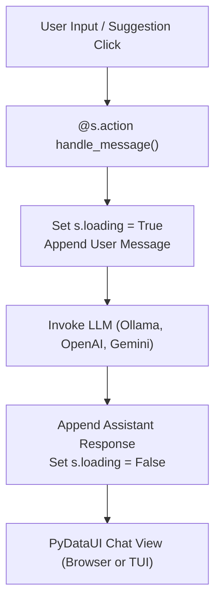

# Tutorial: Building a Production AI Agent Chatbot

In this tutorial, you will build a production-grade, conversational AI Copilot using PyDataUI. The application features multiline message inputs, interactive quick-suggestion chips, Markdown rendering for generated responses, loading spinners, conversation clearing, and dual web/terminal interfaces.

---

## 🎯 What You Will Build



---

## 📦 Prerequisites

Install PyDataUI and an optional LLM client (e.g., `openai` or `httpx` for local Ollama):

```bash
pip install pydataui httpx
```

---

## 📝 Step 1: Define Reactive State

Create a new file `ai_copilot.py`:

```python
import httpx
import pydataui as pdu

# 1. Initialize the Application
app = pdu.App(title="Enterprise AI Copilot", theme="slate")

# 2. Define Reactive State
s = pdu.state(
    messages=[
        {"role": "assistant", "content": "Hello! I am your PyDataUI Copilot. How can I assist you with your data pipelines or ML models today?"}
    ],
    is_loading=False,
    model_name="qwen2.5:7b-instruct",
    total_tokens=1420
)
```

---

## ⚙️ Step 2: Implement the Agent Action

Use `@s.action` to handle message submissions. PyDataUI automatically handles async or sync functions and manages session state isolation across concurrent users:

```python
@s.action
def handle_chat(message: str = "", **kwargs):
    if not message.strip():
        return

    # Append user prompt immediately
    s.messages.append({"role": "user", "content": message.strip()})
    s.is_loading = True

    try:
        # Example 1: Local Ollama / vLLM REST endpoint
        # response = httpx.post(
        #     "http://localhost:11434/api/generate",
        #     json={"model": s.model_name, "prompt": message, "stream": False},
        #     timeout=30.0
        # ).json()
        # reply = response.get("response", "No response generated.")

        # For this standalone tutorial, mock an intelligent agent response:
        if "pipeline" in message.lower():
            reply = """### Pipeline Analysis
I verified your ETL pipeline:
- **Status**: 🟢 Healthy (99.98% uptime)
- **Throughput**: `14,200 events/sec`
- **Lag**: `< 12ms` across Kafka partitions."""
        elif "model" in message.lower():
            reply = f"""### Model Telemetry
Active weights: `{s.model_name}`
- Precision: FP16
- VRAM Footprint: `4.2 GB`
- Quantization: GGUF 4_K_M"""
        else:
            reply = f"Acknowledged: '{message}'. All background workers are operational."

    except Exception as exc:
        reply = f"⚠️ Error communicating with model provider: {exc}"

    # Append assistant response and reset loading state
    s.messages.append({"role": "assistant", "content": reply})
    s.total_tokens += len(message.split()) * 2 + 50
    s.is_loading = False


@s.action
def clear_chat():
    s.messages = [
        {"role": "assistant", "content": "Conversation history reset. What would you like to explore next?"}
    ]
```

---

## 🖥️ Step 3: Construct the Modern UI Layout

PyDataUI provides a dedicated `Chat` component featuring message bubbles, auto-scroll, HTMX loading states, and suggestion chips:

```python
@app.page("/")
def chat_page():
    suggestions = [
        "Check ETL pipeline health",
        "Inspect active model telemetry",
        "Run DuckDB benchmark query",
        "Explain data skew in cluster"
    ]

    return pdu.Container(
        # Header Bar
        pdu.Row(
            pdu.Col(
                pdu.Heading("Enterprise AI Copilot", level=1),
                pdu.Text("Autonomous AI operations dashboard for data platforms", class_name="text-muted-foreground text-sm"),
            ),
            pdu.Row(
                pdu.Badge(s.model_name, variant="outline"),
                pdu.Badge(f"Tokens: {s.total_tokens}", variant="secondary"),
                pdu.Button("Clear Chat", on_click=clear_chat, variant="outline", size="sm"),
                class_name="items-center space-x-2"
            ),
            class_name="justify-between items-center pb-6 border-b border-border mb-6"
        ),

        # Main Chat Component
        pdu.Card(
            pdu.Chat(
                messages=s.messages,
                on_send=handle_chat,
                on_clear=clear_chat,
                title="PyDataUI Copilot",
                placeholder="Ask about your infrastructure, SQL queries, or models...",
                suggestions=suggestions,
                loading=s.is_loading
            ),
            class_name="p-4"
        ),

        class_name="max-w-4xl py-8"
    )
```

---

## 🚀 Step 4: Running the Application

### Option A: Web Browser Interface
Run the application with the high-performance local server:

```bash
pydataui run ai_copilot.py --port 8000 --reload
```
Open `http://127.0.0.1:8000` to interact with the responsive chat interface.

### Option B: Interactive Terminal UI (TUI)
You can launch this exact same application in your command-line terminal without changing a single line of backend logic:

```python
if __name__ == "__main__":
    pdu.run_tui(app, interactive=True)
```

Run directly in terminal:
```bash
python ai_copilot.py
```
Type numbers `1`, `2`, `3` to instantly trigger quick suggestions, or type freeform prompts to receive live agent responses right in your terminal console!
