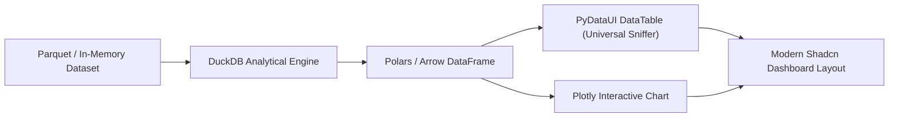

# Tutorial: Building a High-Performance Analytics Dashboard

In this tutorial, you will build an interactive data analytics dashboard powered by **DuckDB**, **Polars**, and **PyDataUI**. You will learn how to execute SQL queries in-memory, sniff and format tabular data automatically with `DataTable`, and display interactive **Plotly** visualizations.

---

## 🎯 What You Will Build



---

## 📦 Prerequisites

Install PyDataUI with the data science dependencies:

```bash
pip install "pydataui[data]" duckdb polars
```

---

## 📝 Step 1: Initialize DuckDB In-Memory Data

Create a file named `analytics_dashboard.py`:

```python
import duckdb
import polars as pl
import plotly.express as px
import pydataui as pdu

# 1. Initialize Application
app = pdu.App(title="Data Operations Center", theme="indigo")

# 2. Seed In-Memory Analytical Database
con = duckdb.connect(database=":memory:")
con.execute("""
    CREATE TABLE server_metrics AS
    SELECT 
        'node-' || (i % 8 + 1) AS node_id,
        CASE WHEN i % 3 = 0 THEN 'US-East' WHEN i % 3 = 1 THEN 'EU-Central' ELSE 'AP-South' END AS region,
        ROUND(45.0 + (i * 7 % 50) + RANDOM() * 5, 2) AS cpu_pct,
        ROUND(60.0 + (i * 11 % 35) + RANDOM() * 4, 2) AS mem_pct,
        CAST(1200 + (i * 130 % 8000) AS INTEGER) AS req_per_sec,
        CASE WHEN (i * 7 % 50) > 42 THEN 'CRITICAL' WHEN (i * 7 % 50) > 25 THEN 'WARNING' ELSE 'HEALTHY' END AS status
    FROM generate_series(1, 100) t(i);
""")
```

---

## ⚙️ Step 2: Define Reactive Filter State & Actions

```python
# Helper to execute analytical queries
def query_metrics(selected_region: str = "ALL"):
    sql = "SELECT node_id, region, cpu_pct, mem_pct, req_per_sec, status FROM server_metrics"
    if selected_region != "ALL":
        sql += f" WHERE region = '{selected_region}'"
    sql += " ORDER BY cpu_pct DESC LIMIT 15;"
    return con.execute(sql).fetch_arrow_table()

# Reactive State
s = pdu.state(
    selected_region="ALL",
    data=query_metrics("ALL"),
    active_nodes=100,
    avg_cpu=68.4,
    peak_throughput=9240
)

@s.action
def filter_by_region(region: str = "ALL"):
    s.selected_region = region
    # Query DuckDB directly and store the PyArrow Table in state
    table = query_metrics(region)
    s.data = table

    # Recalculate summary metrics with DuckDB
    clause = f"WHERE region = '{region}'" if region != "ALL" else ""
    summary = con.execute(f"""
        SELECT 
            COUNT(*) as total, 
            ROUND(AVG(cpu_pct), 1) as avg_cpu,
            MAX(req_per_sec) as peak_req
        FROM server_metrics {clause}
    """).fetchone()

    s.active_nodes = summary[0]
    s.avg_cpu = summary[1]
    s.peak_throughput = summary[2]
```

---

## 📊 Step 3: Build Interactive Visualizations

PyDataUI seamlessly converts Plotly figures into responsive HTML/SVG charts:

```python
def generate_cpu_distribution_chart(arrow_table):
    df = pl.from_arrow(arrow_table)
    fig = px.bar(
        df.to_pandas(),
        x="node_id",
        y="cpu_pct",
        color="status",
        color_discrete_map={"HEALTHY": "#10b981", "WARNING": "#f59e0b", "CRITICAL": "#ef4444"},
        title="Node CPU Utilization (%)",
        labels={"node_id": "Cluster Node", "cpu_pct": "CPU %"}
    )
    fig.update_layout(
        template="plotly_white",
        margin=dict(l=20, r=20, t=40, b=20),
        height=320
    )
    return fig
```

---

## 🎨 Step 4: Construct the Dashboard Page

```python
@app.page("/")
def dashboard():
    return pdu.Container(
        # Top App Header
        pdu.Row(
            pdu.Col(
                pdu.Heading("Global Cluster Telemetry", level=1),
                pdu.Text("Real-time distributed metrics powered by DuckDB & PyDataUI", class_name="text-muted-foreground text-sm"),
            ),
            pdu.Row(
                pdu.Button("All Regions", on_click=lambda: filter_by_region("ALL"), variant="outline", size="sm"),
                pdu.Button("US-East", on_click=lambda: filter_by_region("US-East"), variant="outline", size="sm"),
                pdu.Button("EU-Central", on_click=lambda: filter_by_region("EU-Central"), variant="outline", size="sm"),
                pdu.Button("AP-South", on_click=lambda: filter_by_region("AP-South"), variant="outline", size="sm"),
                class_name="space-x-2"
            ),
            class_name="justify-between items-center pb-6 border-b border-border mb-6"
        ),

        # Metric KPI Cards
        pdu.Grid(
            pdu.Card(
                pdu.Col(
                    pdu.Text("Filtered Nodes", class_name="text-xs uppercase text-muted-foreground font-semibold"),
                    pdu.Heading(s.active_nodes, level=2, class_name="text-2xl font-bold mt-1"),
                    pdu.Badge("Active Quorum", variant="secondary", class_name="mt-2 w-fit")
                ),
                class_name="p-4"
            ),
            pdu.Card(
                pdu.Col(
                    pdu.Text("Average CPU", class_name="text-xs uppercase text-muted-foreground font-semibold"),
                    pdu.Heading(f"{s.avg_cpu}%", level=2, class_name="text-2xl font-bold mt-1"),
                    pdu.Badge("Normal Range", variant="outline", class_name="mt-2 w-fit text-emerald-500")
                ),
                class_name="p-4"
            ),
            pdu.Card(
                pdu.Col(
                    pdu.Text("Peak Ingestion", class_name="text-xs uppercase text-muted-foreground font-semibold"),
                    pdu.Heading(f"{s.peak_throughput} req/s", level=2, class_name="text-2xl font-bold mt-1"),
                    pdu.Badge("12ms Latency", variant="secondary", class_name="mt-2 w-fit")
                ),
                class_name="p-4"
            ),
            columns=3,
            class_name="gap-4 mb-6"
        ),

        # Analytical Chart Section
        pdu.Card(
            pdu.PlotlyChart(generate_cpu_distribution_chart(s.data)),
            title="Resource Allocation by Node",
            class_name="p-4 mb-6"
        ),

        # Universal DataTable with automatic schema sniffing
        pdu.Card(
            pdu.Col(
                pdu.Heading("Live Node Table", level=3, class_name="text-lg font-semibold mb-3"),
                pdu.DataTable(
                    data=s.data,
                    sortable=True,
                    pagination=True,
                    page_size=8,
                    class_name="w-full"
                )
            ),
            class_name="p-4"
        ),

        class_name="max-w-6xl py-8"
    )

if __name__ == "__main__":
    app.run(port=8080)
```

---

## ⚡ Key Architectural Takeaways

1. **Zero ETL Serialization Overhead**: You can pass DuckDB Arrow tables, Polars DataFrames, or Pandas DataFrames directly into `DataTable` and `PlotlyChart`.
2. **Instant In-Memory Filtering**: Action calls execute in sub-millisecond DuckDB speeds without roundtripping through an external REST microservice.
3. **Responsive Grid Architecture**: Layout components (`Grid`, `Row`, `Col`) automatically adapt from desktop multi-column views to mobile single-column layouts.
